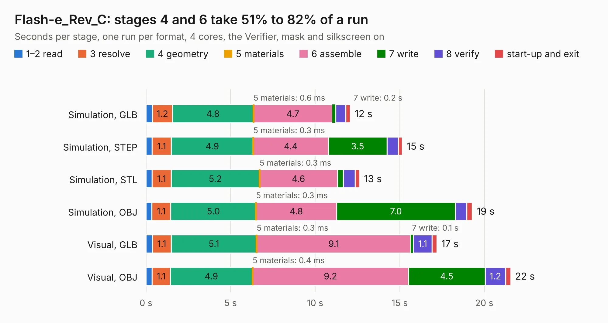

# 1892. Flash-e_Rev_C

Board 1,892 of the 3,126 of [Corpus Testing](../Corpus-Testing.md), on [Corpus Page 18](../CorpusTestingPages/Corpus-Testing-18.md#1892-flash-e_rev_c).

| Mode and format | 1–2 read | 3 resolve | 4 geometry | 5 materials | 6 assemble | 7 write | 8 verify | start-up and exit | Total |
|---|---:|---:|---:|---:|---:|---:|---:|---:|---:|
| Simulation, GLB | 0.4 | 1.2 | 4.8 | 0.6&nbsp;ms | 4.7 | 0.2 | 0.6 | 0.3 | 12.1 |
| Simulation, STEP | 0.4 | 1.1 | 4.9 | 0.3&nbsp;ms | 4.4 | 3.5 | 0.7 | 0.2 | 15.2 |
| Simulation, STL | 0.4 | 1.1 | 5.2 | 0.3&nbsp;ms | 4.6 | 0.3 | 0.7 | 0.3 | 12.6 |
| Simulation, OBJ | 0.3 | 1.1 | 5.0 | 0.3&nbsp;ms | 4.8 | 7.0 | 0.7 | 0.3 | 19.3 |
| Visual, GLB | 0.4 | 1.1 | 5.1 | 0.3&nbsp;ms | 9.1 | 0.1 | 1.1 | 0.3 | 17.2 |
| Visual, OBJ | 0.4 | 1.1 | 4.9 | 0.4&nbsp;ms | 9.2 | 4.5 | 1.2 | 0.3 | 21.6 |

<table align="center"><tr><td valign="top">

| Board | Repo: [OLIMEX/Flash-e](https://github.com/OLIMEX/Flash-e) Board: `Flash-e_Rev_C.kicad_pcb` |
|---|---|
| Folder | HARDWARE / Flash-e-Rev.C |
| Complexity | 288&nbsp;/&nbsp;1000 (size&nbsp;243, features&nbsp;45) |
| KESE&nbsp;features | through vias, filled zones, copper text |
| Tested | 9th November 2026 |
| Copper&nbsp;layers | 4 |
| File&nbsp;format | KiCad 5 (20171130) |
| Parts,&nbsp;tracks,&nbsp;vias | 35, 1,162, 85 |
| Triangles,&nbsp;simulation | 1,152,680 in 79 parts |
| Verifier | PASS in all six runs |

</td><td valign="top">

<table>
<tr><th>File type</th><th>File size</th><th>Peak memory used</th></tr>
<tr><th colspan="3" align="left">Simulation</th></tr>
<tr><td>GLB</td><td align="right">40&nbsp;MB</td><td align="right">496&nbsp;MB</td></tr>
<tr><td>STEP</td><td align="right">203&nbsp;MB</td><td align="right">571&nbsp;MB</td></tr>
<tr><td>STL</td><td align="right">58&nbsp;MB</td><td align="right">487&nbsp;MB</td></tr>
<tr><td>OBJ</td><td align="right">120&nbsp;MB</td><td align="right">823&nbsp;MB</td></tr>
<tr><th colspan="3" align="left">Visual</th></tr>
<tr><td>GLB</td><td align="right">27&nbsp;MB</td><td align="right">561&nbsp;MB</td></tr>
<tr><td>OBJ</td><td align="right">81&nbsp;MB</td><td align="right">631&nbsp;MB</td></tr>
</table>

</td></tr></table>

| Previous | Next |
|:---|---:|
| [1891. ESP32-SBC-FabGL_Rev_B](b1891b_ESP32-SBC-FabGL_ESP32-SBC-FabGL-Rev-B.md) | [1893. FOSDEM-MUSIC-BOX_RevA](b1893b_FOSDEM-MUSIC-BOX_FOSDEM-MUSIC-BOX-RevA.md) |
