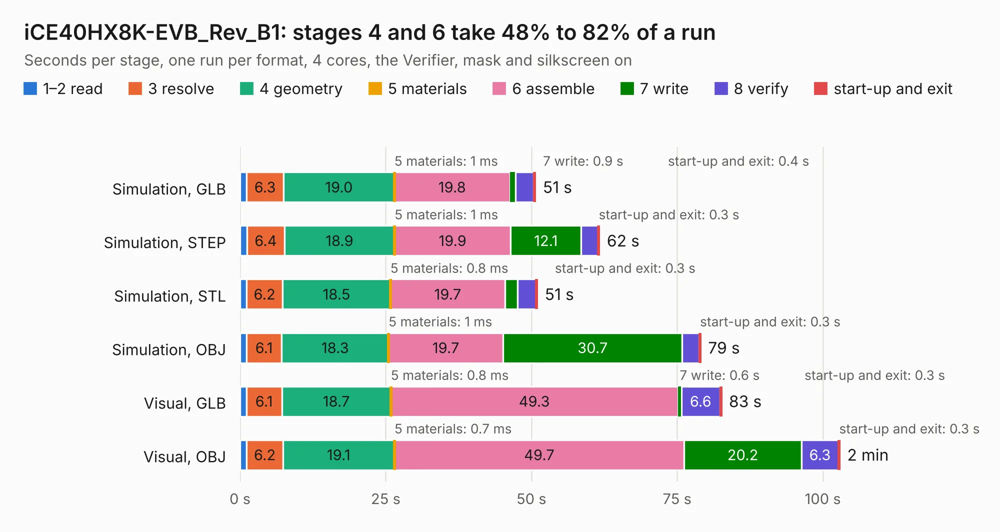

# 1892. iCE40HX8K-EVB_Rev_B1

Board 1,892 of the 3,112 of [Corpus Testing](../Corpus-Testing.md), on [Corpus Page 18](../CorpusTestingPages/Corpus-Testing-18.md#1892-ice40hx8k-evb_rev_b1).

| Mode and format | 1–2 read | 3 resolve | 4 geometry | 5 materials | 6 assemble | 7 write | 8 verify | start-up and exit | Total |
|---|---:|---:|---:|---:|---:|---:|---:|---:|---:|
| Simulation, GLB | 1.1 | 6.3 | 19.0 | 1&nbsp;ms | 19.8 | 0.9 | 3.1 | 0.4 | 50.7 |
| Simulation, STEP | 1.2 | 6.4 | 18.9 | 1&nbsp;ms | 19.9 | 12.1 | 2.9 | 0.3 | 61.7 |
| Simulation, STL | 1.1 | 6.2 | 18.5 | 0.8&nbsp;ms | 19.7 | 2.1 | 3.2 | 0.3 | 51.1 |
| Simulation, OBJ | 1.1 | 6.1 | 18.3 | 1&nbsp;ms | 19.7 | 30.7 | 2.9 | 0.3 | 79.1 |
| Visual, GLB | 1.1 | 6.1 | 18.7 | 0.8&nbsp;ms | 49.3 | 0.6 | 6.6 | 0.3 | 82.7 |
| Visual, OBJ | 1.2 | 6.2 | 19.1 | 0.7&nbsp;ms | 49.7 | 20.2 | 6.3 | 0.3 | 103.0 |

<table align="center"><tr><td valign="top">

| Board | Repo: [OLIMEX/iCE40HX8K-EVB](https://github.com/OLIMEX/iCE40HX8K-EVB) Board: `iCE40HX8K-EVB_Rev_B1.kicad_pcb` |
|---|---|
| Folder | HARDWARE / REV-B1 |
| Complexity | 314&nbsp;/&nbsp;1000 (size&nbsp;269, features&nbsp;45) |
| KESE&nbsp;features | through vias, slotted holes, filled zones |
| Tested | 9th November 2026 |
| Copper&nbsp;layers | 2 |
| File&nbsp;format | KiCad 5 (20171130) |
| Parts,&nbsp;tracks,&nbsp;vias | 96, 7,178, 863 |
| Triangles,&nbsp;simulation | 5,101,374 in 247 parts |
| Verifier | PASS in all six runs |

</td><td valign="top">

<table>
<tr><th>File type</th><th>File size</th><th>Peak memory used</th></tr>
<tr><th colspan="3" align="left">Simulation</th></tr>
<tr><td>GLB</td><td align="right">177&nbsp;MB</td><td align="right">1.5&nbsp;GB</td></tr>
<tr><td>STEP</td><td align="right">734&nbsp;MB</td><td align="right">1.8&nbsp;GB</td></tr>
<tr><td>STL</td><td align="right">255&nbsp;MB</td><td align="right">1.5&nbsp;GB</td></tr>
<tr><td>OBJ</td><td align="right">558&nbsp;MB</td><td align="right">3.3&nbsp;GB</td></tr>
<tr><th colspan="3" align="left">Visual</th></tr>
<tr><td>GLB</td><td align="right">117&nbsp;MB</td><td align="right">2.0&nbsp;GB</td></tr>
<tr><td>OBJ</td><td align="right">377&nbsp;MB</td><td align="right">2.6&nbsp;GB</td></tr>
</table>

</td></tr></table>

| Previous | Next |
|:---|---:|
| [1891. iCE40HX8K-EVB_Rev_B](b1891b_iCE40HX8K-EVB_iCE40HX8K-EVB-Rev-B.md) | [1893. iMX8MPLUS-SOM_Rev_B](b1893b_iMX8MP-SOM_iMX8MPLUS-SOM-Rev-B.md) |
