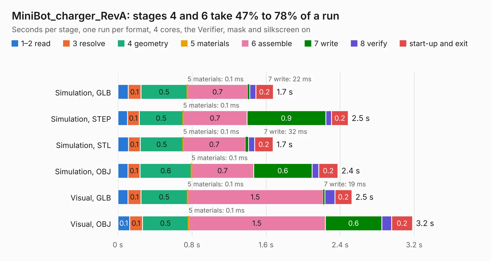

# 1893. MiniBot_charger_RevA

Board 1,893 of the 3,104 of [Corpus Testing](../Corpus-Testing.md), on [Corpus Page 18](../CorpusTestingPages/Corpus-Testing-18.md#1893-minibot_charger_reva).

| Mode and format | 1–2 read | 3 resolve | 4 geometry | 5 materials | 6 assemble | 7 write | 8 verify | start-up and exit | Total |
|---|---:|---:|---:|---:|---:|---:|---:|---:|---:|
| Simulation, GLB | 0.1 | 0.1 | 0.5 | 0.1&nbsp;ms | 0.7 | 22&nbsp;ms | 65&nbsp;ms | 0.2 | 1.7 |
| Simulation, STEP | 0.1 | 0.1 | 0.5 | 0.1&nbsp;ms | 0.7 | 0.9 | 62&nbsp;ms | 0.2 | 2.5 |
| Simulation, STL | 0.1 | 0.1 | 0.5 | 0.1&nbsp;ms | 0.7 | 32&nbsp;ms | 67&nbsp;ms | 0.2 | 1.7 |
| Simulation, OBJ | 0.1 | 0.1 | 0.6 | 0.1&nbsp;ms | 0.7 | 0.6 | 73&nbsp;ms | 0.2 | 2.4 |
| Visual, GLB | 0.1 | 0.1 | 0.5 | 0.1&nbsp;ms | 1.5 | 19&nbsp;ms | 0.1 | 0.2 | 2.5 |
| Visual, OBJ | 0.1 | 0.1 | 0.5 | 0.1&nbsp;ms | 1.5 | 0.6 | 0.1 | 0.2 | 3.2 |

<table align="center"><tr><td valign="top">

| Board | Repo: [OLIMEX/Minibot](https://github.com/OLIMEX/Minibot) Board: `MiniBot_charger_RevA.kicad_pcb` |
|---|---|
| Folder | HARDWARE / charger |
| Complexity | 168&nbsp;/&nbsp;1000 (size&nbsp;123, features&nbsp;45) |
| KESE&nbsp;features | through vias, slotted holes, filled zones |
| Tested | 9th November 2026 |
| Copper&nbsp;layers | 2 |
| File&nbsp;format | KiCad 5 (20171130) |
| Parts,&nbsp;tracks,&nbsp;vias | 12, 107, 3 |
| Triangles,&nbsp;simulation | 117,320 in 27 parts |
| Verifier | PASS in all six runs |

</td><td valign="top">

<table>
<tr><th>File type</th><th>File size</th><th>Peak memory used</th></tr>
<tr><th colspan="3" align="left">Simulation</th></tr>
<tr><td>GLB</td><td align="right">4.3&nbsp;MB</td><td align="right">188&nbsp;MB</td></tr>
<tr><td>STEP</td><td align="right">23&nbsp;MB</td><td align="right">201&nbsp;MB</td></tr>
<tr><td>STL</td><td align="right">5.9&nbsp;MB</td><td align="right">189&nbsp;MB</td></tr>
<tr><td>OBJ</td><td align="right">12&nbsp;MB</td><td align="right">189&nbsp;MB</td></tr>
<tr><th colspan="3" align="left">Visual</th></tr>
<tr><td>GLB</td><td align="right">3.6&nbsp;MB</td><td align="right">158&nbsp;MB</td></tr>
<tr><td>OBJ</td><td align="right">10.0&nbsp;MB</td><td align="right">158&nbsp;MB</td></tr>
</table>

</td></tr></table>

| Previous | Next |
|:---|---:|
| [1892. LoRa-STM32WL-DevKit_RevD1](b1892b_LoRa-STM32WL-DevKIT_LoRa-STM32WL-DevKit-RevD1.md) | [1894. MiniBot_RevA](b1894b_Minibot_MiniBot-RevA.md) |
