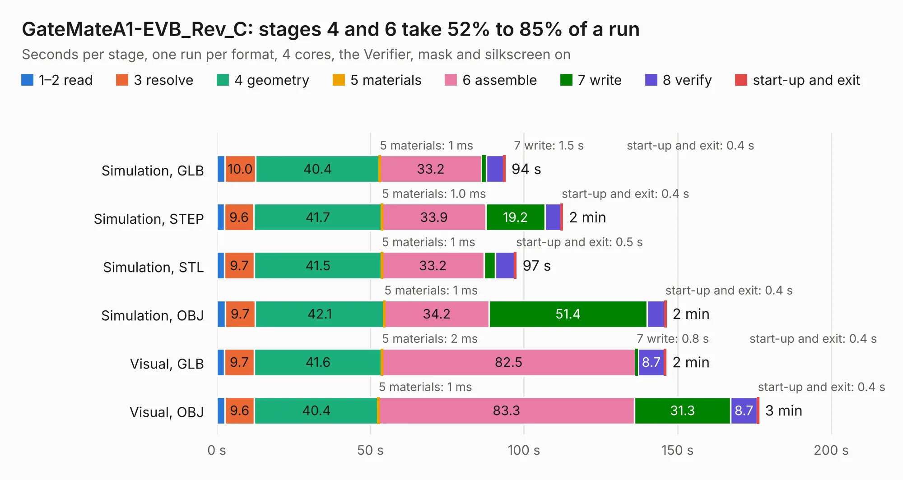

# 1894. GateMateA1-EVB_Rev_C

Board 1,894 of the 3,123 of [Corpus Testing](../Corpus-Testing.md), on [Corpus Page 18](../CorpusTestingPages/Corpus-Testing-18.md#1894-gatematea1-evb_rev_c).

| Mode and format | 1–2 read | 3 resolve | 4 geometry | 5 materials | 6 assemble | 7 write | 8 verify | start-up and exit | Total |
|---|---:|---:|---:|---:|---:|---:|---:|---:|---:|
| Simulation, GLB | 2.6 | 10.0 | 40.4 | 1&nbsp;ms | 33.2 | 1.5 | 5.7 | 0.4 | 93.8 |
| Simulation, STEP | 2.5 | 9.6 | 41.7 | 1.0&nbsp;ms | 33.9 | 19.2 | 5.2 | 0.4 | 112.5 |
| Simulation, STL | 2.5 | 9.7 | 41.5 | 1&nbsp;ms | 33.2 | 3.6 | 6.4 | 0.5 | 97.4 |
| Simulation, OBJ | 2.8 | 9.7 | 42.1 | 1&nbsp;ms | 34.2 | 51.4 | 5.8 | 0.4 | 146.2 |
| Visual, GLB | 2.5 | 9.7 | 41.6 | 2&nbsp;ms | 82.5 | 0.8 | 8.7 | 0.4 | 146.2 |
| Visual, OBJ | 2.6 | 9.6 | 40.4 | 1&nbsp;ms | 83.3 | 31.3 | 8.7 | 0.4 | 176.3 |

<table align="center"><tr><td valign="top">

| Board | Repo: [OLIMEX/GateMateA1-EVB](https://github.com/OLIMEX/GateMateA1-EVB) Board: `GateMateA1-EVB_Rev_C.kicad_pcb` |
|---|---|
| Folder | HARDWARE / GateMateA1-EVB-Rev.C |
| Complexity | 429&nbsp;/&nbsp;1000 (size&nbsp;304, features&nbsp;125) |
| KESE&nbsp;features | through vias, slotted holes, rounded, trapezoid or chamfered pads, arc tracks, filled zones, copper text, knockout text, stack-up, dielectric εr and tanδ |
| Tested | 9th November 2026 |
| Copper&nbsp;layers | 4 |
| File&nbsp;format | KiCad 7 (20221018) |
| Parts,&nbsp;tracks,&nbsp;vias | 268, 9,108, 1,267 |
| Triangles,&nbsp;simulation | 7,169,180 in 302 parts |
| Verifier | PASS in all six runs |

</td><td valign="top">

<table>
<tr><th>File type</th><th>File size</th><th>Peak memory used</th></tr>
<tr><th colspan="3" align="left">Simulation</th></tr>
<tr><td>GLB</td><td align="right">250&nbsp;MB</td><td align="right">2.1&nbsp;GB</td></tr>
<tr><td>STEP</td><td align="right">1.1&nbsp;GB</td><td align="right">2.6&nbsp;GB</td></tr>
<tr><td>STL</td><td align="right">358&nbsp;MB</td><td align="right">2.0&nbsp;GB</td></tr>
<tr><td>OBJ</td><td align="right">779&nbsp;MB</td><td align="right">4.7&nbsp;GB</td></tr>
<tr><th colspan="3" align="left">Visual</th></tr>
<tr><td>GLB</td><td align="right">171&nbsp;MB</td><td align="right">2.6&nbsp;GB</td></tr>
<tr><td>OBJ</td><td align="right">548&nbsp;MB</td><td align="right">3.4&nbsp;GB</td></tr>
</table>

</td></tr></table>

| Previous | Next |
|:---|---:|
| [1893. GateMateA1-EVB_Rev_B](b1893b_GateMateA1-EVB_GateMateA1-EVB-Rev-B.md) | [1895. ICE40-ADC_Rev_A](b1895b_iCE40-ADC_ICE40-ADC-Rev-A.md) |
