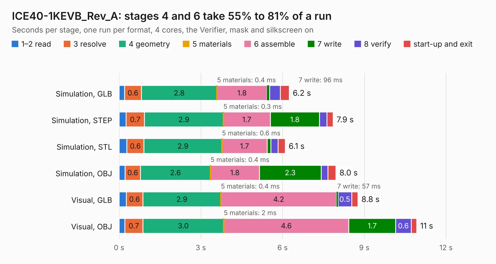

# 1900. ICE40-1KEVB_Rev_A

Board 1,900 of the 3,123 of [Corpus Testing](../Corpus-Testing.md), on [Corpus Page 18](../CorpusTestingPages/Corpus-Testing-18.md#1900-ice40-1kevb_rev_a).

| Mode and format | 1–2 read | 3 resolve | 4 geometry | 5 materials | 6 assemble | 7 write | 8 verify | start-up and exit | Total |
|---|---:|---:|---:|---:|---:|---:|---:|---:|---:|
| Simulation, GLB | 0.2 | 0.6 | 2.8 | 0.4&nbsp;ms | 1.8 | 96&nbsp;ms | 0.4 | 0.3 | 6.2 |
| Simulation, STEP | 0.3 | 0.7 | 2.9 | 0.3&nbsp;ms | 1.7 | 1.8 | 0.3 | 0.2 | 7.9 |
| Simulation, STL | 0.3 | 0.6 | 2.9 | 0.6&nbsp;ms | 1.7 | 0.1 | 0.3 | 0.3 | 6.1 |
| Simulation, OBJ | 0.2 | 0.6 | 2.6 | 0.4&nbsp;ms | 1.8 | 2.3 | 0.2 | 0.3 | 8.0 |
| Visual, GLB | 0.3 | 0.6 | 2.9 | 0.4&nbsp;ms | 4.2 | 57&nbsp;ms | 0.5 | 0.2 | 8.8 |
| Visual, OBJ | 0.2 | 0.7 | 3.0 | 2&nbsp;ms | 4.6 | 1.7 | 0.6 | 0.2 | 10.9 |

<table align="center"><tr><td valign="top">

| Board | Repo: [OLIMEX/iCE40HX1K-EVB](https://github.com/OLIMEX/iCE40HX1K-EVB) Board: `ICE40-1KEVB_Rev_A.kicad_pcb` |
|---|---|
| Complexity | 102&nbsp;/&nbsp;1000 (size&nbsp;102, features&nbsp;0) |
| Tested | 9th November 2026 |
| Copper&nbsp;layers | 2 |
| File&nbsp;format | KiCad 4 (4) |
| Parts,&nbsp;tracks,&nbsp;vias | 67, 0, 0 |
| Triangles,&nbsp;simulation | 457,628 in 106 parts |
| Note | mostly unrouted |
| Verifier | PASS in all six runs |

</td><td valign="top">

<table>
<tr><th>File type</th><th>File size</th><th>Peak memory used</th></tr>
<tr><th colspan="3" align="left">Simulation</th></tr>
<tr><td>GLB</td><td align="right">16&nbsp;MB</td><td align="right">301&nbsp;MB</td></tr>
<tr><td>STEP</td><td align="right">69&nbsp;MB</td><td align="right">333&nbsp;MB</td></tr>
<tr><td>STL</td><td align="right">23&nbsp;MB</td><td align="right">295&nbsp;MB</td></tr>
<tr><td>OBJ</td><td align="right">48&nbsp;MB</td><td align="right">370&nbsp;MB</td></tr>
<tr><th colspan="3" align="left">Visual</th></tr>
<tr><td>GLB</td><td align="right">11&nbsp;MB</td><td align="right">320&nbsp;MB</td></tr>
<tr><td>OBJ</td><td align="right">31&nbsp;MB</td><td align="right">323&nbsp;MB</td></tr>
</table>

</td></tr></table>

| Previous | Next |
|:---|---:|
| [1899. ICE40-IO_Rev_A](b1899b_iCE40-IO_ICE40-IO-Rev-A.md) | [1901. iCE40HX1K-EVB_Rev_B](b1901b_iCE40HX1K-EVB_iCE40HX1K-EVB-Rev-B.md) |
