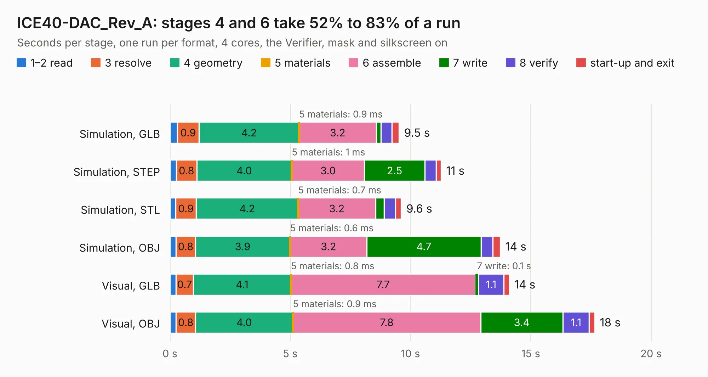

# 1901. ICE40-DAC_Rev_A

Board 1,901 of the 3,130 of [Corpus Testing](../Corpus-Testing.md), on [Corpus Page 18](../CorpusTestingPages/Corpus-Testing-18.md#1901-ice40-dac_rev_a).

| Mode and format | 1–2 read | 3 resolve | 4 geometry | 5 materials | 6 assemble | 7 write | 8 verify | start-up and exit | Total |
|---|---:|---:|---:|---:|---:|---:|---:|---:|---:|
| Simulation, GLB | 0.3 | 0.9 | 4.2 | 0.9&nbsp;ms | 3.2 | 0.2 | 0.5 | 0.3 | 9.5 |
| Simulation, STEP | 0.3 | 0.8 | 4.0 | 1&nbsp;ms | 3.0 | 2.5 | 0.5 | 0.2 | 11.3 |
| Simulation, STL | 0.2 | 0.9 | 4.2 | 0.7&nbsp;ms | 3.2 | 0.4 | 0.5 | 0.2 | 9.6 |
| Simulation, OBJ | 0.3 | 0.8 | 3.9 | 0.6&nbsp;ms | 3.2 | 4.7 | 0.5 | 0.3 | 13.7 |
| Visual, GLB | 0.2 | 0.7 | 4.1 | 0.8&nbsp;ms | 7.7 | 0.1 | 1.1 | 0.2 | 14.1 |
| Visual, OBJ | 0.3 | 0.8 | 4.0 | 0.9&nbsp;ms | 7.8 | 3.4 | 1.1 | 0.2 | 17.7 |

<table align="center"><tr><td valign="top">

| Board | Repo: [OLIMEX/iCE40-DAC](https://github.com/OLIMEX/iCE40-DAC) Board: `ICE40-DAC_Rev_A.kicad_pcb` |
|---|---|
| Complexity | 212&nbsp;/&nbsp;1000 (size&nbsp;177, features&nbsp;35) |
| KESE&nbsp;features | through vias, filled zones |
| Tested | 9th November 2026 |
| Copper&nbsp;layers | 2 |
| File&nbsp;format | KiCad 5 (20170123) |
| Parts,&nbsp;tracks,&nbsp;vias | 39, 1,005, 166 |
| Triangles,&nbsp;simulation | 1,030,836 in 72 parts |
| Verifier | PASS in all six runs |

</td><td valign="top">

<table>
<tr><th>File type</th><th>File size</th><th>Peak memory used</th></tr>
<tr><th colspan="3" align="left">Simulation</th></tr>
<tr><td>GLB</td><td align="right">36&nbsp;MB</td><td align="right">467&nbsp;MB</td></tr>
<tr><td>STEP</td><td align="right">194&nbsp;MB</td><td align="right">529&nbsp;MB</td></tr>
<tr><td>STL</td><td align="right">52&nbsp;MB</td><td align="right">456&nbsp;MB</td></tr>
<tr><td>OBJ</td><td align="right">106&nbsp;MB</td><td align="right">710&nbsp;MB</td></tr>
<tr><th colspan="3" align="left">Visual</th></tr>
<tr><td>GLB</td><td align="right">27&nbsp;MB</td><td align="right">570&nbsp;MB</td></tr>
<tr><td>OBJ</td><td align="right">80&nbsp;MB</td><td align="right">565&nbsp;MB</td></tr>
</table>

</td></tr></table>

| Previous | Next |
|:---|---:|
| [1900. ICE40-DAC_Rev_A1](b1900b_iCE40-DAC_ICE40-DAC-Rev-A1.md) | [1902. ICE40-DIO_Rev_A](b1902b_iCE40-DIO_ICE40-DIO-Rev-A.md) |
