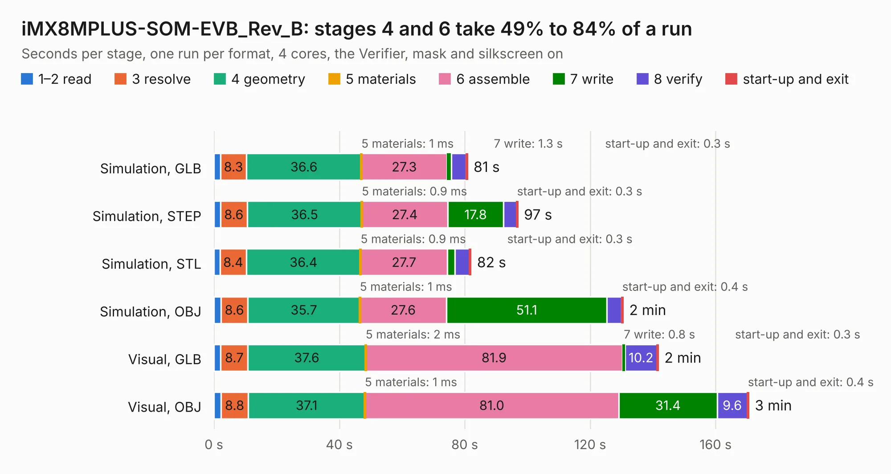

# 1901. iMX8MPLUS-SOM-EVB_Rev_B

Board 1,901 of the 3,119 of [Corpus Testing](../Corpus-Testing.md), on [Corpus Page 18](../CorpusTestingPages/Corpus-Testing-18.md#1901-imx8mplus-som-evb_rev_b).

| Mode and format | 1–2 read | 3 resolve | 4 geometry | 5 materials | 6 assemble | 7 write | 8 verify | start-up and exit | Total |
|---|---:|---:|---:|---:|---:|---:|---:|---:|---:|
| Simulation, GLB | 2.1 | 8.3 | 36.6 | 1&nbsp;ms | 27.3 | 1.3 | 4.8 | 0.3 | 80.8 |
| Simulation, STEP | 2.1 | 8.6 | 36.5 | 0.9&nbsp;ms | 27.4 | 17.8 | 4.2 | 0.3 | 96.9 |
| Simulation, STL | 2.0 | 8.4 | 36.4 | 0.9&nbsp;ms | 27.7 | 2.4 | 4.7 | 0.3 | 81.9 |
| Simulation, OBJ | 2.2 | 8.6 | 35.7 | 1&nbsp;ms | 27.6 | 51.1 | 4.7 | 0.4 | 130.4 |
| Visual, GLB | 2.2 | 8.7 | 37.6 | 2&nbsp;ms | 81.9 | 0.8 | 10.2 | 0.3 | 141.6 |
| Visual, OBJ | 2.2 | 8.8 | 37.1 | 1&nbsp;ms | 81.0 | 31.4 | 9.6 | 0.4 | 170.5 |

<table align="center"><tr><td valign="top">

| Board | Repo: [OLIMEX/iMX8MP-SOM-EVB](https://github.com/OLIMEX/iMX8MP-SOM-EVB) Board: `iMX8MPLUS-SOM-EVB_Rev_B.kicad_pcb` |
|---|---|
| Folder | HARDWARE / iMX8MP-SOM-EVB-rev.b |
| Complexity | 364&nbsp;/&nbsp;1000 (size&nbsp;299, features&nbsp;65) |
| KESE&nbsp;features | through vias, slotted holes, rounded, trapezoid or chamfered pads, filled zones, copper text |
| Tested | 9th November 2026 |
| Copper&nbsp;layers | 4 |
| File&nbsp;format | KiCad 5 (20171130) |
| Parts,&nbsp;tracks,&nbsp;vias | 317, 7,518, 1,183 |
| Triangles,&nbsp;simulation | 7,608,794 in 443 parts |
| Verifier | PASS in all six runs |

</td><td valign="top">

<table>
<tr><th>File type</th><th>File size</th><th>Peak memory used</th></tr>
<tr><th colspan="3" align="left">Simulation</th></tr>
<tr><td>GLB</td><td align="right">265&nbsp;MB</td><td align="right">2.3&nbsp;GB</td></tr>
<tr><td>STEP</td><td align="right">1.1&nbsp;GB</td><td align="right">2.9&nbsp;GB</td></tr>
<tr><td>STL</td><td align="right">380&nbsp;MB</td><td align="right">2.2&nbsp;GB</td></tr>
<tr><td>OBJ</td><td align="right">824&nbsp;MB</td><td align="right">4.9&nbsp;GB</td></tr>
<tr><th colspan="3" align="left">Visual</th></tr>
<tr><td>GLB</td><td align="right">184&nbsp;MB</td><td align="right">2.8&nbsp;GB</td></tr>
<tr><td>OBJ</td><td align="right">592&nbsp;MB</td><td align="right">3.7&nbsp;GB</td></tr>
</table>

</td></tr></table>

| Previous | Next |
|:---|---:|
| [1900. iMX8MPLUS-SOM_Rev_B](b1900b_iMX8MP-SOM_iMX8MPLUS-SOM-Rev-B.md) | [1902. Lime2-SHIELD_RevC](b1902b_LIME2-SHIELD_Lime2-SHIELD-RevC.md) |
