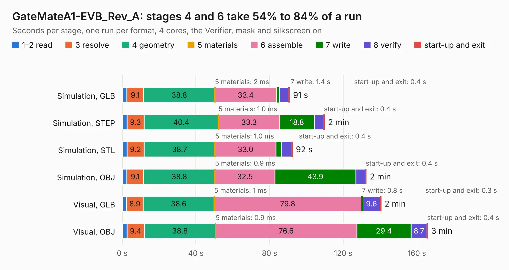

# 1902 GateMateA1-EVB_Rev_A

Board 1,902 of the 3,138 of [Corpus Testing](../Corpus-Testing.md), on [Corpus Page 18](../CorpusTestingPages/Corpus-Testing-18.md#1902-gatematea1-evb_rev_a).

| Mode and format | 1–2 read | 3 resolve | 4 geometry | 5 materials | 6 assemble | 7 write | 8 verify | start-up and exit | Total |
|---|---:|---:|---:|---:|---:|---:|---:|---:|---:|
| Simulation, GLB | 2.5 | 9.1 | 38.8 | 2&nbsp;ms | 33.4 | 1.4 | 5.2 | 0.4 | 90.8 |
| Simulation, STEP | 2.6 | 9.3 | 40.4 | 1.0&nbsp;ms | 33.3 | 18.8 | 5.0 | 0.4 | 109.8 |
| Simulation, STL | 2.6 | 9.2 | 38.7 | 1.0&nbsp;ms | 33.0 | 3.0 | 5.5 | 0.4 | 92.3 |
| Simulation, OBJ | 2.5 | 9.1 | 38.8 | 0.9&nbsp;ms | 32.5 | 43.9 | 5.2 | 0.4 | 132.5 |
| Visual, GLB | 2.4 | 8.9 | 38.6 | 1&nbsp;ms | 79.8 | 0.8 | 9.6 | 0.3 | 140.5 |
| Visual, OBJ | 2.6 | 9.4 | 38.8 | 0.9&nbsp;ms | 76.6 | 29.4 | 8.7 | 0.4 | 165.8 |

<table align="center"><tr><td valign="top">

| Board | Repo: [OLIMEX/GateMateA1-EVB](https://github.com/OLIMEX/GateMateA1-EVB) Board: `GateMateA1-EVB_Rev_A.kicad_pcb` |
|---|---|
| Folder | HARDWARE / GateMateA1-EVB-Rev.A |
| Complexity | 427&nbsp;/&nbsp;1000 (size&nbsp;302, features&nbsp;125) |
| KESE&nbsp;features | through vias, slotted holes, rounded, trapezoid or chamfered pads, arc tracks, filled zones, copper text, knockout text, stack-up, dielectric εr and tanδ |
| Tested | 9th November 2026 |
| Copper&nbsp;layers | 4 |
| File&nbsp;format | KiCad 7 (20221018) |
| Parts,&nbsp;tracks,&nbsp;vias | 267, 8,244, 1,191 |
| Triangles,&nbsp;simulation | 7,054,476 in 301 parts |
| Verifier | PASS in all six runs |

</td><td valign="top">

<table>
<tr><th>File type</th><th>File size</th><th>Peak memory used</th></tr>
<tr><th colspan="3" align="left">Simulation</th></tr>
<tr><td>GLB</td><td align="right">246&nbsp;MB</td><td align="right">2.0&nbsp;GB</td></tr>
<tr><td>STEP</td><td align="right">1.1&nbsp;GB</td><td align="right">2.5&nbsp;GB</td></tr>
<tr><td>STL</td><td align="right">353&nbsp;MB</td><td align="right">2.0&nbsp;GB</td></tr>
<tr><td>OBJ</td><td align="right">767&nbsp;MB</td><td align="right">4.6&nbsp;GB</td></tr>
<tr><th colspan="3" align="left">Visual</th></tr>
<tr><td>GLB</td><td align="right">167&nbsp;MB</td><td align="right">2.6&nbsp;GB</td></tr>
<tr><td>OBJ</td><td align="right">537&nbsp;MB</td><td align="right">3.5&nbsp;GB</td></tr>
</table>

</td></tr></table>

| Previous | Next |
|:---|---:|
| [1901 FOSDEM-MUSIC-BOX_RevA](b1901b_FOSDEM-MUSIC-BOX_FOSDEM-MUSIC-BOX-RevA.md) | [1903 GateMateA1-EVB_Rev_B](b1903b_GateMateA1-EVB_GateMateA1-EVB-Rev-B.md) |
