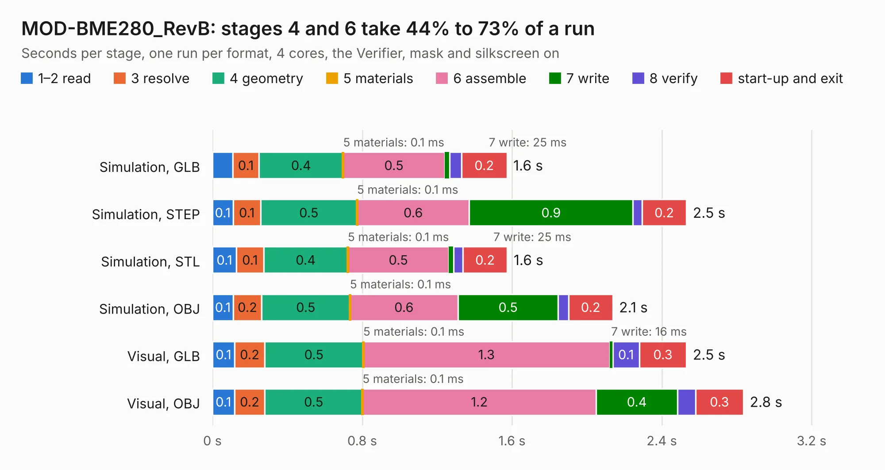

# 1902. MOD-BME280_RevB

Board 1,902 of the 3,109 of [Corpus Testing](../Corpus-Testing.md), on [Corpus Page 18](../CorpusTestingPages/Corpus-Testing-18.md#1902-mod-bme280_revb).

| Mode and format | 1–2 read | 3 resolve | 4 geometry | 5 materials | 6 assemble | 7 write | 8 verify | start-up and exit | Total |
|---|---:|---:|---:|---:|---:|---:|---:|---:|---:|
| Simulation, GLB | 0.1 | 0.1 | 0.4 | 0.1&nbsp;ms | 0.5 | 25&nbsp;ms | 65&nbsp;ms | 0.2 | 1.6 |
| Simulation, STEP | 0.1 | 0.1 | 0.5 | 0.1&nbsp;ms | 0.6 | 0.9 | 48&nbsp;ms | 0.2 | 2.5 |
| Simulation, STL | 0.1 | 0.1 | 0.4 | 0.1&nbsp;ms | 0.5 | 25&nbsp;ms | 49&nbsp;ms | 0.2 | 1.6 |
| Simulation, OBJ | 0.1 | 0.2 | 0.5 | 0.1&nbsp;ms | 0.6 | 0.5 | 55&nbsp;ms | 0.2 | 2.1 |
| Visual, GLB | 0.1 | 0.2 | 0.5 | 0.1&nbsp;ms | 1.3 | 16&nbsp;ms | 0.1 | 0.3 | 2.5 |
| Visual, OBJ | 0.1 | 0.2 | 0.5 | 0.1&nbsp;ms | 1.2 | 0.4 | 96&nbsp;ms | 0.3 | 2.8 |

<table align="center"><tr><td valign="top">

| Board | Repo: [OLIMEX/MOD-BME280](https://github.com/OLIMEX/MOD-BME280) Board: `MOD-BME280_RevB.kicad_pcb` |
|---|---|
| Folder | HARDWARE / MOD-BME280-Rev.B |
| Complexity | 163&nbsp;/&nbsp;1000 (size&nbsp;118, features&nbsp;45) |
| KESE&nbsp;features | through vias, rounded, trapezoid or chamfered pads, filled zones |
| Tested | 9th November 2026 |
| Copper&nbsp;layers | 2 |
| File&nbsp;format | KiCad 5 (20171130) |
| Parts,&nbsp;tracks,&nbsp;vias | 8, 93, 7 |
| Triangles,&nbsp;simulation | 80,616 in 19 parts |
| Verifier | PASS in all six runs |

</td><td valign="top">

<table>
<tr><th>File type</th><th>File size</th><th>Peak memory used</th></tr>
<tr><th colspan="3" align="left">Simulation</th></tr>
<tr><td>GLB</td><td align="right">3.0&nbsp;MB</td><td align="right">189&nbsp;MB</td></tr>
<tr><td>STEP</td><td align="right">15&nbsp;MB</td><td align="right">188&nbsp;MB</td></tr>
<tr><td>STL</td><td align="right">4.0&nbsp;MB</td><td align="right">189&nbsp;MB</td></tr>
<tr><td>OBJ</td><td align="right">8.2&nbsp;MB</td><td align="right">186&nbsp;MB</td></tr>
<tr><th colspan="3" align="left">Visual</th></tr>
<tr><td>GLB</td><td align="right">2.6&nbsp;MB</td><td align="right">154&nbsp;MB</td></tr>
<tr><td>OBJ</td><td align="right">7.3&nbsp;MB</td><td align="right">155&nbsp;MB</td></tr>
</table>

</td></tr></table>

| Previous | Next |
|:---|---:|
| [1901. MOD-BME280_RevA](b1901b_MOD-BME280_MOD-BME280-RevA.md) | [1903. MOD-ENV_revB](b1903b_MOD-ENV_MOD-ENV-revB.md) |
