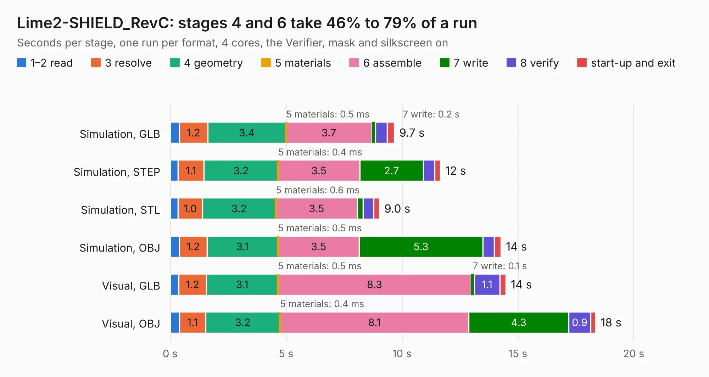

# 1903. Lime2-SHIELD_RevC

Board 1,903 of the 3,120 of [Corpus Testing](../Corpus-Testing.md), on [Corpus Page 18](../CorpusTestingPages/Corpus-Testing-18.md#1903-lime2-shield_revc).

| Mode and format | 1–2 read | 3 resolve | 4 geometry | 5 materials | 6 assemble | 7 write | 8 verify | start-up and exit | Total |
|---|---:|---:|---:|---:|---:|---:|---:|---:|---:|
| Simulation, GLB | 0.4 | 1.2 | 3.4 | 0.5&nbsp;ms | 3.7 | 0.2 | 0.5 | 0.3 | 9.7 |
| Simulation, STEP | 0.3 | 1.1 | 3.2 | 0.4&nbsp;ms | 3.5 | 2.7 | 0.5 | 0.2 | 11.7 |
| Simulation, STL | 0.3 | 1.0 | 3.2 | 0.6&nbsp;ms | 3.5 | 0.3 | 0.5 | 0.2 | 9.0 |
| Simulation, OBJ | 0.4 | 1.2 | 3.1 | 0.5&nbsp;ms | 3.5 | 5.3 | 0.5 | 0.3 | 14.3 |
| Visual, GLB | 0.4 | 1.2 | 3.1 | 0.5&nbsp;ms | 8.3 | 0.1 | 1.1 | 0.3 | 14.5 |
| Visual, OBJ | 0.4 | 1.1 | 3.2 | 0.4&nbsp;ms | 8.1 | 4.3 | 0.9 | 0.2 | 18.4 |

<table align="center"><tr><td valign="top">

| Board | Repo: [OLIMEX/LIME2-SHIELD](https://github.com/OLIMEX/LIME2-SHIELD) Board: `Lime2-SHIELD_RevC.kicad_pcb` |
|---|---|
| Folder | HARDWARE / Lime2-SHIELD-Rev.C |
| Complexity | 232&nbsp;/&nbsp;1000 (size&nbsp;187, features&nbsp;45) |
| KESE&nbsp;features | through vias, rounded, trapezoid or chamfered pads, filled zones |
| Tested | 9th November 2026 |
| Copper&nbsp;layers | 4 |
| File&nbsp;format | KiCad 5 (20171130) |
| Parts,&nbsp;tracks,&nbsp;vias | 39, 689, 117 |
| Triangles,&nbsp;simulation | 1,041,168 in 165 parts |
| Verifier | PASS in all six runs |

</td><td valign="top">

<table>
<tr><th>File type</th><th>File size</th><th>Peak memory used</th></tr>
<tr><th colspan="3" align="left">Simulation</th></tr>
<tr><td>GLB</td><td align="right">37&nbsp;MB</td><td align="right">482&nbsp;MB</td></tr>
<tr><td>STEP</td><td align="right">165&nbsp;MB</td><td align="right">581&nbsp;MB</td></tr>
<tr><td>STL</td><td align="right">52&nbsp;MB</td><td align="right">474&nbsp;MB</td></tr>
<tr><td>OBJ</td><td align="right">109&nbsp;MB</td><td align="right">779&nbsp;MB</td></tr>
<tr><th colspan="3" align="left">Visual</th></tr>
<tr><td>GLB</td><td align="right">27&nbsp;MB</td><td align="right">639&nbsp;MB</td></tr>
<tr><td>OBJ</td><td align="right">83&nbsp;MB</td><td align="right">627&nbsp;MB</td></tr>
</table>

</td></tr></table>

| Previous | Next |
|:---|---:|
| [1902. iMX8MPLUS-SOM-EVB_Rev_B](b1902b_iMX8MP-SOM-EVB_iMX8MPLUS-SOM-EVB-Rev-B.md) | [1904. LoRa_RevA](b1904b_LoRa-868-915_LoRa-RevA.md) |
