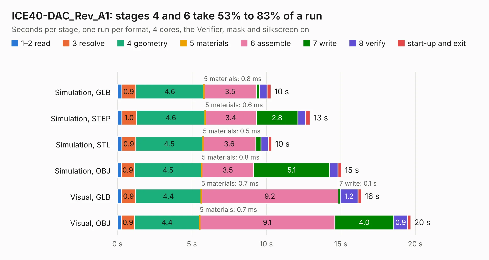

# 1906. ICE40-DAC_Rev_A1

Board 1,906 of the 3,139 of [Corpus Testing](../Corpus-Testing.md), on [Corpus Page 18](../CorpusTestingPages/Corpus-Testing-18.md#1906-ice40-dac_rev_a1).

| Mode and format | 1–2 read | 3 resolve | 4 geometry | 5 materials | 6 assemble | 7 write | 8 verify | start-up and exit | Total |
|---|---:|---:|---:|---:|---:|---:|---:|---:|---:|
| Simulation, GLB | 0.3 | 0.9 | 4.6 | 0.8&nbsp;ms | 3.5 | 0.2 | 0.5 | 0.3 | 10.3 |
| Simulation, STEP | 0.3 | 1.0 | 4.6 | 0.6&nbsp;ms | 3.4 | 2.8 | 0.5 | 0.3 | 12.9 |
| Simulation, STL | 0.3 | 0.9 | 4.5 | 0.5&nbsp;ms | 3.6 | 0.3 | 0.5 | 0.2 | 10.4 |
| Simulation, OBJ | 0.3 | 0.9 | 4.5 | 0.8&nbsp;ms | 3.5 | 5.1 | 0.6 | 0.2 | 15.0 |
| Visual, GLB | 0.3 | 0.9 | 4.4 | 0.7&nbsp;ms | 9.2 | 0.1 | 1.2 | 0.2 | 16.4 |
| Visual, OBJ | 0.3 | 0.9 | 4.4 | 0.7&nbsp;ms | 9.1 | 4.0 | 0.9 | 0.2 | 19.7 |

<table align="center"><tr><td valign="top">

| Board | Repo: [OLIMEX/iCE40-DAC](https://github.com/OLIMEX/iCE40-DAC) Board: `ICE40-DAC_Rev_A1.kicad_pcb` |
|---|---|
| Folder | Hardware revision A1 |
| Complexity | 212&nbsp;/&nbsp;1000 (size&nbsp;177, features&nbsp;35) |
| KESE&nbsp;features | through vias, filled zones |
| Tested | 9th November 2026 to 10th November 2026 |
| Copper&nbsp;layers | 2 |
| File&nbsp;format | KiCad 5 (20171130) |
| Parts,&nbsp;tracks,&nbsp;vias | 39, 1,005, 166 |
| Triangles,&nbsp;simulation | 1,063,228 in 72 parts |
| Verifier | PASS in all six runs |
| Run&nbsp;again | Visual, GLB; Visual, OBJ: failed in the corpus run, run again with fixes to KESE made after the corpus run, and passed |

</td><td valign="top">

<table>
<tr><th>File type</th><th>File size</th><th>Peak memory used</th></tr>
<tr><th colspan="3" align="left">Simulation</th></tr>
<tr><td>GLB</td><td align="right">37&nbsp;MB</td><td align="right">467&nbsp;MB</td></tr>
<tr><td>STEP</td><td align="right">195&nbsp;MB</td><td align="right">518&nbsp;MB</td></tr>
<tr><td>STL</td><td align="right">53&nbsp;MB</td><td align="right">470&nbsp;MB</td></tr>
<tr><td>OBJ</td><td align="right">109&nbsp;MB</td><td align="right">753&nbsp;MB</td></tr>
<tr><th colspan="3" align="left">Visual</th></tr>
<tr><td>GLB</td><td align="right">28&nbsp;MB</td><td align="right">608&nbsp;MB</td></tr>
<tr><td>OBJ</td><td align="right">82&nbsp;MB</td><td align="right">631&nbsp;MB</td></tr>
</table>

</td></tr></table>

| Previous | Next |
|:---|---:|
| [1905. ICE40-ADC_Rev_A](b1905b_iCE40-ADC_ICE40-ADC-Rev-A.md) | [1907. ICE40-DAC_Rev_A](b1907b_iCE40-DAC_ICE40-DAC-Rev-A.md) |
