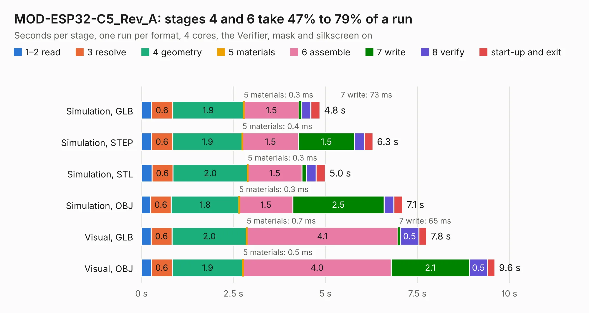

# 1907. MOD-ESP32-C5_Rev_A

Board 1,907 of the 3,112 of [Corpus Testing](../Corpus-Testing.md), on [Corpus Page 18](../CorpusTestingPages/Corpus-Testing-18.md#1907-mod-esp32-c5_rev_a).

| Mode and format | 1–2 read | 3 resolve | 4 geometry | 5 materials | 6 assemble | 7 write | 8 verify | start-up and exit | Total |
|---|---:|---:|---:|---:|---:|---:|---:|---:|---:|
| Simulation, GLB | 0.3 | 0.6 | 1.9 | 0.3&nbsp;ms | 1.5 | 73&nbsp;ms | 0.2 | 0.2 | 4.8 |
| Simulation, STEP | 0.3 | 0.6 | 1.9 | 0.4&nbsp;ms | 1.5 | 1.5 | 0.3 | 0.2 | 6.3 |
| Simulation, STL | 0.3 | 0.6 | 2.0 | 0.3&nbsp;ms | 1.5 | 0.1 | 0.3 | 0.2 | 5.0 |
| Simulation, OBJ | 0.3 | 0.6 | 1.8 | 0.3&nbsp;ms | 1.5 | 2.5 | 0.3 | 0.2 | 7.1 |
| Visual, GLB | 0.3 | 0.6 | 2.0 | 0.7&nbsp;ms | 4.1 | 65&nbsp;ms | 0.5 | 0.2 | 7.8 |
| Visual, OBJ | 0.3 | 0.6 | 1.9 | 0.5&nbsp;ms | 4.0 | 2.1 | 0.5 | 0.2 | 9.6 |

<table align="center"><tr><td valign="top">

| Board | Repo: [OLIMEX/MOD-ESP32-C5](https://github.com/OLIMEX/MOD-ESP32-C5) Board: `MOD-ESP32-C5_Rev_A.kicad_pcb` |
|---|---|
| Folder | HARDWARE / MOD-ESP32-C5.Rev.A |
| Complexity | 274&nbsp;/&nbsp;1000 (size&nbsp;169, features&nbsp;105) |
| KESE&nbsp;features | through vias, slotted holes, rounded, trapezoid or chamfered pads, filled zones, knockout text, stack-up, dielectric εr and tanδ, mask and silkscreen colours |
| Tested | 9th November 2026 |
| Copper&nbsp;layers | 2 |
| File&nbsp;format | KiCad 7 (20221018) |
| Parts,&nbsp;tracks,&nbsp;vias | 26, 873, 107 |
| Triangles,&nbsp;simulation | 437,814 in 54 parts |
| Verifier | PASS in all six runs |

</td><td valign="top">

<table>
<tr><th>File type</th><th>File size</th><th>Peak memory used</th></tr>
<tr><th colspan="3" align="left">Simulation</th></tr>
<tr><td>GLB</td><td align="right">16&nbsp;MB</td><td align="right">298&nbsp;MB</td></tr>
<tr><td>STEP</td><td align="right">73&nbsp;MB</td><td align="right">323&nbsp;MB</td></tr>
<tr><td>STL</td><td align="right">22&nbsp;MB</td><td align="right">292&nbsp;MB</td></tr>
<tr><td>OBJ</td><td align="right">45&nbsp;MB</td><td align="right">351&nbsp;MB</td></tr>
<tr><th colspan="3" align="left">Visual</th></tr>
<tr><td>GLB</td><td align="right">13&nbsp;MB</td><td align="right">341&nbsp;MB</td></tr>
<tr><td>OBJ</td><td align="right">39&nbsp;MB</td><td align="right">337&nbsp;MB</td></tr>
</table>

</td></tr></table>

| Previous | Next |
|:---|---:|
| [1906. MOD-ENV_revB](b1906b_MOD-ENV_MOD-ENV-revB.md) | [1908. MOD-IR-TEMP_RevA](b1908b_MOD-IR-TEMP_MOD-IR-TEMP-RevA.md) |
