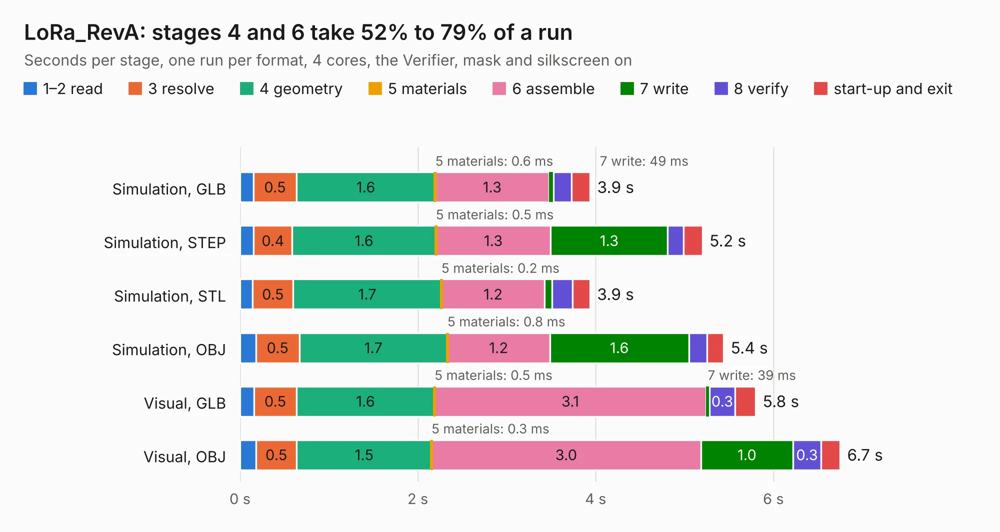

# 1908. LoRa_RevA

Board 1,908 of the 3,125 of [Corpus Testing](../Corpus-Testing.md), on [Corpus Page 18](../CorpusTestingPages/Corpus-Testing-18.md#1908-lora_reva).

| Mode and format | 1–2 read | 3 resolve | 4 geometry | 5 materials | 6 assemble | 7 write | 8 verify | start-up and exit | Total |
|---|---:|---:|---:|---:|---:|---:|---:|---:|---:|
| Simulation, GLB | 0.2 | 0.5 | 1.6 | 0.6&nbsp;ms | 1.3 | 49&nbsp;ms | 0.2 | 0.2 | 3.9 |
| Simulation, STEP | 0.2 | 0.4 | 1.6 | 0.5&nbsp;ms | 1.3 | 1.3 | 0.2 | 0.2 | 5.2 |
| Simulation, STL | 0.1 | 0.5 | 1.7 | 0.2&nbsp;ms | 1.2 | 83&nbsp;ms | 0.2 | 0.2 | 3.9 |
| Simulation, OBJ | 0.2 | 0.5 | 1.7 | 0.8&nbsp;ms | 1.2 | 1.6 | 0.2 | 0.2 | 5.4 |
| Visual, GLB | 0.2 | 0.5 | 1.6 | 0.5&nbsp;ms | 3.1 | 39&nbsp;ms | 0.3 | 0.2 | 5.8 |
| Visual, OBJ | 0.2 | 0.5 | 1.5 | 0.3&nbsp;ms | 3.0 | 1.0 | 0.3 | 0.2 | 6.7 |

<table align="center"><tr><td valign="top">

| Board | Repo: [OLIMEX/LoRa-868-915](https://github.com/OLIMEX/LoRa-868-915) Board: `LoRa_RevA.kicad_pcb` |
|---|---|
| Folder | HARDWARE / LoRa-Rev-A |
| Complexity | 265&nbsp;/&nbsp;1000 (size&nbsp;195, features&nbsp;70) |
| KESE&nbsp;features | through vias, slotted holes, custom pads, filled zones, copper drawings |
| Tested | 9th November 2026 |
| Copper&nbsp;layers | 2 |
| File&nbsp;format | KiCad 5 (20171130) |
| Parts,&nbsp;tracks,&nbsp;vias | 31, 322, 45 |
| Triangles,&nbsp;simulation | 350,196 in 40 parts |
| Verifier | PASS in all six runs |

</td><td valign="top">

<table>
<tr><th>File type</th><th>File size</th><th>Peak memory used</th></tr>
<tr><th colspan="3" align="left">Simulation</th></tr>
<tr><td>GLB</td><td align="right">13&nbsp;MB</td><td align="right">260&nbsp;MB</td></tr>
<tr><td>STEP</td><td align="right">63&nbsp;MB</td><td align="right">265&nbsp;MB</td></tr>
<tr><td>STL</td><td align="right">18&nbsp;MB</td><td align="right">264&nbsp;MB</td></tr>
<tr><td>OBJ</td><td align="right">37&nbsp;MB</td><td align="right">283&nbsp;MB</td></tr>
<tr><th colspan="3" align="left">Visual</th></tr>
<tr><td>GLB</td><td align="right">8.5&nbsp;MB</td><td align="right">255&nbsp;MB</td></tr>
<tr><td>OBJ</td><td align="right">25&nbsp;MB</td><td align="right">242&nbsp;MB</td></tr>
</table>

</td></tr></table>

| Previous | Next |
|:---|---:|
| [1907. Lime2-SHIELD_RevC](b1907b_LIME2-SHIELD_Lime2-SHIELD-RevC.md) | [1909. LoRa_RevB](b1909b_LoRa-868-915_LoRa-RevB.md) |
