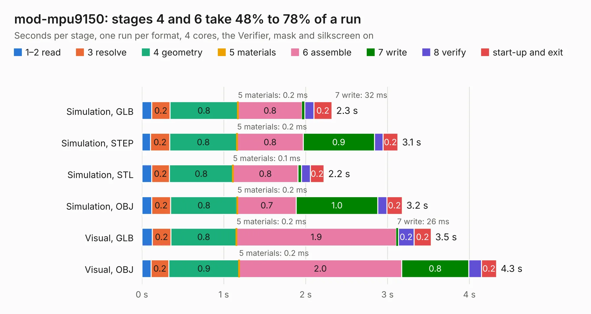

# 1910. mod-mpu9150

Board 1,910 of the 3,110 of [Corpus Testing](../Corpus-Testing.md), on [Corpus Page 18](../CorpusTestingPages/Corpus-Testing-18.md#1910-mod-mpu9150).

| Mode and format | 1–2 read | 3 resolve | 4 geometry | 5 materials | 6 assemble | 7 write | 8 verify | start-up and exit | Total |
|---|---:|---:|---:|---:|---:|---:|---:|---:|---:|
| Simulation, GLB | 0.1 | 0.2 | 0.8 | 0.2&nbsp;ms | 0.8 | 32&nbsp;ms | 0.1 | 0.2 | 2.3 |
| Simulation, STEP | 0.1 | 0.2 | 0.8 | 0.2&nbsp;ms | 0.8 | 0.9 | 0.1 | 0.2 | 3.1 |
| Simulation, STL | 0.1 | 0.2 | 0.8 | 0.1&nbsp;ms | 0.8 | 44&nbsp;ms | 0.1 | 0.2 | 2.2 |
| Simulation, OBJ | 0.1 | 0.2 | 0.8 | 0.2&nbsp;ms | 0.7 | 1.0 | 0.1 | 0.2 | 3.2 |
| Visual, GLB | 0.1 | 0.2 | 0.8 | 0.2&nbsp;ms | 1.9 | 26&nbsp;ms | 0.2 | 0.2 | 3.5 |
| Visual, OBJ | 0.1 | 0.2 | 0.9 | 0.2&nbsp;ms | 2.0 | 0.8 | 0.2 | 0.2 | 4.3 |

<table align="center"><tr><td valign="top">

| Board | Repo: [OLIMEX/MOD-MPU9150](https://github.com/OLIMEX/MOD-MPU9150) Board: `mod-mpu9150.kicad_pcb` |
|---|---|
| Folder | HARDWARE / MOD-MPU9150-Rev.A |
| Complexity | 163&nbsp;/&nbsp;1000 (size&nbsp;128, features&nbsp;35) |
| KESE&nbsp;features | through vias, filled zones |
| Tested | 9th November 2026 |
| Copper&nbsp;layers | 2 |
| File&nbsp;format | KiCad 4 (4) |
| Parts,&nbsp;tracks,&nbsp;vias | 14, 125, 9 |
| Triangles,&nbsp;simulation | 199,710 in 38 parts |
| Verifier | PASS in all six runs |

</td><td valign="top">

<table>
<tr><th>File type</th><th>File size</th><th>Peak memory used</th></tr>
<tr><th colspan="3" align="left">Simulation</th></tr>
<tr><td>GLB</td><td align="right">7.2&nbsp;MB</td><td align="right">218&nbsp;MB</td></tr>
<tr><td>STEP</td><td align="right">39&nbsp;MB</td><td align="right">232&nbsp;MB</td></tr>
<tr><td>STL</td><td align="right">10.0&nbsp;MB</td><td align="right">220&nbsp;MB</td></tr>
<tr><td>OBJ</td><td align="right">20&nbsp;MB</td><td align="right">217&nbsp;MB</td></tr>
<tr><th colspan="3" align="left">Visual</th></tr>
<tr><td>GLB</td><td align="right">6.0&nbsp;MB</td><td align="right">214&nbsp;MB</td></tr>
<tr><td>OBJ</td><td align="right">17&nbsp;MB</td><td align="right">212&nbsp;MB</td></tr>
</table>

</td></tr></table>

| Previous | Next |
|:---|---:|
| [1909. MOD-LCD2.8RTP_Rev_D](b1909b_MOD-LCD2-8RTP_MOD-LCD2-8RTP-Rev-D.md) | [1911. mod-oled-128x64](b1911b_MOD-OLED-128x64_mod-oled-128x64.md) |
