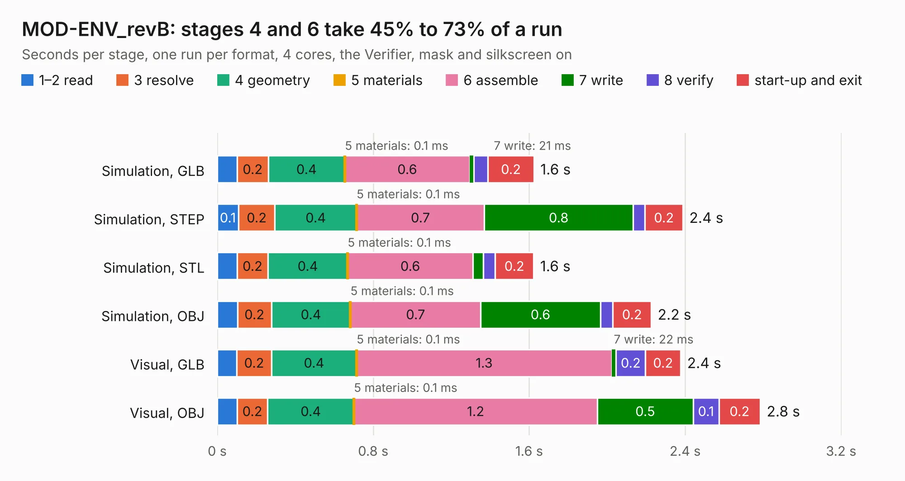

# 1913. MOD-ENV_revB

Board 1,913 of the 3,119 of [Corpus Testing](../Corpus-Testing.md), on [Corpus Page 18](../CorpusTestingPages/Corpus-Testing-18.md#1913-mod-env_revb).

| Mode and format | 1–2 read | 3 resolve | 4 geometry | 5 materials | 6 assemble | 7 write | 8 verify | start-up and exit | Total |
|---|---:|---:|---:|---:|---:|---:|---:|---:|---:|
| Simulation, GLB | 0.1 | 0.2 | 0.4 | 0.1&nbsp;ms | 0.6 | 21&nbsp;ms | 73&nbsp;ms | 0.2 | 1.6 |
| Simulation, STEP | 0.1 | 0.2 | 0.4 | 0.1&nbsp;ms | 0.7 | 0.8 | 61&nbsp;ms | 0.2 | 2.4 |
| Simulation, STL | 0.1 | 0.2 | 0.4 | 0.1&nbsp;ms | 0.6 | 53&nbsp;ms | 61&nbsp;ms | 0.2 | 1.6 |
| Simulation, OBJ | 0.1 | 0.2 | 0.4 | 0.1&nbsp;ms | 0.7 | 0.6 | 64&nbsp;ms | 0.2 | 2.2 |
| Visual, GLB | 0.1 | 0.2 | 0.4 | 0.1&nbsp;ms | 1.3 | 22&nbsp;ms | 0.2 | 0.2 | 2.4 |
| Visual, OBJ | 0.1 | 0.2 | 0.4 | 0.1&nbsp;ms | 1.2 | 0.5 | 0.1 | 0.2 | 2.8 |

<table align="center"><tr><td valign="top">

| Board | Repo: [OLIMEX/MOD-ENV](https://github.com/OLIMEX/MOD-ENV) Board: `MOD-ENV_revB.kicad_pcb` |
|---|---|
| Folder | HARDWARE / REV-B |
| Complexity | 188&nbsp;/&nbsp;1000 (size&nbsp;133, features&nbsp;55) |
| KESE&nbsp;features | through vias, slotted holes, rounded, trapezoid or chamfered pads, filled zones |
| Tested | 9th November 2026 |
| Copper&nbsp;layers | 2 |
| File&nbsp;format | KiCad 5 (20171130) |
| Parts,&nbsp;tracks,&nbsp;vias | 13, 167, 15 |
| Triangles,&nbsp;simulation | 140,154 in 23 parts |
| Verifier | PASS in all six runs |

</td><td valign="top">

<table>
<tr><th>File type</th><th>File size</th><th>Peak memory used</th></tr>
<tr><th colspan="3" align="left">Simulation</th></tr>
<tr><td>GLB</td><td align="right">5.1&nbsp;MB</td><td align="right">200&nbsp;MB</td></tr>
<tr><td>STEP</td><td align="right">26&nbsp;MB</td><td align="right">216&nbsp;MB</td></tr>
<tr><td>STL</td><td align="right">7.0&nbsp;MB</td><td align="right">201&nbsp;MB</td></tr>
<tr><td>OBJ</td><td align="right">14&nbsp;MB</td><td align="right">201&nbsp;MB</td></tr>
<tr><th colspan="3" align="left">Visual</th></tr>
<tr><td>GLB</td><td align="right">4.3&nbsp;MB</td><td align="right">178&nbsp;MB</td></tr>
<tr><td>OBJ</td><td align="right">12&nbsp;MB</td><td align="right">179&nbsp;MB</td></tr>
</table>

</td></tr></table>

| Previous | Next |
|:---|---:|
| [1912. MOD-BME280_RevB](b1912b_MOD-BME280_MOD-BME280-RevB.md) | [1914. MOD-ESP32-C5_Rev_A](b1914b_MOD-ESP32-C5_MOD-ESP32-C5-Rev-A.md) |
