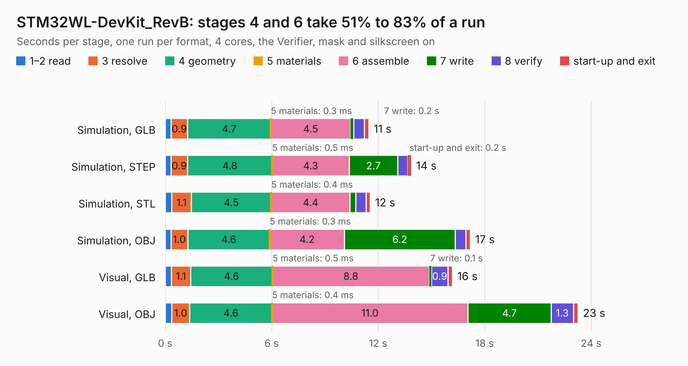

# 1914. STM32WL-DevKit_RevB

Board 1,914 of the 3,130 of [Corpus Testing](../Corpus-Testing.md), on [Corpus Page 18](../CorpusTestingPages/Corpus-Testing-18.md#1914-stm32wl-devkit_revb).

| Mode and format | 1–2 read | 3 resolve | 4 geometry | 5 materials | 6 assemble | 7 write | 8 verify | start-up and exit | Total |
|---|---:|---:|---:|---:|---:|---:|---:|---:|---:|
| Simulation, GLB | 0.3 | 0.9 | 4.7 | 0.3&nbsp;ms | 4.5 | 0.2 | 0.6 | 0.2 | 11.5 |
| Simulation, STEP | 0.3 | 0.9 | 4.8 | 0.5&nbsp;ms | 4.3 | 2.7 | 0.6 | 0.2 | 13.9 |
| Simulation, STL | 0.4 | 1.1 | 4.5 | 0.4&nbsp;ms | 4.4 | 0.3 | 0.6 | 0.2 | 11.6 |
| Simulation, OBJ | 0.3 | 1.0 | 4.6 | 0.3&nbsp;ms | 4.2 | 6.2 | 0.6 | 0.3 | 17.2 |
| Visual, GLB | 0.4 | 1.1 | 4.6 | 0.5&nbsp;ms | 8.8 | 0.1 | 0.9 | 0.2 | 16.2 |
| Visual, OBJ | 0.4 | 1.0 | 4.6 | 0.4&nbsp;ms | 11.0 | 4.7 | 1.3 | 0.3 | 23.3 |

<table align="center"><tr><td valign="top">

| Board | Repo: [OLIMEX/LoRa-STM32WL-DevKIT](https://github.com/OLIMEX/LoRa-STM32WL-DevKIT) Board: `STM32WL-DevKit_RevB.kicad_pcb` |
|---|---|
| Folder | HARDWARE / LoRa-STM32WL-DevKIT / LoRa-STM32WL-DevKit-RevB |
| Complexity | 308&nbsp;/&nbsp;1000 (size&nbsp;228, features&nbsp;80) |
| KESE&nbsp;features | through vias, slotted holes, custom pads, rounded, trapezoid or chamfered pads, filled zones, copper drawings |
| Tested | 9th November 2026 |
| Copper&nbsp;layers | 4 |
| File&nbsp;format | KiCad 5 (20171130) |
| Parts,&nbsp;tracks,&nbsp;vias | 49, 640, 110 |
| Triangles,&nbsp;simulation | 1,098,314 in 74 parts |
| Verifier | PASS in all six runs |

</td><td valign="top">

<table>
<tr><th>File type</th><th>File size</th><th>Peak memory used</th></tr>
<tr><th colspan="3" align="left">Simulation</th></tr>
<tr><td>GLB</td><td align="right">37&nbsp;MB</td><td align="right">449&nbsp;MB</td></tr>
<tr><td>STEP</td><td align="right">167&nbsp;MB</td><td align="right">573&nbsp;MB</td></tr>
<tr><td>STL</td><td align="right">55&nbsp;MB</td><td align="right">445&nbsp;MB</td></tr>
<tr><td>OBJ</td><td align="right">112&nbsp;MB</td><td align="right">801&nbsp;MB</td></tr>
<tr><th colspan="3" align="left">Visual</th></tr>
<tr><td>GLB</td><td align="right">26&nbsp;MB</td><td align="right">634&nbsp;MB</td></tr>
<tr><td>OBJ</td><td align="right">77&nbsp;MB</td><td align="right">629&nbsp;MB</td></tr>
</table>

</td></tr></table>

| Previous | Next |
|:---|---:|
| [1913. MOD-LoRa_RevB](b1913b_LoRa-868-915_MOD-LoRa-RevB.md) | [1915. LoRa-STM32WL-DevKit_RevD1](b1915b_LoRa-STM32WL-DevKIT_LoRa-STM32WL-DevKit-RevD1.md) |
