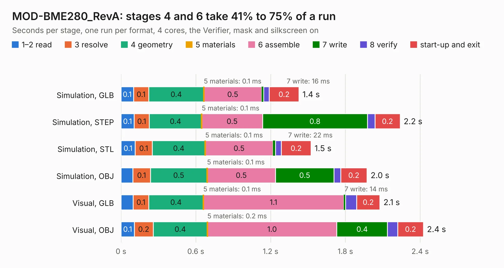

# 1917. MOD-BME280_RevA

Board 1,917 of the 3,128 of [Corpus Testing](../Corpus-Testing.md), on [Corpus Page 18](../CorpusTestingPages/Corpus-Testing-18.md#1917-mod-bme280_reva).

| Mode and format | 1–2 read | 3 resolve | 4 geometry | 5 materials | 6 assemble | 7 write | 8 verify | start-up and exit | Total |
|---|---:|---:|---:|---:|---:|---:|---:|---:|---:|
| Simulation, GLB | 0.1 | 0.1 | 0.4 | 0.1&nbsp;ms | 0.5 | 16&nbsp;ms | 44&nbsp;ms | 0.2 | 1.4 |
| Simulation, STEP | 0.1 | 0.1 | 0.4 | 0.1&nbsp;ms | 0.5 | 0.8 | 60&nbsp;ms | 0.2 | 2.2 |
| Simulation, STL | 0.1 | 0.1 | 0.4 | 0.1&nbsp;ms | 0.5 | 22&nbsp;ms | 47&nbsp;ms | 0.2 | 1.5 |
| Simulation, OBJ | 95&nbsp;ms | 0.1 | 0.5 | 0.1&nbsp;ms | 0.5 | 0.5 | 53&nbsp;ms | 0.2 | 2.0 |
| Visual, GLB | 98&nbsp;ms | 0.1 | 0.4 | 0.1&nbsp;ms | 1.1 | 14&nbsp;ms | 90&nbsp;ms | 0.2 | 2.1 |
| Visual, OBJ | 0.1 | 0.2 | 0.4 | 0.2&nbsp;ms | 1.0 | 0.4 | 82&nbsp;ms | 0.2 | 2.4 |

<table align="center"><tr><td valign="top">

| Board | Repo: [OLIMEX/MOD-BME280](https://github.com/OLIMEX/MOD-BME280) Board: `MOD-BME280_RevA.kicad_pcb` |
|---|---|
| Folder | HARDWARE / MOD-BME280-Rev.A1 |
| Complexity | 154&nbsp;/&nbsp;1000 (size&nbsp;119, features&nbsp;35) |
| KESE&nbsp;features | through vias, filled zones |
| Tested | 9th November 2026 |
| Copper&nbsp;layers | 2 |
| File&nbsp;format | KiCad 5 (20170123) |
| Parts,&nbsp;tracks,&nbsp;vias | 8, 95, 7 |
| Triangles,&nbsp;simulation | 76,542 in 21 parts |
| Verifier | PASS in all six runs |

</td><td valign="top">

<table>
<tr><th>File type</th><th>File size</th><th>Peak memory used</th></tr>
<tr><th colspan="3" align="left">Simulation</th></tr>
<tr><td>GLB</td><td align="right">2.9&nbsp;MB</td><td align="right">177&nbsp;MB</td></tr>
<tr><td>STEP</td><td align="right">14&nbsp;MB</td><td align="right">190&nbsp;MB</td></tr>
<tr><td>STL</td><td align="right">3.8&nbsp;MB</td><td align="right">180&nbsp;MB</td></tr>
<tr><td>OBJ</td><td align="right">7.8&nbsp;MB</td><td align="right">182&nbsp;MB</td></tr>
<tr><th colspan="3" align="left">Visual</th></tr>
<tr><td>GLB</td><td align="right">2.5&nbsp;MB</td><td align="right">155&nbsp;MB</td></tr>
<tr><td>OBJ</td><td align="right">6.9&nbsp;MB</td><td align="right">155&nbsp;MB</td></tr>
</table>

</td></tr></table>

| Previous | Next |
|:---|---:|
| [1916. MIPI-HDMI_Rev_B](b1916b_MIPI-HDMI_MIPI-HDMI-Rev-B.md) | [1918. MOD-BME280_RevB](b1918b_MOD-BME280_MOD-BME280-RevB.md) |
