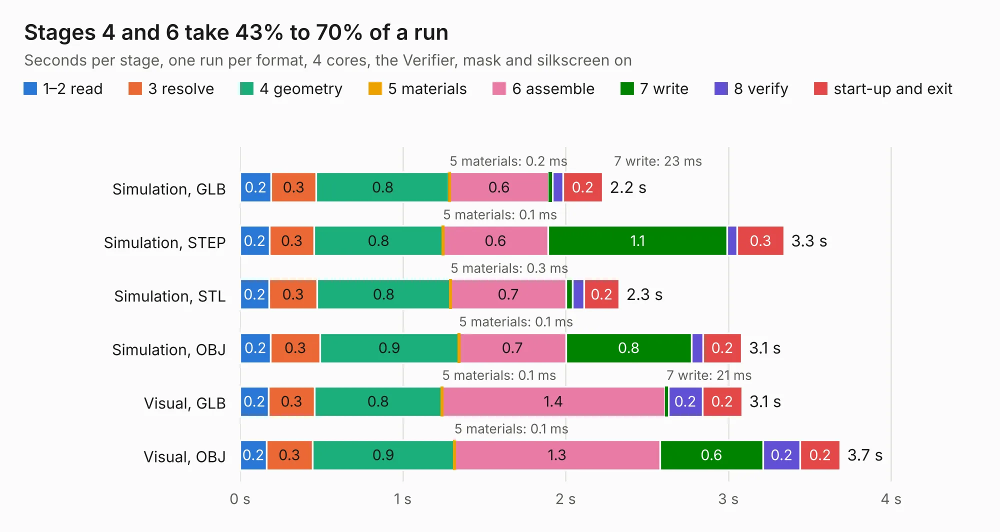

# 1919. A20_OLinuXino_Lime2_SHIELD_TEMPLATE_Rev-AA

Board 1,919 of the 3,101 of [Corpus Testing](../Corpus-Testing.md), on [Corpus Page 18](../CorpusTestingPages/Corpus-Testing-18.md#1919-a20_olinuxino_lime2_shield_template_rev-aa).

| Mode and format | 1–2 read | 3 resolve | 4 geometry | 5 materials | 6 assemble | 7 write | 8 verify | start-up and exit | Total |
|---|---:|---:|---:|---:|---:|---:|---:|---:|---:|
| Simulation, GLB | 0.2 | 0.3 | 0.8 | 0.2&nbsp;ms | 0.6 | 23&nbsp;ms | 64&nbsp;ms | 0.2 | 2.2 |
| Simulation, STEP | 0.2 | 0.3 | 0.8 | 0.1&nbsp;ms | 0.6 | 1.1 | 61&nbsp;ms | 0.3 | 3.3 |
| Simulation, STL | 0.2 | 0.3 | 0.8 | 0.3&nbsp;ms | 0.7 | 41&nbsp;ms | 70&nbsp;ms | 0.2 | 2.3 |
| Simulation, OBJ | 0.2 | 0.3 | 0.9 | 0.1&nbsp;ms | 0.7 | 0.8 | 68&nbsp;ms | 0.2 | 3.1 |
| Visual, GLB | 0.2 | 0.3 | 0.8 | 0.1&nbsp;ms | 1.4 | 21&nbsp;ms | 0.2 | 0.2 | 3.1 |
| Visual, OBJ | 0.2 | 0.3 | 0.9 | 0.1&nbsp;ms | 1.3 | 0.6 | 0.2 | 0.2 | 3.7 |

<table align="center"><tr><td valign="top">

| Board | Repo: [OLIMEX/OLINUXINO](https://github.com/OLIMEX/OLINUXINO) Board: `A20_OLinuXino_Lime2_SHIELD_TEMPLATE_Rev-AA.kicad_pcb` |
|---|---|
| Folder | HARDWARE / A20-OLinuXino-LIME2 / 3. Templates and more / A20-OLinuXino-LIME2-rev-A SHIELD TEMPLATE KiCAD |
| Complexity | 36&nbsp;/&nbsp;1000 (size&nbsp;36, features&nbsp;0) |
| Tested | 9th November 2026 |
| Copper&nbsp;layers | 2 |
| File&nbsp;format | KiCad 3 (3) |
| Parts,&nbsp;tracks,&nbsp;vias | 5, 0, 0 |
| Triangles,&nbsp;simulation | 110,156 in 11 parts |
| Verifier | PASS in all six runs |

</td><td valign="top">

<table>
<tr><th>File type</th><th>File size</th><th>Peak memory used</th></tr>
<tr><th colspan="3" align="left">Simulation</th></tr>
<tr><td>GLB</td><td align="right">4.3&nbsp;MB</td><td align="right">214&nbsp;MB</td></tr>
<tr><td>STEP</td><td align="right">14&nbsp;MB</td><td align="right">212&nbsp;MB</td></tr>
<tr><td>STL</td><td align="right">5.5&nbsp;MB</td><td align="right">203&nbsp;MB</td></tr>
<tr><td>OBJ</td><td align="right">12&nbsp;MB</td><td align="right">213&nbsp;MB</td></tr>
<tr><th colspan="3" align="left">Visual</th></tr>
<tr><td>GLB</td><td align="right">3.6&nbsp;MB</td><td align="right">183&nbsp;MB</td></tr>
<tr><td>OBJ</td><td align="right">10&nbsp;MB</td><td align="right">179&nbsp;MB</td></tr>
</table>

</td></tr></table>

| Previous | Next |
|:---|---:|
| [1918. A10_OLinuXino_Lime_Rev-B_SHIELD_TEMPLATE](b1918b_OLINUXINO_A10-OLinuXino-Lime-Rev-B-SHIELD-TEMPLATE.md) | [1920. A64-OlinuXino_Rev_H](b1920b_OLINUXINO_A64-OlinuXino-Rev-H.md) |
