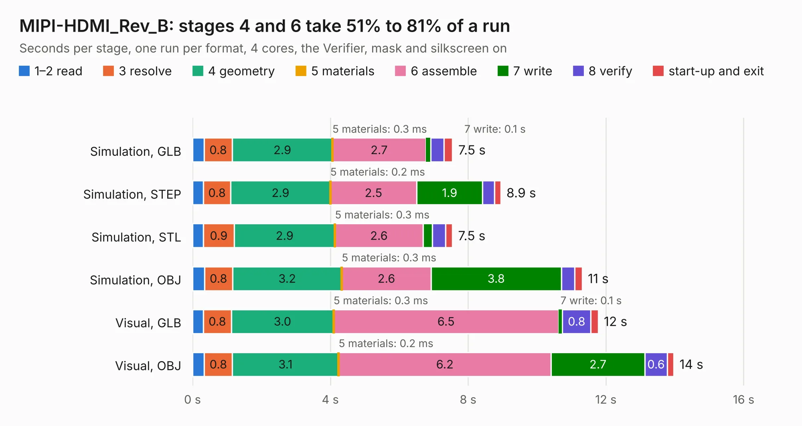

# 1920. MIPI-HDMI_Rev_B

Board 1,920 of the 3,132 of [Corpus Testing](../Corpus-Testing.md), on [Corpus Page 18](../CorpusTestingPages/Corpus-Testing-18.md#1920-mipi-hdmi_rev_b).

| Mode and format | 1–2 read | 3 resolve | 4 geometry | 5 materials | 6 assemble | 7 write | 8 verify | start-up and exit | Total |
|---|---:|---:|---:|---:|---:|---:|---:|---:|---:|
| Simulation, GLB | 0.3 | 0.8 | 2.9 | 0.3&nbsp;ms | 2.7 | 0.1 | 0.4 | 0.2 | 7.5 |
| Simulation, STEP | 0.3 | 0.8 | 2.9 | 0.2&nbsp;ms | 2.5 | 1.9 | 0.3 | 0.2 | 8.9 |
| Simulation, STL | 0.3 | 0.9 | 2.9 | 0.3&nbsp;ms | 2.6 | 0.3 | 0.4 | 0.2 | 7.5 |
| Simulation, OBJ | 0.3 | 0.8 | 3.2 | 0.3&nbsp;ms | 2.6 | 3.8 | 0.4 | 0.2 | 11.3 |
| Visual, GLB | 0.3 | 0.8 | 3.0 | 0.3&nbsp;ms | 6.5 | 0.1 | 0.8 | 0.2 | 11.8 |
| Visual, OBJ | 0.3 | 0.8 | 3.1 | 0.2&nbsp;ms | 6.2 | 2.7 | 0.6 | 0.2 | 14.0 |

<table align="center"><tr><td valign="top">

| Board | Repo: [OLIMEX/MIPI-HDMI](https://github.com/OLIMEX/MIPI-HDMI) Board: `MIPI-HDMI_Rev_B.kicad_pcb` |
|---|---|
| Folder | HARDWARE / MIPI-HDMI-Rev.B |
| Complexity | 342&nbsp;/&nbsp;1000 (size&nbsp;237, features&nbsp;105) |
| KESE&nbsp;features | through vias, slotted holes, filled zones, copper text, knockout text, stack-up, dielectric εr and tanδ, mask and silkscreen colours |
| Tested | 9th November 2026 |
| Copper&nbsp;layers | 4 |
| File&nbsp;format | KiCad 7 (20221018) |
| Parts,&nbsp;tracks,&nbsp;vias | 55, 1,070, 162 |
| Triangles,&nbsp;simulation | 962,002 in 86 parts |
| Verifier | PASS in all six runs |

</td><td valign="top">

<table>
<tr><th>File type</th><th>File size</th><th>Peak memory used</th></tr>
<tr><th colspan="3" align="left">Simulation</th></tr>
<tr><td>GLB</td><td align="right">34&nbsp;MB</td><td align="right">441&nbsp;MB</td></tr>
<tr><td>STEP</td><td align="right">146&nbsp;MB</td><td align="right">518&nbsp;MB</td></tr>
<tr><td>STL</td><td align="right">48&nbsp;MB</td><td align="right">460&nbsp;MB</td></tr>
<tr><td>OBJ</td><td align="right">100&nbsp;MB</td><td align="right">703&nbsp;MB</td></tr>
<tr><th colspan="3" align="left">Visual</th></tr>
<tr><td>GLB</td><td align="right">23&nbsp;MB</td><td align="right">539&nbsp;MB</td></tr>
<tr><td>OBJ</td><td align="right">71&nbsp;MB</td><td align="right">589&nbsp;MB</td></tr>
</table>

</td></tr></table>

| Previous | Next |
|:---|---:|
| [1919. MiniBot_RevA](b1919b_Minibot_MiniBot-RevA.md) | [1921. MOD-BME280_RevA](b1921b_MOD-BME280_MOD-BME280-RevA.md) |
