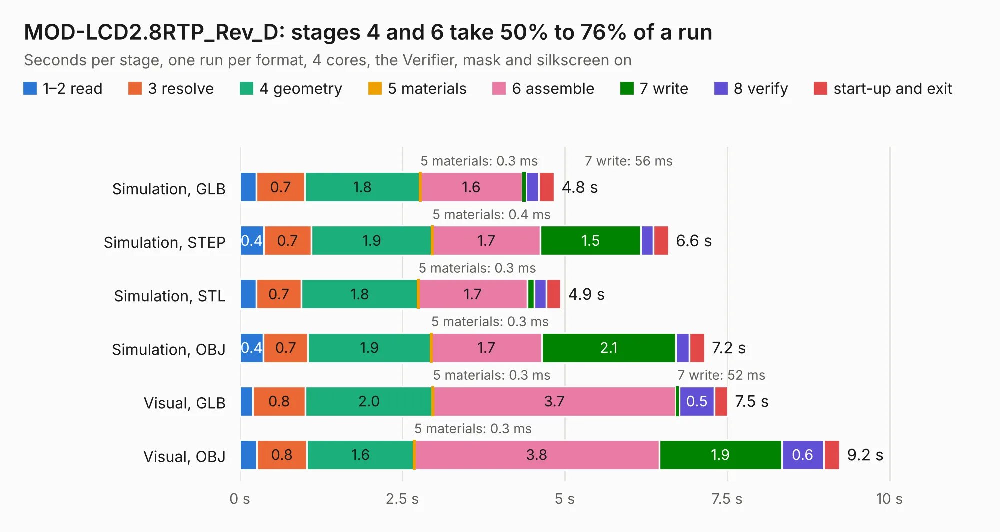

# 1923. MOD-LCD2.8RTP_Rev_D

Board 1,923 of the 3,124 of [Corpus Testing](../Corpus-Testing.md), on [Corpus Page 18](../CorpusTestingPages/Corpus-Testing-18.md#1923-mod-lcd28rtp_rev_d).

| Mode and format | 1–2 read | 3 resolve | 4 geometry | 5 materials | 6 assemble | 7 write | 8 verify | start-up and exit | Total |
|---|---:|---:|---:|---:|---:|---:|---:|---:|---:|
| Simulation, GLB | 0.3 | 0.7 | 1.8 | 0.3&nbsp;ms | 1.6 | 56&nbsp;ms | 0.2 | 0.2 | 4.8 |
| Simulation, STEP | 0.4 | 0.7 | 1.9 | 0.4&nbsp;ms | 1.7 | 1.5 | 0.2 | 0.2 | 6.6 |
| Simulation, STL | 0.3 | 0.7 | 1.8 | 0.3&nbsp;ms | 1.7 | 0.1 | 0.2 | 0.2 | 4.9 |
| Simulation, OBJ | 0.4 | 0.7 | 1.9 | 0.3&nbsp;ms | 1.7 | 2.1 | 0.2 | 0.2 | 7.2 |
| Visual, GLB | 0.2 | 0.8 | 2.0 | 0.3&nbsp;ms | 3.7 | 52&nbsp;ms | 0.5 | 0.2 | 7.5 |
| Visual, OBJ | 0.3 | 0.8 | 1.6 | 0.3&nbsp;ms | 3.8 | 1.9 | 0.6 | 0.2 | 9.2 |

<table align="center"><tr><td valign="top">

| Board | Repo: [OLIMEX/MOD-LCD2.8RTP](https://github.com/OLIMEX/MOD-LCD2.8RTP) Board: `MOD-LCD2.8RTP_Rev_D.kicad_pcb` |
|---|---|
| Folder | HARDWARE / SCHEMATICS / Hardware-revision-D |
| Complexity | 262&nbsp;/&nbsp;1000 (size&nbsp;162, features&nbsp;100) |
| KESE&nbsp;features | through vias, slotted holes, rounded, trapezoid or chamfered pads, filled zones, knockout text, stack-up, dielectric εr and tanδ |
| Tested | 9th November 2026 |
| Copper&nbsp;layers | 2 |
| File&nbsp;format | KiCad 7 (20221018) |
| Parts,&nbsp;tracks,&nbsp;vias | 26, 413, 121 |
| Triangles,&nbsp;simulation | 409,860 in 42 parts |
| Verifier | PASS in all six runs |

</td><td valign="top">

<table>
<tr><th>File type</th><th>File size</th><th>Peak memory used</th></tr>
<tr><th colspan="3" align="left">Simulation</th></tr>
<tr><td>GLB</td><td align="right">15&nbsp;MB</td><td align="right">305&nbsp;MB</td></tr>
<tr><td>STEP</td><td align="right">72&nbsp;MB</td><td align="right">353&nbsp;MB</td></tr>
<tr><td>STL</td><td align="right">20&nbsp;MB</td><td align="right">297&nbsp;MB</td></tr>
<tr><td>OBJ</td><td align="right">42&nbsp;MB</td><td align="right">346&nbsp;MB</td></tr>
<tr><th colspan="3" align="left">Visual</th></tr>
<tr><td>GLB</td><td align="right">12&nbsp;MB</td><td align="right">346&nbsp;MB</td></tr>
<tr><td>OBJ</td><td align="right">36&nbsp;MB</td><td align="right">345&nbsp;MB</td></tr>
</table>

</td></tr></table>

| Previous | Next |
|:---|---:|
| [1922. MOD-LCD2.8RTP_Rev_C](b1922b_MOD-LCD2-8RTP_MOD-LCD2-8RTP-Rev-C.md) | [1924. mod-mpu9150](b1924b_MOD-MPU9150_mod-mpu9150.md) |
