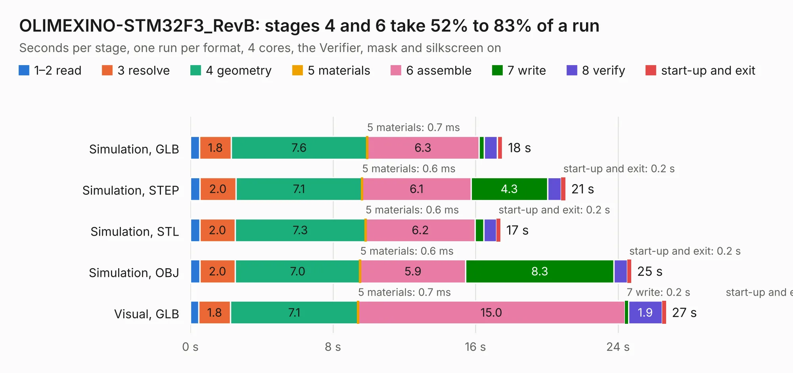

# 1923. OLIMEXINO-STM32F3_RevB

Board 1,923 of the 3,110 of [Corpus Testing](../Corpus-Testing.md), on [Corpus Page 18](../CorpusTestingPages/Corpus-Testing-18.md#1923-olimexino-stm32f3_revb).

| Mode and format | 1–2 read | 3 resolve | 4 geometry | 5 materials | 6 assemble | 7 write | 8 verify | start-up and exit | Total |
|---|---:|---:|---:|---:|---:|---:|---:|---:|---:|
| Simulation, GLB | 0.5 | 1.8 | 7.6 | 0.7&nbsp;ms | 6.3 | 0.3 | 0.7 | 0.3 | 17.5 |
| Simulation, STEP | 0.5 | 2.0 | 7.1 | 0.6&nbsp;ms | 6.1 | 4.3 | 0.8 | 0.2 | 21.1 |
| Simulation, STL | 0.5 | 2.0 | 7.3 | 0.6&nbsp;ms | 6.2 | 0.5 | 0.7 | 0.2 | 17.4 |
| Simulation, OBJ | 0.5 | 2.0 | 7.0 | 0.6&nbsp;ms | 5.9 | 8.3 | 0.7 | 0.2 | 24.8 |
| Visual, GLB | 0.5 | 1.8 | 7.1 | 0.7&nbsp;ms | 15.0 | 0.2 | 1.9 | 0.2 | 26.7 |
| Visual, OBJ | 0.6 | 1.8 | 7.3 | 0.8&nbsp;ms | 14.9 | 6.0 | 2.2 | 0.2 | 32.8 |

<table align="center"><tr><td valign="top">

| Board | Repo: [OLIMEX/OLIMEXINO-STM32F3](https://github.com/OLIMEX/OLIMEXINO-STM32F3) Board: `OLIMEXINO-STM32F3_RevB.kicad_pcb` |
|---|---|
| Folder | HARDWARE / OLIMEXINO-STM32F3-revision-B |
| Complexity | 288&nbsp;/&nbsp;1000 (size&nbsp;233, features&nbsp;55) |
| KESE&nbsp;features | through vias, slotted holes, filled zones, curved board outline |
| Tested | 9th November 2026 |
| Copper&nbsp;layers | 2 |
| File&nbsp;format | KiCad 5 (20171130) |
| Parts,&nbsp;tracks,&nbsp;vias | 101, 1,660, 169 |
| Triangles,&nbsp;simulation | 1,689,092 in 113 parts |
| Verifier | PASS in all six runs |

</td><td valign="top">

<table>
<tr><th>File type</th><th>File size</th><th>Peak memory used</th></tr>
<tr><th colspan="3" align="left">Simulation</th></tr>
<tr><td>GLB</td><td align="right">59&nbsp;MB</td><td align="right">749&nbsp;MB</td></tr>
<tr><td>STEP</td><td align="right">321&nbsp;MB</td><td align="right">793&nbsp;MB</td></tr>
<tr><td>STL</td><td align="right">84&nbsp;MB</td><td align="right">749&nbsp;MB</td></tr>
<tr><td>OBJ</td><td align="right">179&nbsp;MB</td><td align="right">1.1&nbsp;GB</td></tr>
<tr><th colspan="3" align="left">Visual</th></tr>
<tr><td>GLB</td><td align="right">46&nbsp;MB</td><td align="right">844&nbsp;MB</td></tr>
<tr><td>OBJ</td><td align="right">140&nbsp;MB</td><td align="right">1.1&nbsp;GB</td></tr>
</table>

</td></tr></table>

| Previous | Next |
|:---|---:|
| [1922. OLIMEXINO-2560_Rev_B](b1922b_OLIMEXINO-2560_OLIMEXINO-2560-Rev-B.md) | [1924. OLIMEXINO-STM32F3_RevC](b1924b_OLIMEXINO-STM32F3_OLIMEXINO-STM32F3-RevC.md) |
