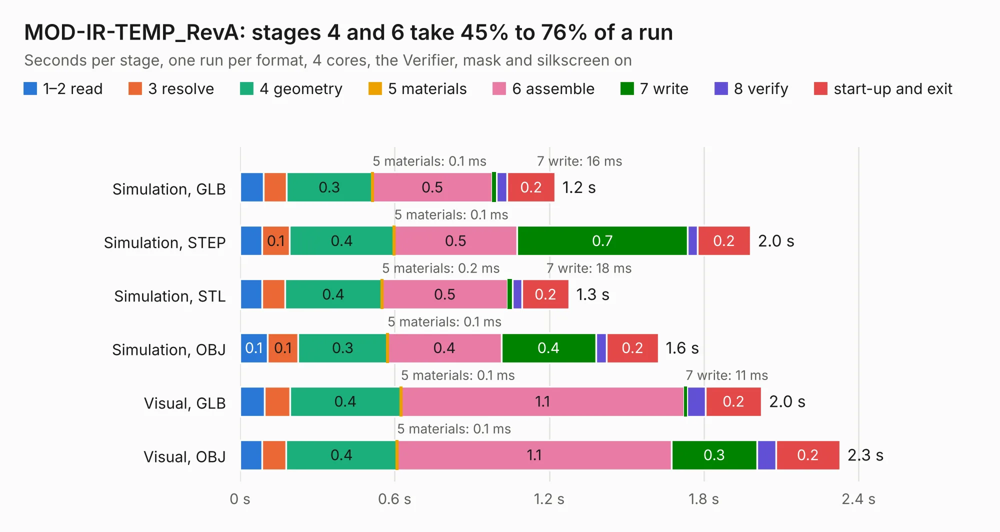

# 1924. MOD-IR-TEMP_RevA

Board 1,924 of the 3,131 of [Corpus Testing](../Corpus-Testing.md), on [Corpus Page 18](../CorpusTestingPages/Corpus-Testing-18.md#1924-mod-ir-temp_reva).

| Mode and format | 1–2 read | 3 resolve | 4 geometry | 5 materials | 6 assemble | 7 write | 8 verify | start-up and exit | Total |
|---|---:|---:|---:|---:|---:|---:|---:|---:|---:|
| Simulation, GLB | 91&nbsp;ms | 89&nbsp;ms | 0.3 | 0.1&nbsp;ms | 0.5 | 16&nbsp;ms | 42&nbsp;ms | 0.2 | 1.2 |
| Simulation, STEP | 85&nbsp;ms | 0.1 | 0.4 | 0.1&nbsp;ms | 0.5 | 0.7 | 38&nbsp;ms | 0.2 | 2.0 |
| Simulation, STL | 85&nbsp;ms | 89&nbsp;ms | 0.4 | 0.2&nbsp;ms | 0.5 | 18&nbsp;ms | 37&nbsp;ms | 0.2 | 1.3 |
| Simulation, OBJ | 0.1 | 0.1 | 0.3 | 0.1&nbsp;ms | 0.4 | 0.4 | 41&nbsp;ms | 0.2 | 1.6 |
| Visual, GLB | 95&nbsp;ms | 99&nbsp;ms | 0.4 | 0.1&nbsp;ms | 1.1 | 11&nbsp;ms | 71&nbsp;ms | 0.2 | 2.0 |
| Visual, OBJ | 85&nbsp;ms | 95&nbsp;ms | 0.4 | 0.1&nbsp;ms | 1.1 | 0.3 | 73&nbsp;ms | 0.2 | 2.3 |

<table align="center"><tr><td valign="top">

| Board | Repo: [OLIMEX/MOD-IR-TEMP](https://github.com/OLIMEX/MOD-IR-TEMP) Board: `MOD-IR-TEMP_RevA.kicad_pcb` |
|---|---|
| Folder | HARDWARE / REV.A |
| Complexity | 138&nbsp;/&nbsp;1000 (size&nbsp;103, features&nbsp;35) |
| KESE&nbsp;features | through vias, filled zones |
| Tested | 9th November 2026 |
| Copper&nbsp;layers | 2 |
| File&nbsp;format | KiCad 5 (20160815) |
| Parts,&nbsp;tracks,&nbsp;vias | 6, 42, 4 |
| Triangles,&nbsp;simulation | 65,598 in 22 parts |
| Verifier | PASS in all six runs |

</td><td valign="top">

<table>
<tr><th>File type</th><th>File size</th><th>Peak memory used</th></tr>
<tr><th colspan="3" align="left">Simulation</th></tr>
<tr><td>GLB</td><td align="right">2.4&nbsp;MB</td><td align="right">172&nbsp;MB</td></tr>
<tr><td>STEP</td><td align="right">11&nbsp;MB</td><td align="right">176&nbsp;MB</td></tr>
<tr><td>STL</td><td align="right">3.3&nbsp;MB</td><td align="right">171&nbsp;MB</td></tr>
<tr><td>OBJ</td><td align="right">6.6&nbsp;MB</td><td align="right">172&nbsp;MB</td></tr>
<tr><th colspan="3" align="left">Visual</th></tr>
<tr><td>GLB</td><td align="right">1.8&nbsp;MB</td><td align="right">153&nbsp;MB</td></tr>
<tr><td>OBJ</td><td align="right">5.0&nbsp;MB</td><td align="right">151&nbsp;MB</td></tr>
</table>

</td></tr></table>

| Previous | Next |
|:---|---:|
| [1923. MOD-ESP32-C5_Rev_A](b1923b_MOD-ESP32-C5_MOD-ESP32-C5-Rev-A.md) | [1925. MOD-LCD2.8RTP_RevB](b1925b_MOD-LCD2-8RTP_MOD-LCD2-8RTP-RevB.md) |
