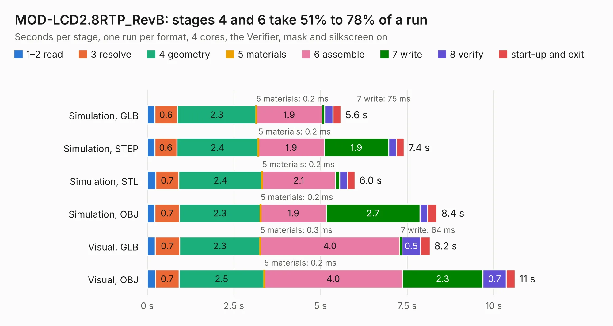

# 1925. MOD-LCD2.8RTP_RevB

Board 1,925 of the 3,131 of [Corpus Testing](../Corpus-Testing.md), on [Corpus Page 18](../CorpusTestingPages/Corpus-Testing-18.md#1925-mod-lcd28rtp_revb).

| Mode and format | 1–2 read | 3 resolve | 4 geometry | 5 materials | 6 assemble | 7 write | 8 verify | start-up and exit | Total |
|---|---:|---:|---:|---:|---:|---:|---:|---:|---:|
| Simulation, GLB | 0.2 | 0.6 | 2.3 | 0.2&nbsp;ms | 1.9 | 75&nbsp;ms | 0.2 | 0.2 | 5.6 |
| Simulation, STEP | 0.2 | 0.6 | 2.4 | 0.2&nbsp;ms | 1.9 | 1.9 | 0.2 | 0.2 | 7.4 |
| Simulation, STL | 0.2 | 0.7 | 2.4 | 0.2&nbsp;ms | 2.1 | 0.1 | 0.2 | 0.2 | 6.0 |
| Simulation, OBJ | 0.2 | 0.7 | 2.3 | 0.2&nbsp;ms | 1.9 | 2.7 | 0.2 | 0.3 | 8.4 |
| Visual, GLB | 0.2 | 0.7 | 2.3 | 0.3&nbsp;ms | 4.0 | 64&nbsp;ms | 0.5 | 0.3 | 8.2 |
| Visual, OBJ | 0.2 | 0.7 | 2.5 | 0.2&nbsp;ms | 4.0 | 2.3 | 0.7 | 0.3 | 10.6 |

<table align="center"><tr><td valign="top">

| Board | Repo: [OLIMEX/MOD-LCD2.8RTP](https://github.com/OLIMEX/MOD-LCD2.8RTP) Board: `MOD-LCD2.8RTP_RevB.kicad_pcb` |
|---|---|
| Folder | HARDWARE / SCHEMATICS / Hardware-revision-B |
| Complexity | 193&nbsp;/&nbsp;1000 (size&nbsp;158, features&nbsp;35) |
| KESE&nbsp;features | through vias, filled zones |
| Tested | 9th November 2026 |
| Copper&nbsp;layers | 2 |
| File&nbsp;format | KiCad 5 (20171130) |
| Parts,&nbsp;tracks,&nbsp;vias | 24, 490, 60 |
| Triangles,&nbsp;simulation | 384,728 in 45 parts |
| Verifier | PASS in all six runs |

</td><td valign="top">

<table>
<tr><th>File type</th><th>File size</th><th>Peak memory used</th></tr>
<tr><th colspan="3" align="left">Simulation</th></tr>
<tr><td>GLB</td><td align="right">14&nbsp;MB</td><td align="right">300&nbsp;MB</td></tr>
<tr><td>STEP</td><td align="right">72&nbsp;MB</td><td align="right">336&nbsp;MB</td></tr>
<tr><td>STL</td><td align="right">19&nbsp;MB</td><td align="right">290&nbsp;MB</td></tr>
<tr><td>OBJ</td><td align="right">40&nbsp;MB</td><td align="right">327&nbsp;MB</td></tr>
<tr><th colspan="3" align="left">Visual</th></tr>
<tr><td>GLB</td><td align="right">12&nbsp;MB</td><td align="right">341&nbsp;MB</td></tr>
<tr><td>OBJ</td><td align="right">36&nbsp;MB</td><td align="right">337&nbsp;MB</td></tr>
</table>

</td></tr></table>

| Previous | Next |
|:---|---:|
| [1924. MOD-IR-TEMP_RevA](b1924b_MOD-IR-TEMP_MOD-IR-TEMP-RevA.md) | [1926. MOD-LCD2.8RTP_Rev_C](b1926b_MOD-LCD2-8RTP_MOD-LCD2-8RTP-Rev-C.md) |
