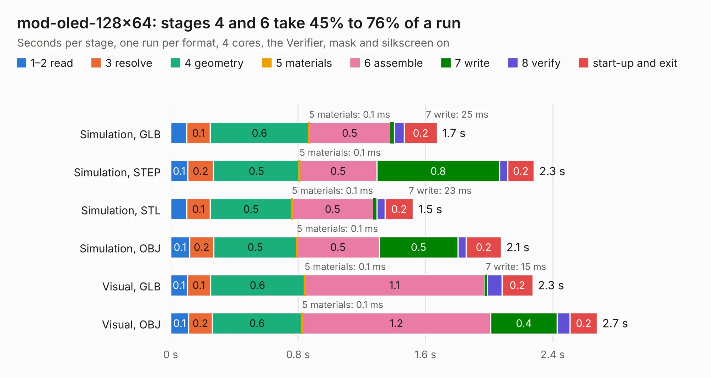

# 1926. mod-oled-128x64

Board 1,926 of the 3,127 of [Corpus Testing](../Corpus-Testing.md), on [Corpus Page 18](../CorpusTestingPages/Corpus-Testing-18.md#1926-mod-oled-128x64).

| Mode and format | 1–2 read | 3 resolve | 4 geometry | 5 materials | 6 assemble | 7 write | 8 verify | start-up and exit | Total |
|---|---:|---:|---:|---:|---:|---:|---:|---:|---:|
| Simulation, GLB | 0.1 | 0.1 | 0.6 | 0.1&nbsp;ms | 0.5 | 25&nbsp;ms | 61&nbsp;ms | 0.2 | 1.7 |
| Simulation, STEP | 0.1 | 0.2 | 0.5 | 0.1&nbsp;ms | 0.5 | 0.8 | 50&nbsp;ms | 0.2 | 2.3 |
| Simulation, STL | 0.1 | 0.1 | 0.5 | 0.1&nbsp;ms | 0.5 | 23&nbsp;ms | 49&nbsp;ms | 0.2 | 1.5 |
| Simulation, OBJ | 0.1 | 0.2 | 0.5 | 0.1&nbsp;ms | 0.5 | 0.5 | 51&nbsp;ms | 0.2 | 2.1 |
| Visual, GLB | 0.1 | 0.1 | 0.6 | 0.1&nbsp;ms | 1.1 | 15&nbsp;ms | 95&nbsp;ms | 0.2 | 2.3 |
| Visual, OBJ | 0.1 | 0.2 | 0.6 | 0.1&nbsp;ms | 1.2 | 0.4 | 81&nbsp;ms | 0.2 | 2.7 |

<table align="center"><tr><td valign="top">

| Board | Repo: [OLIMEX/MOD-OLED-128x64](https://github.com/OLIMEX/MOD-OLED-128x64) Board: `mod-oled-128x64.kicad_pcb` |
|---|---|
| Folder | HARDWARE / MOD-OLED-128x64_Rev.A |
| Complexity | 169&nbsp;/&nbsp;1000 (size&nbsp;134, features&nbsp;35) |
| KESE&nbsp;features | through vias, filled zones |
| Tested | 9th November 2026 |
| Copper&nbsp;layers | 2 |
| File&nbsp;format | KiCad 4 (4) |
| Parts,&nbsp;tracks,&nbsp;vias | 13, 191, 12 |
| Triangles,&nbsp;simulation | 97,926 in 30 parts |
| Verifier | PASS in all six runs |

</td><td valign="top">

<table>
<tr><th>File type</th><th>File size</th><th>Peak memory used</th></tr>
<tr><th colspan="3" align="left">Simulation</th></tr>
<tr><td>GLB</td><td align="right">3.6&nbsp;MB</td><td align="right">192&nbsp;MB</td></tr>
<tr><td>STEP</td><td align="right">18&nbsp;MB</td><td align="right">196&nbsp;MB</td></tr>
<tr><td>STL</td><td align="right">4.9&nbsp;MB</td><td align="right">190&nbsp;MB</td></tr>
<tr><td>OBJ</td><td align="right">10&nbsp;MB</td><td align="right">186&nbsp;MB</td></tr>
<tr><th colspan="3" align="left">Visual</th></tr>
<tr><td>GLB</td><td align="right">3.0&nbsp;MB</td><td align="right">161&nbsp;MB</td></tr>
<tr><td>OBJ</td><td align="right">8.2&nbsp;MB</td><td align="right">159&nbsp;MB</td></tr>
</table>

</td></tr></table>

| Previous | Next |
|:---|---:|
| [1925. mod-mpu9150](b1925b_MOD-MPU9150_mod-mpu9150.md) | [1927. MOD-RTC2_Rev_A](b1927b_MOD-RTC2_MOD-RTC2-Rev-A.md) |
