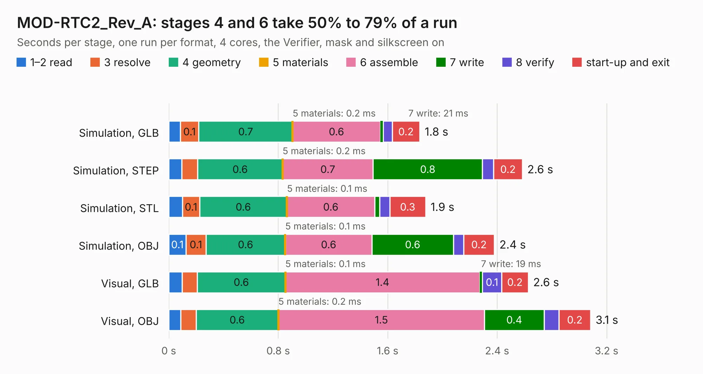

# 1927. MOD-RTC2_Rev_A

Board 1,927 of the 3,127 of [Corpus Testing](../Corpus-Testing.md), on [Corpus Page 18](../CorpusTestingPages/Corpus-Testing-18.md#1927-mod-rtc2_rev_a).

| Mode and format | 1–2 read | 3 resolve | 4 geometry | 5 materials | 6 assemble | 7 write | 8 verify | start-up and exit | Total |
|---|---:|---:|---:|---:|---:|---:|---:|---:|---:|
| Simulation, GLB | 84&nbsp;ms | 0.1 | 0.7 | 0.2&nbsp;ms | 0.6 | 21&nbsp;ms | 67&nbsp;ms | 0.2 | 1.8 |
| Simulation, STEP | 96&nbsp;ms | 0.1 | 0.6 | 0.2&nbsp;ms | 0.7 | 0.8 | 82&nbsp;ms | 0.2 | 2.6 |
| Simulation, STL | 0.1 | 0.1 | 0.6 | 0.1&nbsp;ms | 0.6 | 38&nbsp;ms | 73&nbsp;ms | 0.3 | 1.9 |
| Simulation, OBJ | 0.1 | 0.1 | 0.6 | 0.1&nbsp;ms | 0.6 | 0.6 | 75&nbsp;ms | 0.2 | 2.4 |
| Visual, GLB | 98&nbsp;ms | 0.1 | 0.6 | 0.1&nbsp;ms | 1.4 | 19&nbsp;ms | 0.1 | 0.2 | 2.6 |
| Visual, OBJ | 88&nbsp;ms | 0.1 | 0.6 | 0.2&nbsp;ms | 1.5 | 0.4 | 0.1 | 0.2 | 3.1 |

<table align="center"><tr><td valign="top">

| Board | Repo: [OLIMEX/MOD-RTC2](https://github.com/OLIMEX/MOD-RTC2) Board: `MOD-RTC2_Rev_A.kicad_pcb` |
|---|---|
| Folder | Hardware / MOD-RTC2-A |
| Complexity | 170&nbsp;/&nbsp;1000 (size&nbsp;125, features&nbsp;45) |
| KESE&nbsp;features | through vias, slotted holes, filled zones |
| Tested | 9th November 2026 |
| Copper&nbsp;layers | 2 |
| File&nbsp;format | KiCad 5 (20171114) |
| Parts,&nbsp;tracks,&nbsp;vias | 9, 123, 14 |
| Triangles,&nbsp;simulation | 126,452 in 26 parts |
| Verifier | PASS in all six runs |

</td><td valign="top">

<table>
<tr><th>File type</th><th>File size</th><th>Peak memory used</th></tr>
<tr><th colspan="3" align="left">Simulation</th></tr>
<tr><td>GLB</td><td align="right">4.6&nbsp;MB</td><td align="right">194&nbsp;MB</td></tr>
<tr><td>STEP</td><td align="right">23&nbsp;MB</td><td align="right">198&nbsp;MB</td></tr>
<tr><td>STL</td><td align="right">6.3&nbsp;MB</td><td align="right">185&nbsp;MB</td></tr>
<tr><td>OBJ</td><td align="right">13&nbsp;MB</td><td align="right">186&nbsp;MB</td></tr>
<tr><th colspan="3" align="left">Visual</th></tr>
<tr><td>GLB</td><td align="right">3.5&nbsp;MB</td><td align="right">159&nbsp;MB</td></tr>
<tr><td>OBJ</td><td align="right">9.7&nbsp;MB</td><td align="right">159&nbsp;MB</td></tr>
</table>

</td></tr></table>

| Previous | Next |
|:---|---:|
| [1926. mod-oled-128x64](b1926b_MOD-OLED-128x64_mod-oled-128x64.md) | [1928. NB-IoT-DevKit_Rev_B](b1928b_NB-IoT_NB-IoT-DevKit-Rev-B.md) |
