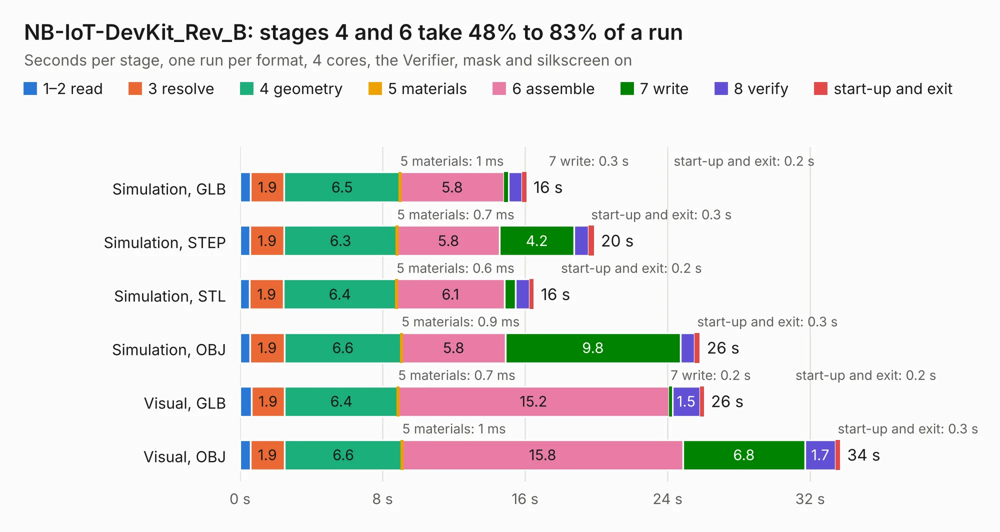

# 1928. NB-IoT-DevKit_Rev_B

Board 1,928 of the 3,126 of [Corpus Testing](../Corpus-Testing.md), on [Corpus Page 18](../CorpusTestingPages/Corpus-Testing-18.md#1928-nb-iot-devkit_rev_b).

| Mode and format | 1–2 read | 3 resolve | 4 geometry | 5 materials | 6 assemble | 7 write | 8 verify | start-up and exit | Total |
|---|---:|---:|---:|---:|---:|---:|---:|---:|---:|
| Simulation, GLB | 0.6 | 1.9 | 6.5 | 1&nbsp;ms | 5.8 | 0.3 | 0.8 | 0.2 | 16.1 |
| Simulation, STEP | 0.6 | 1.9 | 6.3 | 0.7&nbsp;ms | 5.8 | 4.2 | 0.8 | 0.3 | 19.9 |
| Simulation, STL | 0.5 | 1.9 | 6.4 | 0.6&nbsp;ms | 6.1 | 0.6 | 0.8 | 0.2 | 16.5 |
| Simulation, OBJ | 0.6 | 1.9 | 6.6 | 0.9&nbsp;ms | 5.8 | 9.8 | 0.8 | 0.3 | 25.8 |
| Visual, GLB | 0.6 | 1.9 | 6.4 | 0.7&nbsp;ms | 15.2 | 0.2 | 1.5 | 0.2 | 26.0 |
| Visual, OBJ | 0.6 | 1.9 | 6.6 | 1&nbsp;ms | 15.8 | 6.8 | 1.7 | 0.3 | 33.7 |

<table align="center"><tr><td valign="top">

| Board | Repo: [OLIMEX/NB-IoT](https://github.com/OLIMEX/NB-IoT) Board: `NB-IoT-DevKit_Rev_B.kicad_pcb` |
|---|---|
| Folder | HARDWARE / NB-IoT-DevKit_Rev_B |
| Complexity | 307&nbsp;/&nbsp;1000 (size&nbsp;217, features&nbsp;90) |
| KESE&nbsp;features | through vias, slotted holes, custom pads, rounded, trapezoid or chamfered pads, filled zones, copper drawings, copper text |
| Tested | 9th November 2026 |
| Copper&nbsp;layers | 4 |
| File&nbsp;format | KiCad 6 (20190905) |
| Parts,&nbsp;tracks,&nbsp;vias | 105, 2,707, 203 |
| Triangles,&nbsp;simulation | 1,641,942 in 137 parts |
| Verifier | PASS in all six runs |

</td><td valign="top">

<table>
<tr><th>File type</th><th>File size</th><th>Peak memory used</th></tr>
<tr><th colspan="3" align="left">Simulation</th></tr>
<tr><td>GLB</td><td align="right">58&nbsp;MB</td><td align="right">671&nbsp;MB</td></tr>
<tr><td>STEP</td><td align="right">263&nbsp;MB</td><td align="right">725&nbsp;MB</td></tr>
<tr><td>STL</td><td align="right">82&nbsp;MB</td><td align="right">640&nbsp;MB</td></tr>
<tr><td>OBJ</td><td align="right">174&nbsp;MB</td><td align="right">1.1&nbsp;GB</td></tr>
<tr><th colspan="3" align="left">Visual</th></tr>
<tr><td>GLB</td><td align="right">40&nbsp;MB</td><td align="right">780&nbsp;MB</td></tr>
<tr><td>OBJ</td><td align="right">120&nbsp;MB</td><td align="right">968&nbsp;MB</td></tr>
</table>

</td></tr></table>

| Previous | Next |
|:---|---:|
| [1927. MOD-RTC2_Rev_A](b1927b_MOD-RTC2_MOD-RTC2-Rev-A.md) | [1929. NB-IoT-DevKit_Rev_C](b1929b_NB-IoT_NB-IoT-DevKit-Rev-C.md) |
