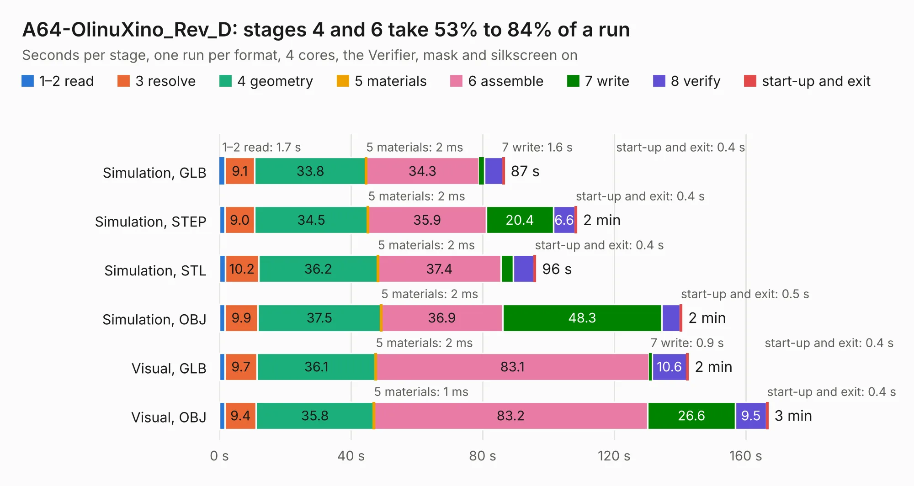

# 1928. A64-OlinuXino_Rev_D

Board 1,928 of the 3,105 of [Corpus Testing](../Corpus-Testing.md), on [Corpus Page 18](../CorpusTestingPages/Corpus-Testing-18.md#1928-a64-olinuxino_rev_d).

| Mode and format | 1–2 read | 3 resolve | 4 geometry | 5 materials | 6 assemble | 7 write | 8 verify | start-up and exit | Total |
|---|---:|---:|---:|---:|---:|---:|---:|---:|---:|
| Simulation, GLB | 1.7 | 9.1 | 33.8 | 2&nbsp;ms | 34.3 | 1.6 | 5.6 | 0.4 | 86.5 |
| Simulation, STEP | 1.7 | 9.0 | 34.5 | 2&nbsp;ms | 35.9 | 20.4 | 6.6 | 0.4 | 108.5 |
| Simulation, STL | 1.8 | 10.2 | 36.2 | 2&nbsp;ms | 37.4 | 3.8 | 6.3 | 0.4 | 96.1 |
| Simulation, OBJ | 1.7 | 9.9 | 37.5 | 2&nbsp;ms | 36.9 | 48.3 | 5.6 | 0.5 | 140.5 |
| Visual, GLB | 1.7 | 9.7 | 36.1 | 2&nbsp;ms | 83.1 | 0.9 | 10.6 | 0.4 | 142.5 |
| Visual, OBJ | 1.7 | 9.4 | 35.8 | 1&nbsp;ms | 83.2 | 26.6 | 9.5 | 0.4 | 166.7 |

<table align="center"><tr><td valign="top">

| Board | Repo: [OLIMEX/OLINUXINO](https://github.com/OLIMEX/OLINUXINO) Board: `A64-OlinuXino_Rev_D.kicad_pcb` |
|---|---|
| Folder | HARDWARE / A64-OLinuXino / 2. Older hardware revisions / A64-OLinuXino hardware revision D |
| Complexity | 393&nbsp;/&nbsp;1000 (size&nbsp;338, features&nbsp;55) |
| KESE&nbsp;features | through vias, slotted holes, filled zones, copper text |
| Tested | 9th November 2026 |
| Copper&nbsp;layers | 6 |
| File&nbsp;format | KiCad 5 (20170123) |
| Parts,&nbsp;tracks,&nbsp;vias | 407, 16,995, 1,161 |
| Triangles,&nbsp;simulation | 10,183,292 in 474 parts |
| Verifier | PASS in all six runs |

</td><td valign="top">

<table>
<tr><th>File type</th><th>File size</th><th>Peak memory used</th></tr>
<tr><th colspan="3" align="left">Simulation</th></tr>
<tr><td>GLB</td><td align="right">354&nbsp;MB</td><td align="right">2.1&nbsp;GB</td></tr>
<tr><td>STEP</td><td align="right">1.5&nbsp;GB</td><td align="right">3.2&nbsp;GB</td></tr>
<tr><td>STL</td><td align="right">509&nbsp;MB</td><td align="right">2.2&nbsp;GB</td></tr>
<tr><td>OBJ</td><td align="right">1.1&nbsp;GB</td><td align="right">6.4&nbsp;GB</td></tr>
<tr><th colspan="3" align="left">Visual</th></tr>
<tr><td>GLB</td><td align="right">199&nbsp;MB</td><td align="right">3.1&nbsp;GB</td></tr>
<tr><td>OBJ</td><td align="right">647&nbsp;MB</td><td align="right">4.1&nbsp;GB</td></tr>
</table>

</td></tr></table>

| Previous | Next |
|:---|---:|
| [1927. A64-OlinuXino_Rev_C](b1927b_OLINUXINO_A64-OlinuXino-Rev-C.md) | [1929. A64-OlinuXino_Rev_E](b1929b_OLINUXINO_A64-OlinuXino-Rev-E.md) |
