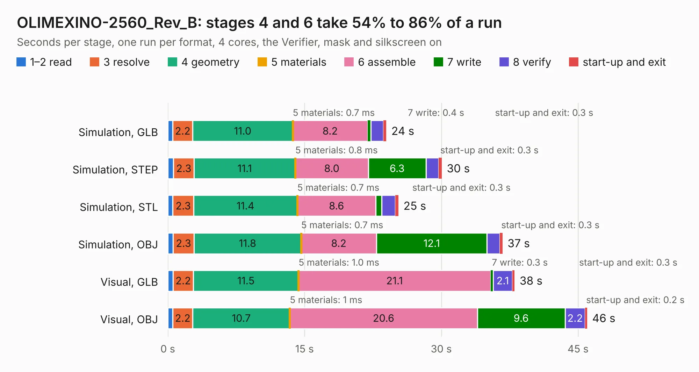

# 1929. OLIMEXINO-2560_Rev_B

Board 1,929 of the 3,117 of [Corpus Testing](../Corpus-Testing.md), on [Corpus Page 18](../CorpusTestingPages/Corpus-Testing-18.md#1929-olimexino-2560_rev_b).

| Mode and format | 1–2 read | 3 resolve | 4 geometry | 5 materials | 6 assemble | 7 write | 8 verify | start-up and exit | Total |
|---|---:|---:|---:|---:|---:|---:|---:|---:|---:|
| Simulation, GLB | 0.6 | 2.2 | 11.0 | 0.7&nbsp;ms | 8.2 | 0.4 | 1.4 | 0.3 | 24.0 |
| Simulation, STEP | 0.6 | 2.3 | 11.1 | 0.8&nbsp;ms | 8.0 | 6.3 | 1.4 | 0.3 | 30.1 |
| Simulation, STL | 0.6 | 2.3 | 11.4 | 0.7&nbsp;ms | 8.6 | 0.7 | 1.5 | 0.3 | 25.3 |
| Simulation, OBJ | 0.6 | 2.3 | 11.8 | 0.7&nbsp;ms | 8.2 | 12.1 | 1.4 | 0.3 | 36.7 |
| Visual, GLB | 0.6 | 2.2 | 11.5 | 1.0&nbsp;ms | 21.1 | 0.3 | 2.1 | 0.3 | 38.0 |
| Visual, OBJ | 0.5 | 2.2 | 10.7 | 1&nbsp;ms | 20.6 | 9.6 | 2.2 | 0.2 | 46.0 |

<table align="center"><tr><td valign="top">

| Board | Repo: [OLIMEX/OLIMEXINO-2560](https://github.com/OLIMEX/OLIMEXINO-2560) Board: `OLIMEXINO-2560_Rev_B.kicad_pcb` |
|---|---|
| Folder | HARDWARE |
| Complexity | 287&nbsp;/&nbsp;1000 (size&nbsp;232, features&nbsp;55) |
| KESE&nbsp;features | through vias, slotted holes, filled zones, curved board outline |
| Tested | 9th November 2026 |
| Copper&nbsp;layers | 2 |
| File&nbsp;format | KiCad 6 (20190516) |
| Parts,&nbsp;tracks,&nbsp;vias | 69, 2,307, 144 |
| Triangles,&nbsp;simulation | 2,075,872 in 146 parts |
| Verifier | PASS in all six runs |

</td><td valign="top">

<table>
<tr><th>File type</th><th>File size</th><th>Peak memory used</th></tr>
<tr><th colspan="3" align="left">Simulation</th></tr>
<tr><td>GLB</td><td align="right">73&nbsp;MB</td><td align="right">781&nbsp;MB</td></tr>
<tr><td>STEP</td><td align="right">410&nbsp;MB</td><td align="right">933&nbsp;MB</td></tr>
<tr><td>STL</td><td align="right">104&nbsp;MB</td><td align="right">765&nbsp;MB</td></tr>
<tr><td>OBJ</td><td align="right">222&nbsp;MB</td><td align="right">1.4&nbsp;GB</td></tr>
<tr><th colspan="3" align="left">Visual</th></tr>
<tr><td>GLB</td><td align="right">58&nbsp;MB</td><td align="right">1.0&nbsp;GB</td></tr>
<tr><td>OBJ</td><td align="right">178&nbsp;MB</td><td align="right">1.2&nbsp;GB</td></tr>
</table>

</td></tr></table>

| Previous | Next |
|:---|---:|
| [1928. Neo6502PC-PWR_Rev_B](b1928b_Neo6502pc_Neo6502PC-PWR-Rev-B.md) | [1930. OLIMEXINO-STM32F3_RevB](b1930b_OLIMEXINO-STM32F3_OLIMEXINO-STM32F3-RevB.md) |
