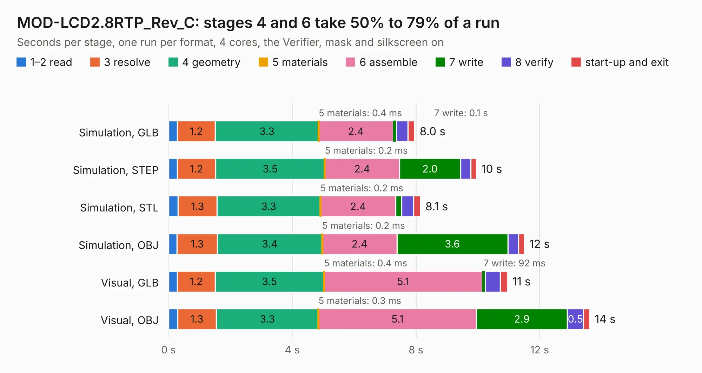

# 1931 MOD-LCD2.8RTP_Rev_C

Board 1,931 of the 3,138 of [Corpus Testing](../Corpus-Testing.md), on [Corpus Page 18](../CorpusTestingPages/Corpus-Testing-18.md#1931-mod-lcd28rtp_rev_c).

| Mode and format | 1–2 read | 3 resolve | 4 geometry | 5 materials | 6 assemble | 7 write | 8 verify | start-up and exit | Total |
|---|---:|---:|---:|---:|---:|---:|---:|---:|---:|
| Simulation, GLB | 0.3 | 1.2 | 3.3 | 0.4&nbsp;ms | 2.4 | 0.1 | 0.4 | 0.2 | 8.0 |
| Simulation, STEP | 0.3 | 1.2 | 3.5 | 0.2&nbsp;ms | 2.4 | 2.0 | 0.3 | 0.2 | 10.0 |
| Simulation, STL | 0.3 | 1.3 | 3.3 | 0.2&nbsp;ms | 2.4 | 0.2 | 0.4 | 0.2 | 8.1 |
| Simulation, OBJ | 0.3 | 1.3 | 3.4 | 0.2&nbsp;ms | 2.4 | 3.6 | 0.3 | 0.2 | 11.5 |
| Visual, GLB | 0.3 | 1.2 | 3.5 | 0.4&nbsp;ms | 5.1 | 92&nbsp;ms | 0.5 | 0.2 | 11.0 |
| Visual, OBJ | 0.3 | 1.3 | 3.3 | 0.3&nbsp;ms | 5.1 | 2.9 | 0.5 | 0.2 | 13.6 |

<table align="center"><tr><td valign="top">

| Board | Repo: [OLIMEX/MOD-LCD2.8RTP](https://github.com/OLIMEX/MOD-LCD2.8RTP) Board: `MOD-LCD2.8RTP_Rev_C.kicad_pcb` |
|---|---|
| Folder | HARDWARE / SCHEMATICS / Hardware-revision-C |
| Complexity | 229&nbsp;/&nbsp;1000 (size&nbsp;174, features&nbsp;55) |
| KESE&nbsp;features | through vias, rounded, trapezoid or chamfered pads, filled zones, copper text |
| Tested | 9th November 2026 |
| Copper&nbsp;layers | 2 |
| File&nbsp;format | KiCad 5 (20171130) |
| Parts,&nbsp;tracks,&nbsp;vias | 27, 821, 284 |
| Triangles,&nbsp;simulation | 677,624 in 45 parts |
| Verifier | PASS in all six runs |

</td><td valign="top">

<table>
<tr><th>File type</th><th>File size</th><th>Peak memory used</th></tr>
<tr><th colspan="3" align="left">Simulation</th></tr>
<tr><td>GLB</td><td align="right">24&nbsp;MB</td><td align="right">401&nbsp;MB</td></tr>
<tr><td>STEP</td><td align="right">98&nbsp;MB</td><td align="right">496&nbsp;MB</td></tr>
<tr><td>STL</td><td align="right">34&nbsp;MB</td><td align="right">412&nbsp;MB</td></tr>
<tr><td>OBJ</td><td align="right">70&nbsp;MB</td><td align="right">485&nbsp;MB</td></tr>
<tr><th colspan="3" align="left">Visual</th></tr>
<tr><td>GLB</td><td align="right">20&nbsp;MB</td><td align="right">493&nbsp;MB</td></tr>
<tr><td>OBJ</td><td align="right">60&nbsp;MB</td><td align="right">540&nbsp;MB</td></tr>
</table>

</td></tr></table>

| Previous | Next |
|:---|---:|
| [1930 MOD-LCD2.8RTP_RevB](b1930b_MOD-LCD2-8RTP_MOD-LCD2-8RTP-RevB.md) | [1932 MOD-LCD2.8RTP_Rev_D](b1932b_MOD-LCD2-8RTP_MOD-LCD2-8RTP-Rev-D.md) |
