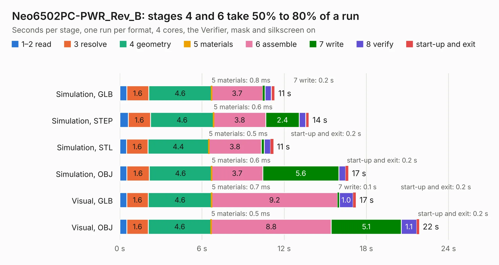

# 1931. Neo6502PC-PWR_Rev_B

Board 1,931 of the 3,120 of [Corpus Testing](../Corpus-Testing.md), on [Corpus Page 18](../CorpusTestingPages/Corpus-Testing-18.md#1931-neo6502pc-pwr_rev_b).

| Mode and format | 1–2 read | 3 resolve | 4 geometry | 5 materials | 6 assemble | 7 write | 8 verify | start-up and exit | Total |
|---|---:|---:|---:|---:|---:|---:|---:|---:|---:|
| Simulation, GLB | 0.5 | 1.6 | 4.6 | 0.8&nbsp;ms | 3.7 | 0.2 | 0.5 | 0.3 | 11.3 |
| Simulation, STEP | 0.6 | 1.6 | 4.6 | 0.6&nbsp;ms | 3.8 | 2.4 | 0.5 | 0.2 | 13.8 |
| Simulation, STL | 0.5 | 1.6 | 4.4 | 0.5&nbsp;ms | 3.8 | 0.2 | 0.5 | 0.2 | 11.2 |
| Simulation, OBJ | 0.5 | 1.6 | 4.6 | 0.6&nbsp;ms | 3.7 | 5.6 | 0.5 | 0.2 | 16.7 |
| Visual, GLB | 0.5 | 1.6 | 4.6 | 0.7&nbsp;ms | 9.2 | 0.1 | 1.0 | 0.2 | 17.2 |
| Visual, OBJ | 0.5 | 1.6 | 4.6 | 0.5&nbsp;ms | 8.8 | 5.1 | 1.1 | 0.2 | 21.9 |

<table align="center"><tr><td valign="top">

| Board | Repo: [OLIMEX/Neo6502pc](https://github.com/OLIMEX/Neo6502pc) Board: `Neo6502PC-PWR_Rev_B.kicad_pcb` |
|---|---|
| Folder | HARDWARE / Neo6502pc-PWR-rev.B |
| Complexity | 299&nbsp;/&nbsp;1000 (size&nbsp;194, features&nbsp;105) |
| KESE&nbsp;features | through vias, slotted holes, rounded, trapezoid or chamfered pads, filled zones, knockout text, stack-up, dielectric εr and tanδ, mask and silkscreen colours |
| Tested | 9th November 2026 |
| Copper&nbsp;layers | 2 |
| File&nbsp;format | KiCad 7 (20221018) |
| Parts,&nbsp;tracks,&nbsp;vias | 53, 2,056, 491 |
| Triangles,&nbsp;simulation | 1,079,874 in 72 parts |
| Verifier | PASS in all six runs |

</td><td valign="top">

<table>
<tr><th>File type</th><th>File size</th><th>Peak memory used</th></tr>
<tr><th colspan="3" align="left">Simulation</th></tr>
<tr><td>GLB</td><td align="right">38&nbsp;MB</td><td align="right">501&nbsp;MB</td></tr>
<tr><td>STEP</td><td align="right">155&nbsp;MB</td><td align="right">621&nbsp;MB</td></tr>
<tr><td>STL</td><td align="right">54&nbsp;MB</td><td align="right">514&nbsp;MB</td></tr>
<tr><td>OBJ</td><td align="right">112&nbsp;MB</td><td align="right">770&nbsp;MB</td></tr>
<tr><th colspan="3" align="left">Visual</th></tr>
<tr><td>GLB</td><td align="right">33&nbsp;MB</td><td align="right">685&nbsp;MB</td></tr>
<tr><td>OBJ</td><td align="right">100&nbsp;MB</td><td align="right">790&nbsp;MB</td></tr>
</table>

</td></tr></table>

| Previous | Next |
|:---|---:|
| [1930. Neo6502PC-CPU_Rev_B](b1930b_Neo6502pc_Neo6502PC-CPU-Rev-B.md) | [1932. OLIMEXINO-2560_Rev_B](b1932b_OLIMEXINO-2560_OLIMEXINO-2560-Rev-B.md) |
