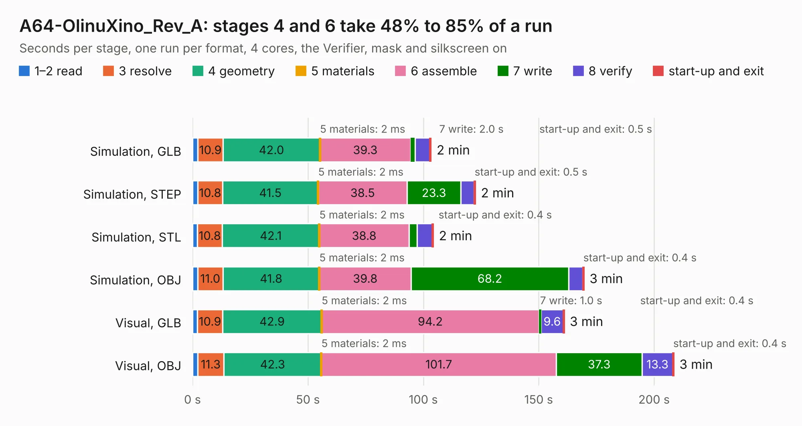

# 1931. A64-OlinuXino_Rev_A

Board 1,931 of the 3,111 of [Corpus Testing](../Corpus-Testing.md), on [Corpus Page 18](../CorpusTestingPages/Corpus-Testing-18.md#1931-a64-olinuxino_rev_a).

| Mode and format | 1–2 read | 3 resolve | 4 geometry | 5 materials | 6 assemble | 7 write | 8 verify | start-up and exit | Total |
|---|---:|---:|---:|---:|---:|---:|---:|---:|---:|
| Simulation, GLB | 2.3 | 10.9 | 42.0 | 2&nbsp;ms | 39.3 | 2.0 | 6.4 | 0.5 | 103.3 |
| Simulation, STEP | 2.2 | 10.8 | 41.5 | 2&nbsp;ms | 38.5 | 23.3 | 5.7 | 0.5 | 122.5 |
| Simulation, STL | 2.1 | 10.8 | 42.1 | 2&nbsp;ms | 38.8 | 3.6 | 6.5 | 0.4 | 104.3 |
| Simulation, OBJ | 2.2 | 11.0 | 41.8 | 2&nbsp;ms | 39.8 | 68.2 | 6.2 | 0.4 | 169.6 |
| Visual, GLB | 2.1 | 10.9 | 42.9 | 2&nbsp;ms | 94.2 | 1.0 | 9.6 | 0.4 | 161.0 |
| Visual, OBJ | 2.2 | 11.3 | 42.3 | 2&nbsp;ms | 101.7 | 37.3 | 13.3 | 0.4 | 208.5 |

<table align="center"><tr><td valign="top">

| Board | Repo: [OLIMEX/OLINUXINO](https://github.com/OLIMEX/OLINUXINO) Board: `A64-OlinuXino_Rev_A.kicad_pcb` |
|---|---|
| Folder | HARDWARE / A64-OLinuXino / 2. Older hardware revisions / A64-OLinuXino hardware revision A |
| Complexity | 379&nbsp;/&nbsp;1000 (size&nbsp;334, features&nbsp;45) |
| KESE&nbsp;features | through vias, filled zones, copper text |
| Tested | 9th November 2026 |
| Copper&nbsp;layers | 6 |
| File&nbsp;format | KiCad 4 (4) |
| Parts,&nbsp;tracks,&nbsp;vias | 385, 13,950, 1,040 |
| Triangles,&nbsp;simulation | 9,633,876 in 462 parts |
| Verifier | PASS in all six runs |

</td><td valign="top">

<table>
<tr><th>File type</th><th>File size</th><th>Peak memory used</th></tr>
<tr><th colspan="3" align="left">Simulation</th></tr>
<tr><td>GLB</td><td align="right">335&nbsp;MB</td><td align="right">2.2&nbsp;GB</td></tr>
<tr><td>STEP</td><td align="right">1.4&nbsp;GB</td><td align="right">2.9&nbsp;GB</td></tr>
<tr><td>STL</td><td align="right">482&nbsp;MB</td><td align="right">2.1&nbsp;GB</td></tr>
<tr><td>OBJ</td><td align="right">1.0&nbsp;GB</td><td align="right">6.1&nbsp;GB</td></tr>
<tr><th colspan="3" align="left">Visual</th></tr>
<tr><td>GLB</td><td align="right">191&nbsp;MB</td><td align="right">3.0&nbsp;GB</td></tr>
<tr><td>OBJ</td><td align="right">621&nbsp;MB</td><td align="right">4.1&nbsp;GB</td></tr>
</table>

</td></tr></table>

| Previous | Next |
|:---|---:|
| [1930. A64-OlinuXino_Rev_H](b1930b_OLINUXINO_A64-OlinuXino-Rev-H.md) | [1932. A64-OlinuXino_Rev_B](b1932b_OLINUXINO_A64-OlinuXino-Rev-B.md) |
