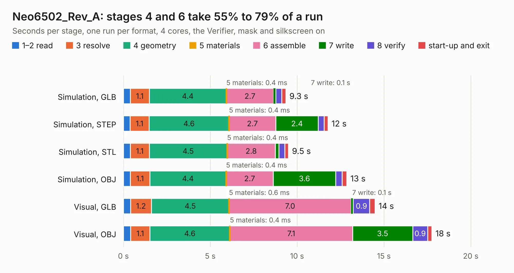

# 1933. Neo6502_Rev_A

Board 1,933 of the 3,128 of [Corpus Testing](../Corpus-Testing.md), on [Corpus Page 18](../CorpusTestingPages/Corpus-Testing-18.md#1933-neo6502_rev_a).

| Mode and format | 1–2 read | 3 resolve | 4 geometry | 5 materials | 6 assemble | 7 write | 8 verify | start-up and exit | Total |
|---|---:|---:|---:|---:|---:|---:|---:|---:|---:|
| Simulation, GLB | 0.4 | 1.1 | 4.4 | 0.4&nbsp;ms | 2.7 | 0.1 | 0.3 | 0.2 | 9.3 |
| Simulation, STEP | 0.4 | 1.1 | 4.6 | 0.4&nbsp;ms | 2.7 | 2.4 | 0.3 | 0.2 | 11.8 |
| Simulation, STL | 0.4 | 1.1 | 4.5 | 0.4&nbsp;ms | 2.8 | 0.2 | 0.3 | 0.2 | 9.5 |
| Simulation, OBJ | 0.4 | 1.1 | 4.4 | 0.4&nbsp;ms | 2.7 | 3.6 | 0.4 | 0.3 | 12.9 |
| Visual, GLB | 0.4 | 1.2 | 4.5 | 0.6&nbsp;ms | 7.0 | 0.1 | 0.9 | 0.3 | 14.5 |
| Visual, OBJ | 0.4 | 1.1 | 4.6 | 0.4&nbsp;ms | 7.1 | 3.5 | 0.9 | 0.2 | 17.8 |

<table align="center"><tr><td valign="top">

| Board | Repo: [OLIMEX/Neo6502](https://github.com/OLIMEX/Neo6502) Board: `Neo6502_Rev_A.kicad_pcb` |
|---|---|
| Folder | HARDWARE / New6502-Rev-A |
| Complexity | 266&nbsp;/&nbsp;1000 (size&nbsp;221, features&nbsp;45) |
| KESE&nbsp;features | through vias, slotted holes, rounded, trapezoid or chamfered pads, copper text |
| Tested | 9th November 2026 |
| Copper&nbsp;layers | 2 |
| File&nbsp;format | KiCad 5 (20171130) |
| Parts,&nbsp;tracks,&nbsp;vias | 89, 625, 45 |
| Triangles,&nbsp;simulation | 618,484 in 142 parts |
| Verifier | PASS in all six runs |

</td><td valign="top">

<table>
<tr><th>File type</th><th>File size</th><th>Peak memory used</th></tr>
<tr><th colspan="3" align="left">Simulation</th></tr>
<tr><td>GLB</td><td align="right">23&nbsp;MB</td><td align="right">380&nbsp;MB</td></tr>
<tr><td>STEP</td><td align="right">108&nbsp;MB</td><td align="right">452&nbsp;MB</td></tr>
<tr><td>STL</td><td align="right">31&nbsp;MB</td><td align="right">376&nbsp;MB</td></tr>
<tr><td>OBJ</td><td align="right">66&nbsp;MB</td><td align="right">489&nbsp;MB</td></tr>
<tr><th colspan="3" align="left">Visual</th></tr>
<tr><td>GLB</td><td align="right">19&nbsp;MB</td><td align="right">445&nbsp;MB</td></tr>
<tr><td>OBJ</td><td align="right">56&nbsp;MB</td><td align="right">492&nbsp;MB</td></tr>
</table>

</td></tr></table>

| Previous | Next |
|:---|---:|
| [1932. Neo6502_Rev_B1](b1932b_Neo6502_Neo6502-Rev-B1.md) | [1934. Neo6502kbd_Rev_A](b1934b_Neo6502kbd_Neo6502kbd-Rev-A.md) |
