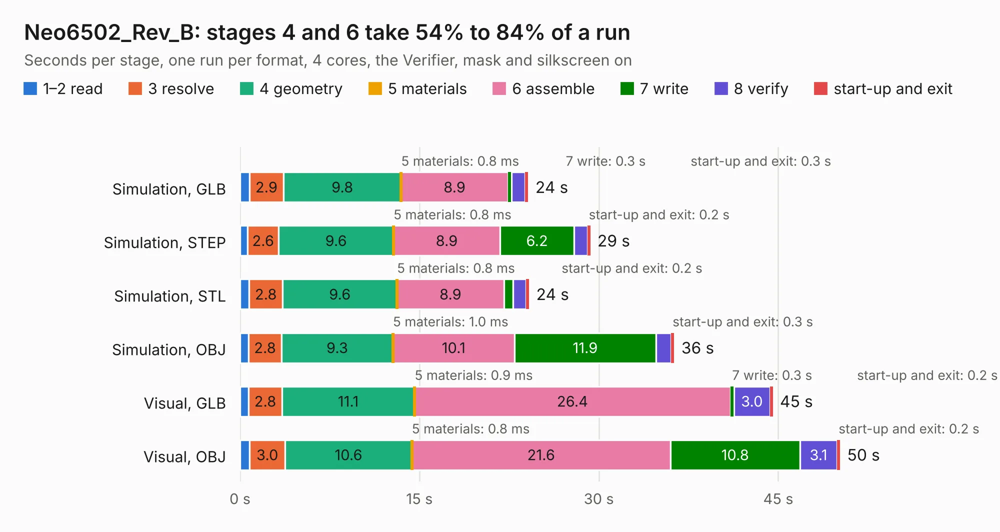

# 1934. Neo6502_Rev_B

Board 1,934 of the 3,131 of [Corpus Testing](../Corpus-Testing.md), on [Corpus Page 18](../CorpusTestingPages/Corpus-Testing-18.md#1934-neo6502_rev_b).

| Mode and format | 1–2 read | 3 resolve | 4 geometry | 5 materials | 6 assemble | 7 write | 8 verify | start-up and exit | Total |
|---|---:|---:|---:|---:|---:|---:|---:|---:|---:|
| Simulation, GLB | 0.8 | 2.9 | 9.8 | 0.8&nbsp;ms | 8.9 | 0.3 | 1.1 | 0.3 | 24.1 |
| Simulation, STEP | 0.6 | 2.6 | 9.6 | 0.8&nbsp;ms | 8.9 | 6.2 | 1.1 | 0.2 | 29.3 |
| Simulation, STL | 0.7 | 2.8 | 9.6 | 0.8&nbsp;ms | 8.9 | 0.8 | 1.1 | 0.2 | 24.2 |
| Simulation, OBJ | 0.7 | 2.8 | 9.3 | 1.0&nbsp;ms | 10.1 | 11.9 | 1.2 | 0.3 | 36.3 |
| Visual, GLB | 0.7 | 2.8 | 11.1 | 0.9&nbsp;ms | 26.4 | 0.3 | 3.0 | 0.2 | 44.5 |
| Visual, OBJ | 0.8 | 3.0 | 10.6 | 0.8&nbsp;ms | 21.6 | 10.8 | 3.1 | 0.2 | 50.2 |

<table align="center"><tr><td valign="top">

| Board | Repo: [OLIMEX/Neo6502](https://github.com/OLIMEX/Neo6502) Board: `Neo6502_Rev_B.kicad_pcb` |
|---|---|
| Folder | HARDWARE / Neo6502-rev-B |
| Complexity | 303&nbsp;/&nbsp;1000 (size&nbsp;248, features&nbsp;55) |
| KESE&nbsp;features | through vias, slotted holes, rounded, trapezoid or chamfered pads, filled zones |
| Tested | 9th November 2026 |
| Copper&nbsp;layers | 2 |
| File&nbsp;format | KiCad 5 (20171130) |
| Parts,&nbsp;tracks,&nbsp;vias | 89, 2,635, 438 |
| Triangles,&nbsp;simulation | 2,044,474 in 142 parts |
| Verifier | PASS in all six runs |

</td><td valign="top">

<table>
<tr><th>File type</th><th>File size</th><th>Peak memory used</th></tr>
<tr><th colspan="3" align="left">Simulation</th></tr>
<tr><td>GLB</td><td align="right">72&nbsp;MB</td><td align="right">902&nbsp;MB</td></tr>
<tr><td>STEP</td><td align="right">388&nbsp;MB</td><td align="right">1.1&nbsp;GB</td></tr>
<tr><td>STL</td><td align="right">102&nbsp;MB</td><td align="right">856&nbsp;MB</td></tr>
<tr><td>OBJ</td><td align="right">217&nbsp;MB</td><td align="right">1.4&nbsp;GB</td></tr>
<tr><th colspan="3" align="left">Visual</th></tr>
<tr><td>GLB</td><td align="right">64&nbsp;MB</td><td align="right">1.1&nbsp;GB</td></tr>
<tr><td>OBJ</td><td align="right">196&nbsp;MB</td><td align="right">1.3&nbsp;GB</td></tr>
</table>

</td></tr></table>

| Previous | Next |
|:---|---:|
| [1933. NB-IoT-DevKit_Rev_D](b1933b_NB-IoT_NB-IoT-DevKit-Rev-D.md) | [1935. Neo6502_Rev_B1](b1935b_Neo6502_Neo6502-Rev-B1.md) |
