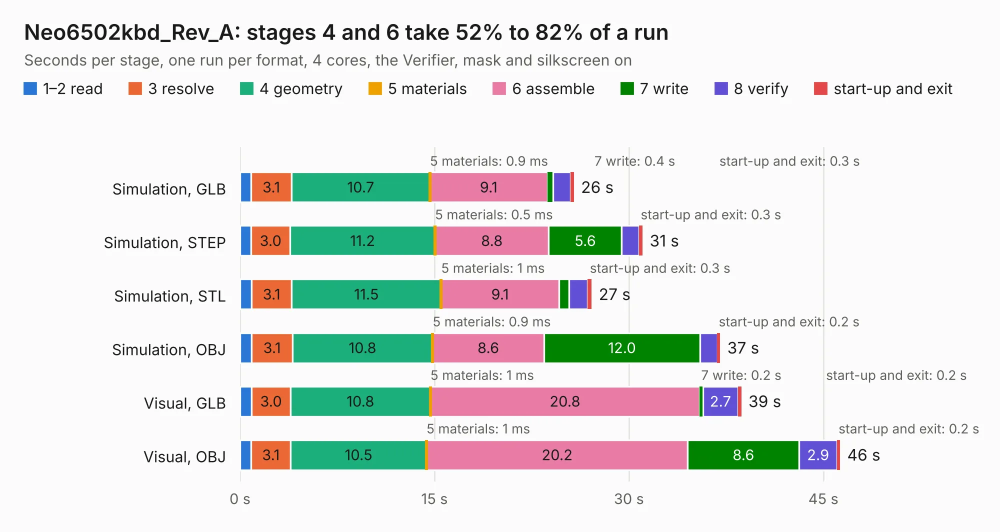

# 1934. Neo6502kbd_Rev_A

Board 1,934 of the 3,128 of [Corpus Testing](../Corpus-Testing.md), on [Corpus Page 18](../CorpusTestingPages/Corpus-Testing-18.md#1934-neo6502kbd_rev_a).

| Mode and format | 1–2 read | 3 resolve | 4 geometry | 5 materials | 6 assemble | 7 write | 8 verify | start-up and exit | Total |
|---|---:|---:|---:|---:|---:|---:|---:|---:|---:|
| Simulation, GLB | 0.9 | 3.1 | 10.7 | 0.9&nbsp;ms | 9.1 | 0.4 | 1.3 | 0.3 | 25.8 |
| Simulation, STEP | 0.9 | 3.0 | 11.2 | 0.5&nbsp;ms | 8.8 | 5.6 | 1.3 | 0.3 | 31.0 |
| Simulation, STL | 0.9 | 3.1 | 11.5 | 1&nbsp;ms | 9.1 | 0.8 | 1.4 | 0.3 | 27.1 |
| Simulation, OBJ | 0.9 | 3.1 | 10.8 | 0.9&nbsp;ms | 8.6 | 12.0 | 1.3 | 0.2 | 37.0 |
| Visual, GLB | 0.9 | 3.0 | 10.8 | 1&nbsp;ms | 20.8 | 0.2 | 2.7 | 0.2 | 38.7 |
| Visual, OBJ | 0.9 | 3.1 | 10.5 | 1&nbsp;ms | 20.2 | 8.6 | 2.9 | 0.2 | 46.3 |

<table align="center"><tr><td valign="top">

| Board | Repo: [OLIMEX/Neo6502kbd](https://github.com/OLIMEX/Neo6502kbd) Board: `Neo6502kbd_Rev_A.kicad_pcb` |
|---|---|
| Folder | HARDWARE / Neo6502kbd-Rev.A |
| Complexity | 377&nbsp;/&nbsp;1000 (size&nbsp;272, features&nbsp;105) |
| KESE&nbsp;features | through vias, slotted holes, filled zones, copper text, knockout text, stack-up, dielectric εr and tanδ, mask and silkscreen colours |
| Tested | 9th November 2026 |
| Copper&nbsp;layers | 4 |
| File&nbsp;format | KiCad 7 (20221018) |
| Parts,&nbsp;tracks,&nbsp;vias | 134, 3,008, 558 |
| Triangles,&nbsp;simulation | 2,878,202 in 179 parts |
| Verifier | PASS in all six runs |

</td><td valign="top">

<table>
<tr><th>File type</th><th>File size</th><th>Peak memory used</th></tr>
<tr><th colspan="3" align="left">Simulation</th></tr>
<tr><td>GLB</td><td align="right">101&nbsp;MB</td><td align="right">1.1&nbsp;GB</td></tr>
<tr><td>STEP</td><td align="right">404&nbsp;MB</td><td align="right">1.3&nbsp;GB</td></tr>
<tr><td>STL</td><td align="right">144&nbsp;MB</td><td align="right">1.1&nbsp;GB</td></tr>
<tr><td>OBJ</td><td align="right">310&nbsp;MB</td><td align="right">2.0&nbsp;GB</td></tr>
<tr><th colspan="3" align="left">Visual</th></tr>
<tr><td>GLB</td><td align="right">66&nbsp;MB</td><td align="right">1.2&nbsp;GB</td></tr>
<tr><td>OBJ</td><td align="right">207&nbsp;MB</td><td align="right">1.5&nbsp;GB</td></tr>
</table>

</td></tr></table>

| Previous | Next |
|:---|---:|
| [1933. Neo6502_Rev_A](b1933b_Neo6502_Neo6502-Rev-A.md) | [1935. Neo6502PC-CPU_Rev_B](b1935b_Neo6502pc_Neo6502PC-CPU-Rev-B.md) |
