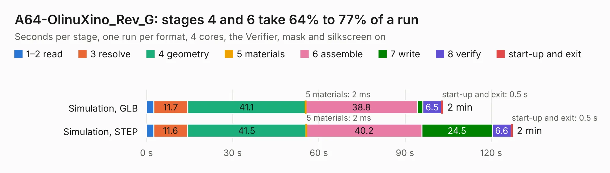

# 1934. A64-OlinuXino_Rev_G

Board 1,934 of the 3,109 of [Corpus Testing](../Corpus-Testing.md), on [Corpus Page 18](../CorpusTestingPages/Corpus-Testing-18.md#1934-a64-olinuxino_rev_g).

| Mode and format | 1–2 read | 3 resolve | 4 geometry | 5 materials | 6 assemble | 7 write | 8 verify | start-up and exit | Total |
|---|---:|---:|---:|---:|---:|---:|---:|---:|---:|
| Simulation, GLB | 2.6 | 11.7 | 41.1 | 2&nbsp;ms | 38.8 | 1.9 | 6.5 | 0.5 | 103.2 |
| Simulation, STEP | 2.6 | 11.6 | 41.5 | 2&nbsp;ms | 40.2 | 24.5 | 6.6 | 0.5 | 127.4 |
| Simulation, STL | 2.6 | 11.7 | 42.3 | 1&nbsp;ms | 39.9 | 4.3 | 6.6 | 0.5 | 107.9 |
| Simulation, OBJ | 2.5 | 12.2 | 43.7 | 1&nbsp;ms | 40.2 | 71.0 | 6.7 | 0.4 | 176.6 |
| Visual, GLB | 2.6 | 11.2 | 41.6 | 2&nbsp;ms | 94.3 | 1.0 | 9.2 | 0.4 | 160.3 |
| Visual, OBJ | 2.4 | 11.6 | 43.8 | 1&nbsp;ms | 96.5 | 34.7 | 8.8 | 0.4 | 198.2 |

<table align="center"><tr><td valign="top">

| Board | Repo: [OLIMEX/OLINUXINO](https://github.com/OLIMEX/OLINUXINO) Board: `A64-OlinuXino_Rev_G.kicad_pcb` |
|---|---|
| Folder | HARDWARE / A64-OLinuXino / 2. Older hardware revisions / A64-OLinuXino hardware revision G |
| Complexity | 393&nbsp;/&nbsp;1000 (size&nbsp;338, features&nbsp;55) |
| KESE&nbsp;features | through vias, slotted holes, filled zones, copper text |
| Tested | 9th November 2026 |
| Copper&nbsp;layers | 6 |
| File&nbsp;format | KiCad 5 (20171130) |
| Parts,&nbsp;tracks,&nbsp;vias | 417, 16,778, 1,140 |
| Triangles,&nbsp;simulation | 10,371,886 in 461 parts |
| Verifier | PASS in all six runs |

</td><td valign="top">

<table>
<tr><th>File type</th><th>File size</th><th>Peak memory used</th></tr>
<tr><th colspan="3" align="left">Simulation</th></tr>
<tr><td>GLB</td><td align="right">361&nbsp;MB</td><td align="right">2.3&nbsp;GB</td></tr>
<tr><td>STEP</td><td align="right">1.5&nbsp;GB</td><td align="right">3.1&nbsp;GB</td></tr>
<tr><td>STL</td><td align="right">519&nbsp;MB</td><td align="right">2.2&nbsp;GB</td></tr>
<tr><td>OBJ</td><td align="right">1.1&nbsp;GB</td><td align="right">6.6&nbsp;GB</td></tr>
<tr><th colspan="3" align="left">Visual</th></tr>
<tr><td>GLB</td><td align="right">199&nbsp;MB</td><td align="right">3.1&nbsp;GB</td></tr>
<tr><td>OBJ</td><td align="right">649&nbsp;MB</td><td align="right">4.2&nbsp;GB</td></tr>
</table>

</td></tr></table>

| Previous | Next |
|:---|---:|
| [1933. A64-OlinuXino_Rev_E](b1933b_OLINUXINO_A64-OlinuXino-Rev-E.md) | [1935. A64-OlinuXino_Rev_G1](b1935b_OLINUXINO_A64-OlinuXino-Rev-G1.md) |
