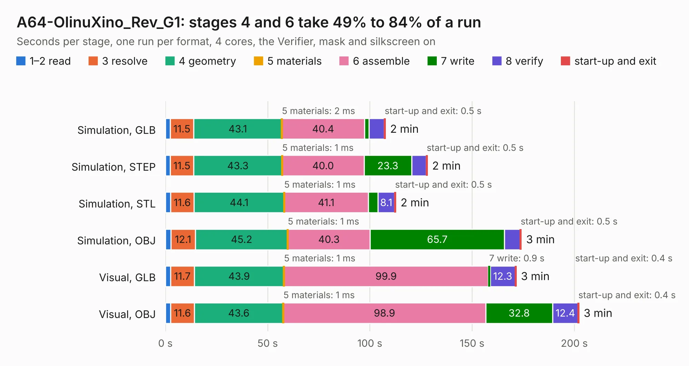

# 1937. A64-OlinuXino_Rev_G1

Board 1,937 of the 3,111 of [Corpus Testing](../Corpus-Testing.md), on [Corpus Page 18](../CorpusTestingPages/Corpus-Testing-18.md#1937-a64-olinuxino_rev_g1).

| Mode and format | 1–2 read | 3 resolve | 4 geometry | 5 materials | 6 assemble | 7 write | 8 verify | start-up and exit | Total |
|---|---:|---:|---:|---:|---:|---:|---:|---:|---:|
| Simulation, GLB | 2.3 | 11.5 | 43.1 | 2&nbsp;ms | 40.4 | 2.3 | 7.4 | 0.5 | 107.5 |
| Simulation, STEP | 2.3 | 11.5 | 43.3 | 1&nbsp;ms | 40.0 | 23.3 | 7.1 | 0.5 | 128.1 |
| Simulation, STL | 2.5 | 11.6 | 44.1 | 1&nbsp;ms | 41.1 | 4.8 | 8.1 | 0.5 | 112.6 |
| Simulation, OBJ | 2.6 | 12.1 | 45.2 | 1&nbsp;ms | 40.3 | 65.7 | 7.7 | 0.5 | 174.0 |
| Visual, GLB | 2.5 | 11.7 | 43.9 | 1&nbsp;ms | 99.9 | 0.9 | 12.3 | 0.4 | 171.5 |
| Visual, OBJ | 2.6 | 11.6 | 43.6 | 1&nbsp;ms | 98.9 | 32.8 | 12.4 | 0.4 | 202.2 |

<table align="center"><tr><td valign="top">

| Board | Repo: [OLIMEX/OLINUXINO](https://github.com/OLIMEX/OLINUXINO) Board: `A64-OlinuXino_Rev_G1.kicad_pcb` |
|---|---|
| Folder | HARDWARE / A64-OLinuXino / 2. Older hardware revisions / A64-OLinuXino hardware revision G1 |
| Complexity | 393&nbsp;/&nbsp;1000 (size&nbsp;338, features&nbsp;55) |
| KESE&nbsp;features | through vias, slotted holes, filled zones, copper text |
| Tested | 9th November 2026 |
| Copper&nbsp;layers | 6 |
| File&nbsp;format | KiCad 5 (20171130) |
| Parts,&nbsp;tracks,&nbsp;vias | 417, 16,778, 1,140 |
| Triangles,&nbsp;simulation | 10,385,472 in 461 parts |
| Verifier | PASS in all six runs |

</td><td valign="top">

<table>
<tr><th>File type</th><th>File size</th><th>Peak memory used</th></tr>
<tr><th colspan="3" align="left">Simulation</th></tr>
<tr><td>GLB</td><td align="right">362&nbsp;MB</td><td align="right">2.3&nbsp;GB</td></tr>
<tr><td>STEP</td><td align="right">1.5&nbsp;GB</td><td align="right">3.2&nbsp;GB</td></tr>
<tr><td>STL</td><td align="right">519&nbsp;MB</td><td align="right">2.4&nbsp;GB</td></tr>
<tr><td>OBJ</td><td align="right">1.1&nbsp;GB</td><td align="right">6.6&nbsp;GB</td></tr>
<tr><th colspan="3" align="left">Visual</th></tr>
<tr><td>GLB</td><td align="right">199&nbsp;MB</td><td align="right">3.2&nbsp;GB</td></tr>
<tr><td>OBJ</td><td align="right">650&nbsp;MB</td><td align="right">4.2&nbsp;GB</td></tr>
</table>

</td></tr></table>

| Previous | Next |
|:---|---:|
| [1936. A64-OlinuXino_Rev_G](b1936b_OLINUXINO_A64-OlinuXino-Rev-G.md) | [1938. LCD-DRIVER_Rev_B](b1938b_OLINUXINO_LCD-DRIVER-Rev-B.md) |
