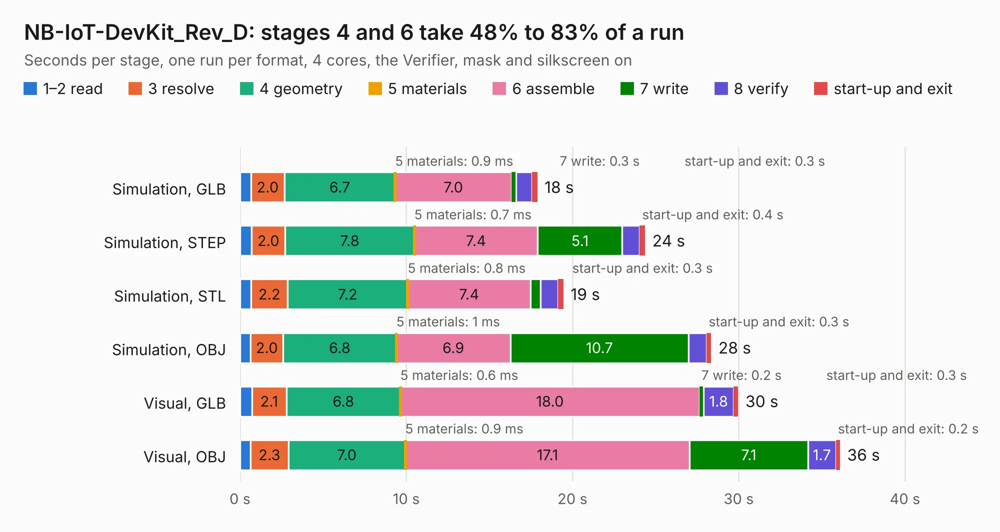

# 1938. NB-IoT-DevKit_Rev_D

Board 1,938 of the 3,138 of [Corpus Testing](../Corpus-Testing.md), on [Corpus Page 18](../CorpusTestingPages/Corpus-Testing-18.md#1938-nb-iot-devkit_rev_d).

| Mode and format | 1–2 read | 3 resolve | 4 geometry | 5 materials | 6 assemble | 7 write | 8 verify | start-up and exit | Total |
|---|---:|---:|---:|---:|---:|---:|---:|---:|---:|
| Simulation, GLB | 0.6 | 2.0 | 6.7 | 0.9&nbsp;ms | 7.0 | 0.3 | 0.9 | 0.3 | 17.9 |
| Simulation, STEP | 0.7 | 2.0 | 7.8 | 0.7&nbsp;ms | 7.4 | 5.1 | 1.0 | 0.4 | 24.4 |
| Simulation, STL | 0.7 | 2.2 | 7.2 | 0.8&nbsp;ms | 7.4 | 0.6 | 1.1 | 0.3 | 19.5 |
| Simulation, OBJ | 0.6 | 2.0 | 6.8 | 1&nbsp;ms | 6.9 | 10.7 | 1.1 | 0.3 | 28.3 |
| Visual, GLB | 0.7 | 2.1 | 6.8 | 0.6&nbsp;ms | 18.0 | 0.2 | 1.8 | 0.3 | 30.0 |
| Visual, OBJ | 0.6 | 2.3 | 7.0 | 0.9&nbsp;ms | 17.1 | 7.1 | 1.7 | 0.2 | 36.1 |

<table align="center"><tr><td valign="top">

| Board | Repo: [OLIMEX/NB-IoT](https://github.com/OLIMEX/NB-IoT) Board: `NB-IoT-DevKit_Rev_D.kicad_pcb` |
|---|---|
| Folder | HARDWARE / NB-IoT-DevKit_Rev_D |
| Complexity | 307&nbsp;/&nbsp;1000 (size&nbsp;217, features&nbsp;90) |
| KESE&nbsp;features | through vias, slotted holes, custom pads, rounded, trapezoid or chamfered pads, filled zones, copper drawings, copper text |
| Tested | 9th November 2026 |
| Copper&nbsp;layers | 4 |
| File&nbsp;format | KiCad 5 (20171130) |
| Parts,&nbsp;tracks,&nbsp;vias | 105, 2,813, 196 |
| Triangles,&nbsp;simulation | 1,716,800 in 137 parts |
| Verifier | PASS in all six runs |

</td><td valign="top">

<table>
<tr><th>File type</th><th>File size</th><th>Peak memory used</th></tr>
<tr><th colspan="3" align="left">Simulation</th></tr>
<tr><td>GLB</td><td align="right">60&nbsp;MB</td><td align="right">637&nbsp;MB</td></tr>
<tr><td>STEP</td><td align="right">275&nbsp;MB</td><td align="right">766&nbsp;MB</td></tr>
<tr><td>STL</td><td align="right">86&nbsp;MB</td><td align="right">673&nbsp;MB</td></tr>
<tr><td>OBJ</td><td align="right">182&nbsp;MB</td><td align="right">1.2&nbsp;GB</td></tr>
<tr><th colspan="3" align="left">Visual</th></tr>
<tr><td>GLB</td><td align="right">42&nbsp;MB</td><td align="right">820&nbsp;MB</td></tr>
<tr><td>OBJ</td><td align="right">126&nbsp;MB</td><td align="right">982&nbsp;MB</td></tr>
</table>

</td></tr></table>

| Previous | Next |
|:---|---:|
| [1937. NB-IoT-DevKit_Rev_C](b1937b_NB-IoT_NB-IoT-DevKit-Rev-C.md) | [1939. Neo6502_Rev_B](b1939b_Neo6502_Neo6502-Rev-B.md) |
