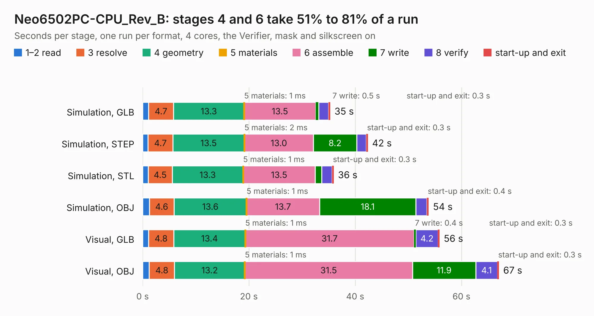

# 1938. Neo6502PC-CPU_Rev_B

Board 1,938 of the 3,131 of [Corpus Testing](../Corpus-Testing.md), on [Corpus Page 18](../CorpusTestingPages/Corpus-Testing-18.md#1938-neo6502pc-cpu_rev_b).

| Mode and format | 1–2 read | 3 resolve | 4 geometry | 5 materials | 6 assemble | 7 write | 8 verify | start-up and exit | Total |
|---|---:|---:|---:|---:|---:|---:|---:|---:|---:|
| Simulation, GLB | 1.1 | 4.7 | 13.3 | 1&nbsp;ms | 13.5 | 0.5 | 1.9 | 0.3 | 35.3 |
| Simulation, STEP | 1.0 | 4.7 | 13.5 | 2&nbsp;ms | 13.0 | 8.2 | 1.8 | 0.3 | 42.4 |
| Simulation, STL | 1.0 | 4.5 | 13.3 | 1&nbsp;ms | 13.5 | 1.2 | 2.0 | 0.3 | 36.0 |
| Simulation, OBJ | 1.3 | 4.6 | 13.6 | 1&nbsp;ms | 13.7 | 18.1 | 2.1 | 0.4 | 53.8 |
| Visual, GLB | 1.1 | 4.8 | 13.4 | 1&nbsp;ms | 31.7 | 0.4 | 4.2 | 0.3 | 55.9 |
| Visual, OBJ | 1.3 | 4.8 | 13.2 | 1&nbsp;ms | 31.5 | 11.9 | 4.1 | 0.3 | 67.1 |

<table align="center"><tr><td valign="top">

| Board | Repo: [OLIMEX/Neo6502pc](https://github.com/OLIMEX/Neo6502pc) Board: `Neo6502PC-CPU_Rev_B.kicad_pcb` |
|---|---|
| Folder | HARDWARE / Neo6502pc-CPU-rev.B |
| Complexity | 378&nbsp;/&nbsp;1000 (size&nbsp;273, features&nbsp;105) |
| KESE&nbsp;features | through vias, slotted holes, filled zones, copper text, knockout text, stack-up, dielectric εr and tanδ, mask and silkscreen colours |
| Tested | 9th November 2026 |
| Copper&nbsp;layers | 4 |
| File&nbsp;format | KiCad 7 (20221018) |
| Parts,&nbsp;tracks,&nbsp;vias | 100, 3,940, 752 |
| Triangles,&nbsp;simulation | 3,472,416 in 168 parts |
| Verifier | PASS in all six runs |

</td><td valign="top">

<table>
<tr><th>File type</th><th>File size</th><th>Peak memory used</th></tr>
<tr><th colspan="3" align="left">Simulation</th></tr>
<tr><td>GLB</td><td align="right">121&nbsp;MB</td><td align="right">1.3&nbsp;GB</td></tr>
<tr><td>STEP</td><td align="right">496&nbsp;MB</td><td align="right">1.5&nbsp;GB</td></tr>
<tr><td>STL</td><td align="right">174&nbsp;MB</td><td align="right">1.2&nbsp;GB</td></tr>
<tr><td>OBJ</td><td align="right">374&nbsp;MB</td><td align="right">2.3&nbsp;GB</td></tr>
<tr><th colspan="3" align="left">Visual</th></tr>
<tr><td>GLB</td><td align="right">81&nbsp;MB</td><td align="right">1.3&nbsp;GB</td></tr>
<tr><td>OBJ</td><td align="right">254&nbsp;MB</td><td align="right">1.8&nbsp;GB</td></tr>
</table>

</td></tr></table>

| Previous | Next |
|:---|---:|
| [1937. Neo6502kbd_Rev_A](b1937b_Neo6502kbd_Neo6502kbd-Rev-A.md) | [1939. Neo6502PC-PWR_Rev_B](b1939b_Neo6502pc_Neo6502PC-PWR-Rev-B.md) |
