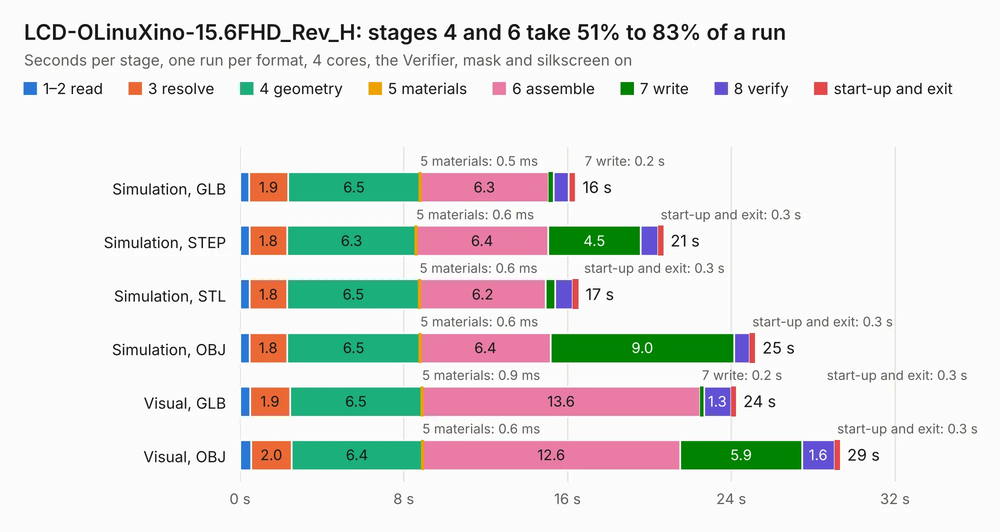

# 1938. LCD-OLinuXino-15.6FHD_Rev_H

Board 1,938 of the 3,108 of [Corpus Testing](../Corpus-Testing.md), on [Corpus Page 18](../CorpusTestingPages/Corpus-Testing-18.md#1938-lcd-olinuxino-156fhd_rev_h).

| Mode and format | 1–2 read | 3 resolve | 4 geometry | 5 materials | 6 assemble | 7 write | 8 verify | start-up and exit | Total |
|---|---:|---:|---:|---:|---:|---:|---:|---:|---:|
| Simulation, GLB | 0.4 | 1.9 | 6.5 | 0.5&nbsp;ms | 6.3 | 0.2 | 0.7 | 0.3 | 16.4 |
| Simulation, STEP | 0.5 | 1.8 | 6.3 | 0.6&nbsp;ms | 6.4 | 4.5 | 0.9 | 0.3 | 20.7 |
| Simulation, STL | 0.5 | 1.8 | 6.5 | 0.6&nbsp;ms | 6.2 | 0.4 | 0.9 | 0.3 | 16.5 |
| Simulation, OBJ | 0.5 | 1.8 | 6.5 | 0.6&nbsp;ms | 6.4 | 9.0 | 0.8 | 0.3 | 25.2 |
| Visual, GLB | 0.5 | 1.9 | 6.5 | 0.9&nbsp;ms | 13.6 | 0.2 | 1.3 | 0.3 | 24.2 |
| Visual, OBJ | 0.5 | 2.0 | 6.4 | 0.6&nbsp;ms | 12.6 | 5.9 | 1.6 | 0.3 | 29.3 |

<table align="center"><tr><td valign="top">

| Board | Repo: [OLIMEX/OLINUXINO](https://github.com/OLIMEX/OLINUXINO) Board: `LCD-OLinuXino-15.6FHD_Rev_H.kicad_pcb` |
|---|---|
| Folder | HARDWARE / LCDs / LCD-OLinuXino-15.6FHD / Hardware revision H |
| Complexity | 294&nbsp;/&nbsp;1000 (size&nbsp;249, features&nbsp;45) |
| KESE&nbsp;features | through vias, rounded, trapezoid or chamfered pads, filled zones |
| Tested | 9th November 2026 |
| Copper&nbsp;layers | 4 |
| File&nbsp;format | KiCad 5 (20171130) |
| Parts,&nbsp;tracks,&nbsp;vias | 59, 2,339, 238 |
| Triangles,&nbsp;simulation | 1,452,132 in 113 parts |
| Verifier | PASS in all six runs |

</td><td valign="top">

<table>
<tr><th>File type</th><th>File size</th><th>Peak memory used</th></tr>
<tr><th colspan="3" align="left">Simulation</th></tr>
<tr><td>GLB</td><td align="right">51&nbsp;MB</td><td align="right">570&nbsp;MB</td></tr>
<tr><td>STEP</td><td align="right">219&nbsp;MB</td><td align="right">708&nbsp;MB</td></tr>
<tr><td>STL</td><td align="right">73&nbsp;MB</td><td align="right">563&nbsp;MB</td></tr>
<tr><td>OBJ</td><td align="right">153&nbsp;MB</td><td align="right">983&nbsp;MB</td></tr>
<tr><th colspan="3" align="left">Visual</th></tr>
<tr><td>GLB</td><td align="right">36&nbsp;MB</td><td align="right">793&nbsp;MB</td></tr>
<tr><td>OBJ</td><td align="right">110&nbsp;MB</td><td align="right">805&nbsp;MB</td></tr>
</table>

</td></tr></table>

| Previous | Next |
|:---|---:|
| [1937. LCD-DRIVER_Rev_D](b1937b_OLINUXINO_LCD-DRIVER-Rev-D.md) | [1939. LCD-OLinuXino-5TS](b1939b_OLINUXINO_LCD-OLinuXino-5TS.md) |
