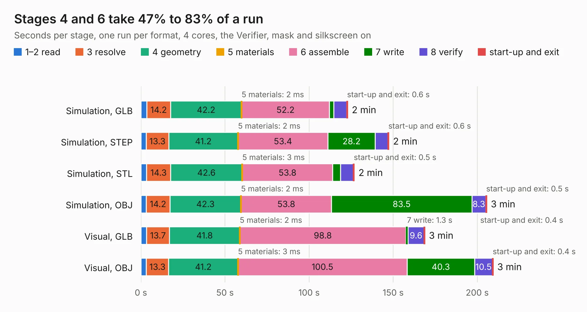

# 1938. STMP157-OLinuXino-LIME2_Rev_B1

Board 1,938 of the 3,104 of [Corpus Testing](../Corpus-Testing.md), on [Corpus Page 18](../CorpusTestingPages/Corpus-Testing-18.md#1938-stmp157-olinuxino-lime2_rev_b1).

| Mode and format | 1–2 read | 3 resolve | 4 geometry | 5 materials | 6 assemble | 7 write | 8 verify | start-up and exit | Total |
|---|---:|---:|---:|---:|---:|---:|---:|---:|---:|
| Simulation, GLB | 3.5 | 14.2 | 42.2 | 2&nbsp;ms | 52.2 | 2.5 | 7.7 | 0.6 | 122.9 |
| Simulation, STEP | 3.2 | 13.3 | 41.2 | 2&nbsp;ms | 53.4 | 28.2 | 7.5 | 0.6 | 147.5 |
| Simulation, STL | 3.4 | 14.3 | 42.6 | 3&nbsp;ms | 53.8 | 4.7 | 7.6 | 0.5 | 126.9 |
| Simulation, OBJ | 3.1 | 14.2 | 42.3 | 2&nbsp;ms | 53.8 | 83.5 | 8.3 | 0.5 | 205.6 |
| Visual, GLB | 3.3 | 13.7 | 41.8 | 2&nbsp;ms | 98.8 | 1.3 | 9.6 | 0.4 | 168.8 |
| Visual, OBJ | 3.2 | 13.3 | 41.2 | 3&nbsp;ms | 100.5 | 40.3 | 10.5 | 0.4 | 209.4 |

<table align="center"><tr><td valign="top">

| Board | Repo: [OLIMEX/OLINUXINO](https://github.com/OLIMEX/OLINUXINO) Board: `STMP157-OLinuXino-LIME2_Rev_B1.kicad_pcb` |
|---|---|
| Folder | HARDWARE / STMP157-OLinuXino-LIME2 / 1. Latest hardware revision / STMP157-OLinuXino-LIME2_Rev_B1 |
| Complexity | 394&nbsp;/&nbsp;1000 (size&nbsp;339, features&nbsp;55) |
| KESE&nbsp;features | through vias, slotted holes, filled zones, copper text |
| Tested | 9th November 2026 |
| Copper&nbsp;layers | 8 |
| File&nbsp;format | KiCad 5 (20171130) |
| Parts,&nbsp;tracks,&nbsp;vias | 397, 12,688, 1,172 |
| Triangles,&nbsp;simulation | 13,053,034 in 494 parts |
| Verifier | PASS in all six runs |

</td><td valign="top">

<table>
<tr><th>File type</th><th>File size</th><th>Peak memory used</th></tr>
<tr><th colspan="3" align="left">Simulation</th></tr>
<tr><td>GLB</td><td align="right">452&nbsp;MB</td><td align="right">2.5&nbsp;GB</td></tr>
<tr><td>STEP</td><td align="right">1.6&nbsp;GB</td><td align="right">3.9&nbsp;GB</td></tr>
<tr><td>STL</td><td align="right">653&nbsp;MB</td><td align="right">2.7&nbsp;GB</td></tr>
<tr><td>OBJ</td><td align="right">1.5&nbsp;GB</td><td align="right">8.3&nbsp;GB</td></tr>
<tr><th colspan="3" align="left">Visual</th></tr>
<tr><td>GLB</td><td align="right">223&nbsp;MB</td><td align="right">3.5&nbsp;GB</td></tr>
<tr><td>OBJ</td><td align="right">740&nbsp;MB</td><td align="right">4.7&nbsp;GB</td></tr>
</table>

</td></tr></table>

| Previous | Next |
|:---|---:|
| [1937. Lime2-SATA_RevA](b1937b_OLINUXINO_Lime2-SATA-RevA.md) | [1939. OSHW-GHOST_Rev_A](b1939b_OSHW-GHOST_OSHW-GHOST-Rev-A.md) |
