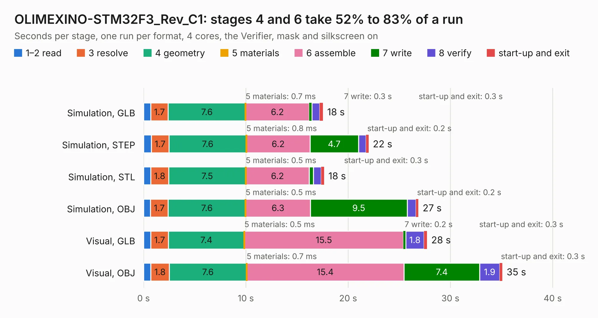

# 1939. OLIMEXINO-STM32F3_Rev_C1

Board 1,939 of the 3,124 of [Corpus Testing](../Corpus-Testing.md), on [Corpus Page 18](../CorpusTestingPages/Corpus-Testing-18.md#1939-olimexino-stm32f3_rev_c1).

| Mode and format | 1–2 read | 3 resolve | 4 geometry | 5 materials | 6 assemble | 7 write | 8 verify | start-up and exit | Total |
|---|---:|---:|---:|---:|---:|---:|---:|---:|---:|
| Simulation, GLB | 0.7 | 1.7 | 7.6 | 0.7&nbsp;ms | 6.2 | 0.3 | 0.8 | 0.3 | 17.5 |
| Simulation, STEP | 0.8 | 1.7 | 7.6 | 0.8&nbsp;ms | 6.2 | 4.7 | 0.8 | 0.2 | 22.0 |
| Simulation, STL | 0.7 | 1.8 | 7.5 | 0.5&nbsp;ms | 6.2 | 0.4 | 0.7 | 0.3 | 17.7 |
| Simulation, OBJ | 0.7 | 1.7 | 7.6 | 0.5&nbsp;ms | 6.3 | 9.5 | 0.8 | 0.2 | 26.9 |
| Visual, GLB | 0.7 | 1.7 | 7.4 | 0.5&nbsp;ms | 15.5 | 0.2 | 1.8 | 0.3 | 27.7 |
| Visual, OBJ | 0.7 | 1.8 | 7.6 | 0.7&nbsp;ms | 15.4 | 7.4 | 1.9 | 0.3 | 35.1 |

<table align="center"><tr><td valign="top">

| Board | Repo: [OLIMEX/OLIMEXINO-STM32F3](https://github.com/OLIMEX/OLIMEXINO-STM32F3) Board: `OLIMEXINO-STM32F3_Rev_C1.kicad_pcb` |
|---|---|
| Folder | HARDWARE / OLIMEXINO-STM32F3-revision-C1 |
| Complexity | 318&nbsp;/&nbsp;1000 (size&nbsp;233, features&nbsp;85) |
| KESE&nbsp;features | through vias, slotted holes, filled zones, curved board outline, stack-up, dielectric εr and tanδ |
| Tested | 9th November 2026 |
| Copper&nbsp;layers | 2 |
| File&nbsp;format | KiCad 6 (20211014) |
| Parts,&nbsp;tracks,&nbsp;vias | 102, 1,665, 170 |
| Triangles,&nbsp;simulation | 1,594,344 in 113 parts |
| Verifier | PASS in all six runs |

</td><td valign="top">

<table>
<tr><th>File type</th><th>File size</th><th>Peak memory used</th></tr>
<tr><th colspan="3" align="left">Simulation</th></tr>
<tr><td>GLB</td><td align="right">56&nbsp;MB</td><td align="right">754&nbsp;MB</td></tr>
<tr><td>STEP</td><td align="right">299&nbsp;MB</td><td align="right">780&nbsp;MB</td></tr>
<tr><td>STL</td><td align="right">80&nbsp;MB</td><td align="right">759&nbsp;MB</td></tr>
<tr><td>OBJ</td><td align="right">169&nbsp;MB</td><td align="right">1.1&nbsp;GB</td></tr>
<tr><th colspan="3" align="left">Visual</th></tr>
<tr><td>GLB</td><td align="right">45&nbsp;MB</td><td align="right">800&nbsp;MB</td></tr>
<tr><td>OBJ</td><td align="right">136&nbsp;MB</td><td align="right">975&nbsp;MB</td></tr>
</table>

</td></tr></table>

| Previous | Next |
|:---|---:|
| [1938. OLIMEXINO-STM32F3_RevC](b1938b_OLIMEXINO-STM32F3_OLIMEXINO-STM32F3-RevC.md) | [1940. OLIMEXINO-STM32F3_Rev_D](b1940b_OLIMEXINO-STM32F3_OLIMEXINO-STM32F3-Rev-D.md) |
