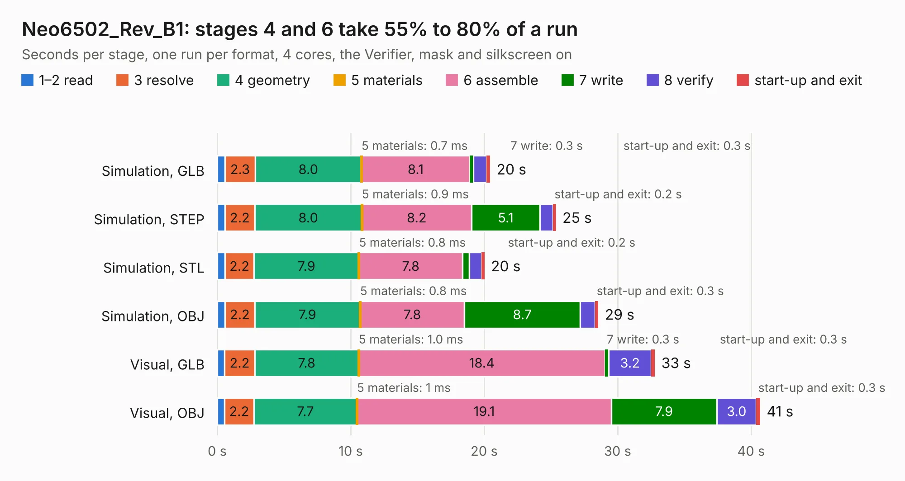

# 1940. Neo6502_Rev_B1

Board 1,940 of the 3,139 of [Corpus Testing](../Corpus-Testing.md), on [Corpus Page 18](../CorpusTestingPages/Corpus-Testing-18.md#1940-neo6502_rev_b1).

| Mode and format | 1–2 read | 3 resolve | 4 geometry | 5 materials | 6 assemble | 7 write | 8 verify | start-up and exit | Total |
|---|---:|---:|---:|---:|---:|---:|---:|---:|---:|
| Simulation, GLB | 0.6 | 2.3 | 8.0 | 0.7&nbsp;ms | 8.1 | 0.3 | 1.0 | 0.3 | 20.4 |
| Simulation, STEP | 0.6 | 2.2 | 8.0 | 0.9&nbsp;ms | 8.2 | 5.1 | 1.0 | 0.2 | 25.4 |
| Simulation, STL | 0.6 | 2.2 | 7.9 | 0.8&nbsp;ms | 7.8 | 0.5 | 0.9 | 0.2 | 20.0 |
| Simulation, OBJ | 0.6 | 2.2 | 7.9 | 0.8&nbsp;ms | 7.8 | 8.7 | 1.1 | 0.3 | 28.6 |
| Visual, GLB | 0.6 | 2.2 | 7.8 | 1.0&nbsp;ms | 18.4 | 0.3 | 3.2 | 0.3 | 32.8 |
| Visual, OBJ | 0.5 | 2.2 | 7.7 | 1&nbsp;ms | 19.1 | 7.9 | 3.0 | 0.3 | 40.7 |

<table align="center"><tr><td valign="top">

| Board | Repo: [OLIMEX/Neo6502](https://github.com/OLIMEX/Neo6502) Board: `Neo6502_Rev_B1.kicad_pcb` |
|---|---|
| Folder | HARDWARE / Neo6502-rev-B1 |
| Complexity | 303&nbsp;/&nbsp;1000 (size&nbsp;248, features&nbsp;55) |
| KESE&nbsp;features | through vias, slotted holes, rounded, trapezoid or chamfered pads, filled zones |
| Tested | 9th November 2026 |
| Copper&nbsp;layers | 2 |
| File&nbsp;format | KiCad 5 (20171130) |
| Parts,&nbsp;tracks,&nbsp;vias | 89, 2,635, 438 |
| Triangles,&nbsp;simulation | 2,044,474 in 142 parts |
| Verifier | PASS in all six runs |

</td><td valign="top">

<table>
<tr><th>File type</th><th>File size</th><th>Peak memory used</th></tr>
<tr><th colspan="3" align="left">Simulation</th></tr>
<tr><td>GLB</td><td align="right">72&nbsp;MB</td><td align="right">929&nbsp;MB</td></tr>
<tr><td>STEP</td><td align="right">388&nbsp;MB</td><td align="right">1.1&nbsp;GB</td></tr>
<tr><td>STL</td><td align="right">102&nbsp;MB</td><td align="right">896&nbsp;MB</td></tr>
<tr><td>OBJ</td><td align="right">217&nbsp;MB</td><td align="right">1.4&nbsp;GB</td></tr>
<tr><th colspan="3" align="left">Visual</th></tr>
<tr><td>GLB</td><td align="right">64&nbsp;MB</td><td align="right">1.1&nbsp;GB</td></tr>
<tr><td>OBJ</td><td align="right">196&nbsp;MB</td><td align="right">1.4&nbsp;GB</td></tr>
</table>

</td></tr></table>

| Previous | Next |
|:---|---:|
| [1939. Neo6502_Rev_B](b1939b_Neo6502_Neo6502-Rev-B.md) | [1941. Neo6502_Rev_A](b1941b_Neo6502_Neo6502-Rev-A.md) |
