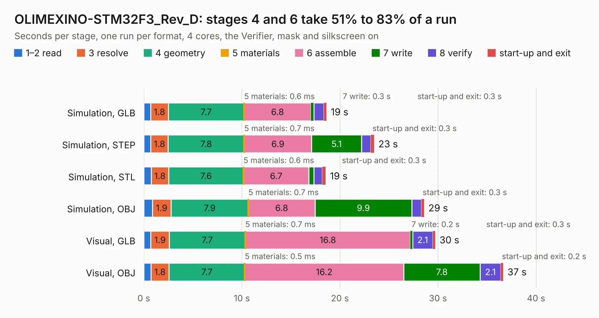

# 1941. OLIMEXINO-STM32F3_Rev_D

Board 1,941 of the 3,128 of [Corpus Testing](../Corpus-Testing.md), on [Corpus Page 18](../CorpusTestingPages/Corpus-Testing-18.md#1941-olimexino-stm32f3_rev_d).

| Mode and format | 1–2 read | 3 resolve | 4 geometry | 5 materials | 6 assemble | 7 write | 8 verify | start-up and exit | Total |
|---|---:|---:|---:|---:|---:|---:|---:|---:|---:|
| Simulation, GLB | 0.7 | 1.8 | 7.7 | 0.6&nbsp;ms | 6.8 | 0.3 | 1.0 | 0.3 | 18.6 |
| Simulation, STEP | 0.7 | 1.8 | 7.8 | 0.7&nbsp;ms | 6.9 | 5.1 | 0.9 | 0.3 | 23.5 |
| Simulation, STL | 0.8 | 1.8 | 7.6 | 0.6&nbsp;ms | 6.7 | 0.5 | 0.9 | 0.3 | 18.5 |
| Simulation, OBJ | 0.9 | 1.9 | 7.9 | 0.7&nbsp;ms | 6.8 | 9.9 | 1.0 | 0.3 | 28.6 |
| Visual, GLB | 0.7 | 1.9 | 7.7 | 0.7&nbsp;ms | 16.8 | 0.2 | 2.1 | 0.3 | 29.7 |
| Visual, OBJ | 0.7 | 1.8 | 7.7 | 0.5&nbsp;ms | 16.2 | 7.8 | 2.1 | 0.2 | 36.6 |

<table align="center"><tr><td valign="top">

| Board | Repo: [OLIMEX/OLIMEXINO-STM32F3](https://github.com/OLIMEX/OLIMEXINO-STM32F3) Board: `OLIMEXINO-STM32F3_Rev_D.kicad_pcb` |
|---|---|
| Folder | HARDWARE / OLIMEXINO-STM32F3-revision-D |
| Complexity | 310&nbsp;/&nbsp;1000 (size&nbsp;235, features&nbsp;75) |
| KESE&nbsp;features | through vias, slotted holes, filled zones, stack-up, dielectric εr and tanδ |
| Tested | 9th November 2026 |
| Copper&nbsp;layers | 2 |
| File&nbsp;format | KiCad 7 (20221018) |
| Parts,&nbsp;tracks,&nbsp;vias | 104, 1,872, 174 |
| Triangles,&nbsp;simulation | 1,612,954 in 112 parts |
| Verifier | PASS in all six runs |

</td><td valign="top">

<table>
<tr><th>File type</th><th>File size</th><th>Peak memory used</th></tr>
<tr><th colspan="3" align="left">Simulation</th></tr>
<tr><td>GLB</td><td align="right">57&nbsp;MB</td><td align="right">774&nbsp;MB</td></tr>
<tr><td>STEP</td><td align="right">318&nbsp;MB</td><td align="right">780&nbsp;MB</td></tr>
<tr><td>STL</td><td align="right">81&nbsp;MB</td><td align="right">742&nbsp;MB</td></tr>
<tr><td>OBJ</td><td align="right">171&nbsp;MB</td><td align="right">1.1&nbsp;GB</td></tr>
<tr><th colspan="3" align="left">Visual</th></tr>
<tr><td>GLB</td><td align="right">46&nbsp;MB</td><td align="right">868&nbsp;MB</td></tr>
<tr><td>OBJ</td><td align="right">141&nbsp;MB</td><td align="right">1.0&nbsp;GB</td></tr>
</table>

</td></tr></table>

| Previous | Next |
|:---|---:|
| [1940. OLIMEXINO-STM32F3_Rev_C1](b1940b_OLIMEXINO-STM32F3_OLIMEXINO-STM32F3-Rev-C1.md) | [1942. A10_OLinuXino_Lime_Rev-B_SHIELD_TEMPLATE](b1942b_OLINUXINO_A10-OLinuXino-Lime-Rev-B-SHIELD-TEMPLATE.md) |
