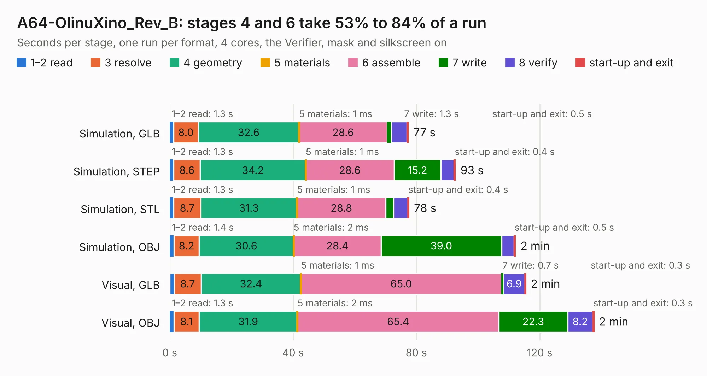

# 1943. A64-OlinuXino_Rev_B

Board 1,943 of the 3,122 of [Corpus Testing](../Corpus-Testing.md), on [Corpus Page 18](../CorpusTestingPages/Corpus-Testing-18.md#1943-a64-olinuxino_rev_b).

| Mode and format | 1–2 read | 3 resolve | 4 geometry | 5 materials | 6 assemble | 7 write | 8 verify | start-up and exit | Total |
|---|---:|---:|---:|---:|---:|---:|---:|---:|---:|
| Simulation, GLB | 1.3 | 8.0 | 32.6 | 1&nbsp;ms | 28.6 | 1.3 | 5.1 | 0.5 | 77.4 |
| Simulation, STEP | 1.3 | 8.6 | 34.2 | 1&nbsp;ms | 28.6 | 15.2 | 4.3 | 0.4 | 92.7 |
| Simulation, STL | 1.3 | 8.7 | 31.3 | 1&nbsp;ms | 28.8 | 2.5 | 4.6 | 0.4 | 77.6 |
| Simulation, OBJ | 1.4 | 8.2 | 30.6 | 2&nbsp;ms | 28.4 | 39.0 | 4.0 | 0.5 | 112.1 |
| Visual, GLB | 1.4 | 8.7 | 32.4 | 1&nbsp;ms | 65.0 | 0.7 | 6.9 | 0.3 | 115.5 |
| Visual, OBJ | 1.3 | 8.1 | 31.9 | 2&nbsp;ms | 65.4 | 22.3 | 8.2 | 0.3 | 137.6 |

<table align="center"><tr><td valign="top">

| Board | Repo: [OLIMEX/OLINUXINO](https://github.com/OLIMEX/OLINUXINO) Board: `A64-OlinuXino_Rev_B.kicad_pcb` |
|---|---|
| Folder | HARDWARE / A64-OLinuXino / 2. Older hardware revisions / A64-OLinuXino hardware revision B |
| Complexity | 348&nbsp;/&nbsp;1000 (size&nbsp;333, features&nbsp;15) |
| KESE&nbsp;features | through vias |
| Tested | 9th November 2026 |
| Copper&nbsp;layers | 6 |
| File&nbsp;format | KiCad 4 (4) |
| Parts,&nbsp;tracks,&nbsp;vias | 384, 13,451, 992 |
| Triangles,&nbsp;simulation | 8,558,286 in 462 parts |
| Verifier | PASS in all six runs |

</td><td valign="top">

<table>
<tr><th>File type</th><th>File size</th><th>Peak memory used</th></tr>
<tr><th colspan="3" align="left">Simulation</th></tr>
<tr><td>GLB</td><td align="right">297&nbsp;MB</td><td align="right">2.0&nbsp;GB</td></tr>
<tr><td>STEP</td><td align="right">1.2&nbsp;GB</td><td align="right">2.5&nbsp;GB</td></tr>
<tr><td>STL</td><td align="right">428&nbsp;MB</td><td align="right">1.9&nbsp;GB</td></tr>
<tr><td>OBJ</td><td align="right">930&nbsp;MB</td><td align="right">5.4&nbsp;GB</td></tr>
<tr><th colspan="3" align="left">Visual</th></tr>
<tr><td>GLB</td><td align="right">165&nbsp;MB</td><td align="right">2.7&nbsp;GB</td></tr>
<tr><td>OBJ</td><td align="right">537&nbsp;MB</td><td align="right">3.5&nbsp;GB</td></tr>
</table>

</td></tr></table>

| Previous | Next |
|:---|---:|
| [1942. A64-OlinuXino_Rev_A](b1942b_OLINUXINO_A64-OlinuXino-Rev-A.md) | [1944. A64-OlinuXino_Rev_C](b1944b_OLINUXINO_A64-OlinuXino-Rev-C.md) |
