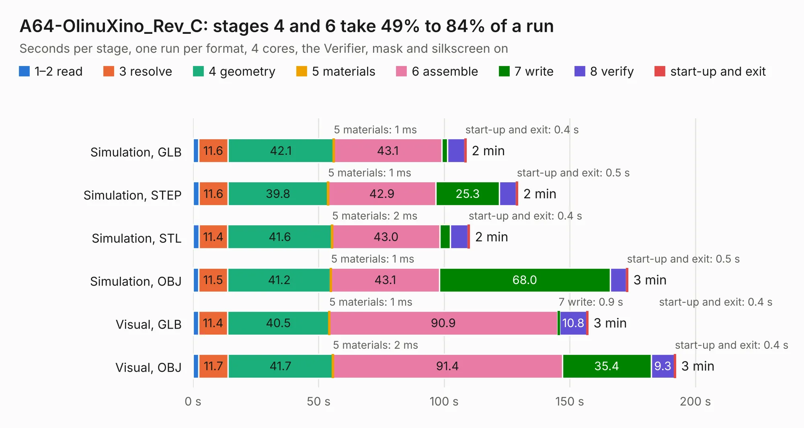

# 1943. A64-OlinuXino_Rev_C

Board 1,943 of the 3,121 of [Corpus Testing](../Corpus-Testing.md), on [Corpus Page 18](../CorpusTestingPages/Corpus-Testing-18.md#1943-a64-olinuxino_rev_c).

| Mode and format | 1–2 read | 3 resolve | 4 geometry | 5 materials | 6 assemble | 7 write | 8 verify | start-up and exit | Total |
|---|---:|---:|---:|---:|---:|---:|---:|---:|---:|
| Simulation, GLB | 2.3 | 11.6 | 42.1 | 1&nbsp;ms | 43.1 | 2.1 | 7.0 | 0.4 | 108.7 |
| Simulation, STEP | 2.3 | 11.6 | 39.8 | 1&nbsp;ms | 42.9 | 25.3 | 6.7 | 0.5 | 129.2 |
| Simulation, STL | 2.4 | 11.4 | 41.6 | 2&nbsp;ms | 43.0 | 4.1 | 7.1 | 0.4 | 110.0 |
| Simulation, OBJ | 2.3 | 11.5 | 41.2 | 1&nbsp;ms | 43.1 | 68.0 | 6.5 | 0.5 | 173.0 |
| Visual, GLB | 2.3 | 11.4 | 40.5 | 1&nbsp;ms | 90.9 | 0.9 | 10.8 | 0.4 | 157.2 |
| Visual, OBJ | 2.3 | 11.7 | 41.7 | 2&nbsp;ms | 91.4 | 35.4 | 9.3 | 0.4 | 192.1 |

<table align="center"><tr><td valign="top">

| Board | Repo: [OLIMEX/OLINUXINO](https://github.com/OLIMEX/OLINUXINO) Board: `A64-OlinuXino_Rev_C.kicad_pcb` |
|---|---|
| Folder | HARDWARE / A64-OLinuXino / 2. Older hardware revisions / A64-OLinuXino hardware revision C |
| Complexity | 393&nbsp;/&nbsp;1000 (size&nbsp;338, features&nbsp;55) |
| KESE&nbsp;features | through vias, slotted holes, filled zones, copper text |
| Tested | 9th November 2026 |
| Copper&nbsp;layers | 6 |
| File&nbsp;format | KiCad 5 (20170123) |
| Parts,&nbsp;tracks,&nbsp;vias | 406, 17,000, 1,160 |
| Triangles,&nbsp;simulation | 10,251,140 in 475 parts |
| Verifier | PASS in all six runs |

</td><td valign="top">

<table>
<tr><th>File type</th><th>File size</th><th>Peak memory used</th></tr>
<tr><th colspan="3" align="left">Simulation</th></tr>
<tr><td>GLB</td><td align="right">356&nbsp;MB</td><td align="right">2.1&nbsp;GB</td></tr>
<tr><td>STEP</td><td align="right">1.5&nbsp;GB</td><td align="right">3.1&nbsp;GB</td></tr>
<tr><td>STL</td><td align="right">513&nbsp;MB</td><td align="right">2.2&nbsp;GB</td></tr>
<tr><td>OBJ</td><td align="right">1.1&nbsp;GB</td><td align="right">6.5&nbsp;GB</td></tr>
<tr><th colspan="3" align="left">Visual</th></tr>
<tr><td>GLB</td><td align="right">198&nbsp;MB</td><td align="right">3.1&nbsp;GB</td></tr>
<tr><td>OBJ</td><td align="right">644&nbsp;MB</td><td align="right">4.2&nbsp;GB</td></tr>
</table>

</td></tr></table>

| Previous | Next |
|:---|---:|
| [1942. A64-OlinuXino_Rev_B](b1942b_OLINUXINO_A64-OlinuXino-Rev-B.md) | [1944. A64-OlinuXino_Rev_D](b1944b_OLINUXINO_A64-OlinuXino-Rev-D.md) |
