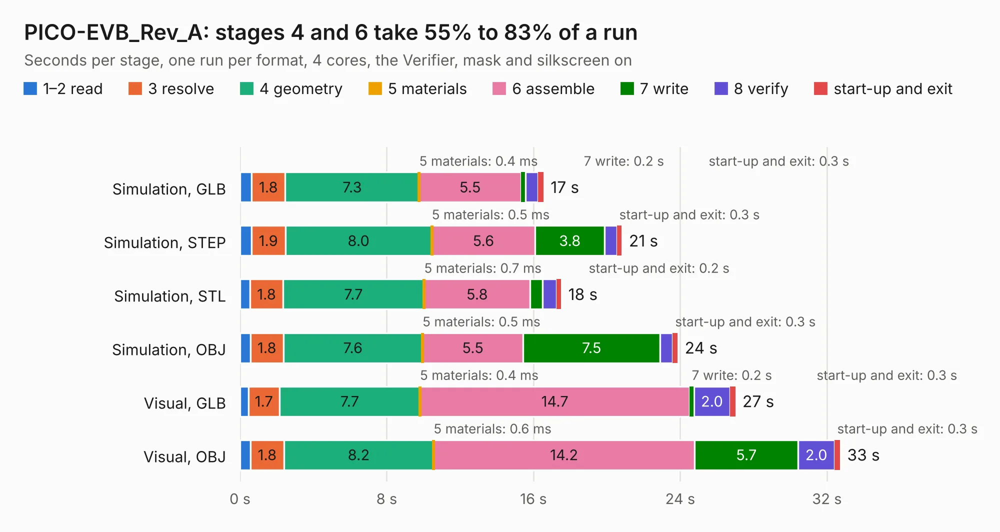

# 1944. PICO-EVB_Rev_A

Board 1,944 of the 3,108 of [Corpus Testing](../Corpus-Testing.md), on [Corpus Page 18](../CorpusTestingPages/Corpus-Testing-18.md#1944-pico-evb_rev_a).

| Mode and format | 1–2 read | 3 resolve | 4 geometry | 5 materials | 6 assemble | 7 write | 8 verify | start-up and exit | Total |
|---|---:|---:|---:|---:|---:|---:|---:|---:|---:|
| Simulation, GLB | 0.6 | 1.8 | 7.3 | 0.4&nbsp;ms | 5.5 | 0.2 | 0.7 | 0.3 | 16.5 |
| Simulation, STEP | 0.6 | 1.9 | 8.0 | 0.5&nbsp;ms | 5.6 | 3.8 | 0.7 | 0.3 | 20.8 |
| Simulation, STL | 0.6 | 1.8 | 7.7 | 0.7&nbsp;ms | 5.8 | 0.7 | 0.8 | 0.2 | 17.5 |
| Simulation, OBJ | 0.6 | 1.8 | 7.6 | 0.5&nbsp;ms | 5.5 | 7.5 | 0.7 | 0.3 | 23.9 |
| Visual, GLB | 0.4 | 1.7 | 7.7 | 0.4&nbsp;ms | 14.7 | 0.2 | 2.0 | 0.3 | 27.0 |
| Visual, OBJ | 0.6 | 1.8 | 8.2 | 0.6&nbsp;ms | 14.2 | 5.7 | 2.0 | 0.3 | 32.7 |

<table align="center"><tr><td valign="top">

| Board | Repo: [OLIMEX/PICO-EVB](https://github.com/OLIMEX/PICO-EVB) Board: `PICO-EVB_Rev_A.kicad_pcb` |
|---|---|
| Folder | HARDWARE / PICO-EVB_Rev_A |
| Complexity | 293&nbsp;/&nbsp;1000 (size&nbsp;188, features&nbsp;105) |
| KESE&nbsp;features | through vias, slotted holes, rounded, trapezoid or chamfered pads, filled zones, knockout text, stack-up, dielectric εr and tanδ, mask and silkscreen colours |
| Tested | 9th November 2026 |
| Copper&nbsp;layers | 2 |
| File&nbsp;format | KiCad 7 (20221018) |
| Parts,&nbsp;tracks,&nbsp;vias | 83, 1,237, 199 |
| Triangles,&nbsp;simulation | 1,497,342 in 110 parts |
| Verifier | PASS in all six runs |

</td><td valign="top">

<table>
<tr><th>File type</th><th>File size</th><th>Peak memory used</th></tr>
<tr><th colspan="3" align="left">Simulation</th></tr>
<tr><td>GLB</td><td align="right">53&nbsp;MB</td><td align="right">650&nbsp;MB</td></tr>
<tr><td>STEP</td><td align="right">277&nbsp;MB</td><td align="right">693&nbsp;MB</td></tr>
<tr><td>STL</td><td align="right">75&nbsp;MB</td><td align="right">657&nbsp;MB</td></tr>
<tr><td>OBJ</td><td align="right">159&nbsp;MB</td><td align="right">1.1&nbsp;GB</td></tr>
<tr><th colspan="3" align="left">Visual</th></tr>
<tr><td>GLB</td><td align="right">41&nbsp;MB</td><td align="right">783&nbsp;MB</td></tr>
<tr><td>OBJ</td><td align="right">124&nbsp;MB</td><td align="right">894&nbsp;MB</td></tr>
</table>

</td></tr></table>

| Previous | Next |
|:---|---:|
| [1943. OSHW-GHOST_Rev_A](b1943b_OSHW-GHOST_OSHW-GHOST-Rev-A.md) | [1945. POEv3_Rev_A](b1945b_POEv3_POEv3-Rev-A.md) |
