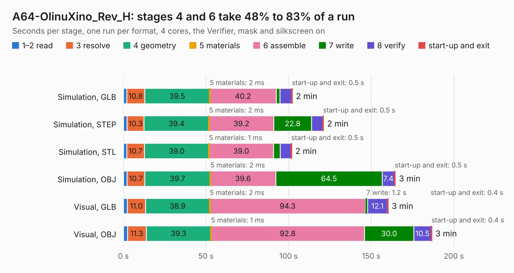

# 1946. A64-OlinuXino_Rev_H

Board 1,946 of the 3,130 of [Corpus Testing](../Corpus-Testing.md), on [Corpus Page 19](../CorpusTestingPages/Corpus-Testing-19.md#1946-a64-olinuxino_rev_h).

| Mode and format | 1–2 read | 3 resolve | 4 geometry | 5 materials | 6 assemble | 7 write | 8 verify | start-up and exit | Total |
|---|---:|---:|---:|---:|---:|---:|---:|---:|---:|
| Simulation, GLB | 2.0 | 10.8 | 39.5 | 2&nbsp;ms | 40.2 | 2.2 | 7.0 | 0.5 | 102.3 |
| Simulation, STEP | 2.2 | 10.3 | 39.4 | 2&nbsp;ms | 39.2 | 22.8 | 6.8 | 0.5 | 121.1 |
| Simulation, STL | 2.0 | 10.7 | 39.0 | 1&nbsp;ms | 39.0 | 4.0 | 6.6 | 0.5 | 101.9 |
| Simulation, OBJ | 2.2 | 10.7 | 39.7 | 2&nbsp;ms | 39.6 | 64.5 | 7.4 | 0.5 | 164.6 |
| Visual, GLB | 2.3 | 11.0 | 38.9 | 2&nbsp;ms | 94.3 | 1.2 | 12.1 | 0.4 | 160.2 |
| Visual, OBJ | 2.5 | 11.3 | 39.3 | 1&nbsp;ms | 92.8 | 30.0 | 10.5 | 0.4 | 186.7 |

<table align="center"><tr><td valign="top">

| Board | Repo: [OLIMEX/OLINUXINO](https://github.com/OLIMEX/OLINUXINO) Board: `A64-OlinuXino_Rev_H.kicad_pcb` |
|---|---|
| Folder | HARDWARE / A64-OLinuXino / 1. Latest hardware revision / A64-OLinuXino hardware revision H |
| Complexity | 383&nbsp;/&nbsp;1000 (size&nbsp;338, features&nbsp;45) |
| KESE&nbsp;features | through vias, slotted holes, filled zones |
| Tested | 9th November 2026 |
| Copper&nbsp;layers | 6 |
| File&nbsp;format | KiCad 5 (20171130) |
| Parts,&nbsp;tracks,&nbsp;vias | 424, 17,062, 1,130 |
| Triangles,&nbsp;simulation | 10,395,028 in 463 parts |
| Verifier | PASS in all six runs |

</td><td valign="top">

<table>
<tr><th>File type</th><th>File size</th><th>Peak memory used</th></tr>
<tr><th colspan="3" align="left">Simulation</th></tr>
<tr><td>GLB</td><td align="right">362&nbsp;MB</td><td align="right">2.4&nbsp;GB</td></tr>
<tr><td>STEP</td><td align="right">1.5&nbsp;GB</td><td align="right">3.2&nbsp;GB</td></tr>
<tr><td>STL</td><td align="right">520&nbsp;MB</td><td align="right">2.4&nbsp;GB</td></tr>
<tr><td>OBJ</td><td align="right">1.1&nbsp;GB</td><td align="right">6.6&nbsp;GB</td></tr>
<tr><th colspan="3" align="left">Visual</th></tr>
<tr><td>GLB</td><td align="right">200&nbsp;MB</td><td align="right">3.2&nbsp;GB</td></tr>
<tr><td>OBJ</td><td align="right">652&nbsp;MB</td><td align="right">4.2&nbsp;GB</td></tr>
</table>

</td></tr></table>

| Previous | Next |
|:---|---:|
| [1945. A20_OLinuXino_Lime2_SHIELD_TEMPLATE_Rev-AA](b1945b_OLINUXINO_A20-OLinuXino-Lime2-SHIELD-TEMPLATE-Rev-AA.md) | [1947. A64-OlinuXino_Rev_A](b1947b_OLINUXINO_A64-OlinuXino-Rev-A.md) |
