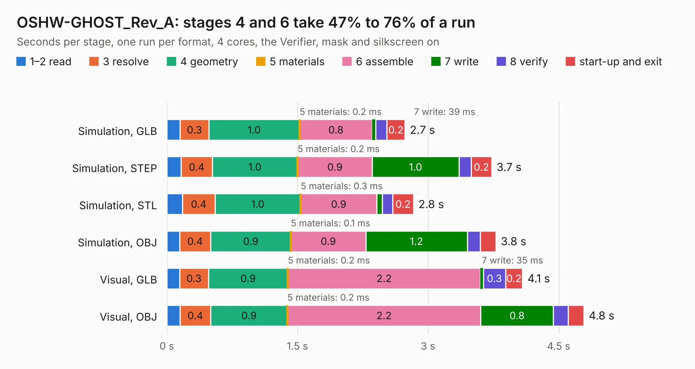

# 1947. OSHW-GHOST_Rev_A

Board 1,947 of the 3,112 of [Corpus Testing](../Corpus-Testing.md), on [Corpus Page 19](../CorpusTestingPages/Corpus-Testing-19.md#1947-oshw-ghost_rev_a).

| Mode and format | 1–2 read | 3 resolve | 4 geometry | 5 materials | 6 assemble | 7 write | 8 verify | start-up and exit | Total |
|---|---:|---:|---:|---:|---:|---:|---:|---:|---:|
| Simulation, GLB | 0.2 | 0.3 | 1.0 | 0.2&nbsp;ms | 0.8 | 39&nbsp;ms | 0.1 | 0.2 | 2.7 |
| Simulation, STEP | 0.2 | 0.4 | 1.0 | 0.2&nbsp;ms | 0.9 | 1.0 | 0.1 | 0.2 | 3.7 |
| Simulation, STL | 0.2 | 0.4 | 1.0 | 0.3&nbsp;ms | 0.9 | 65&nbsp;ms | 0.1 | 0.2 | 2.8 |
| Simulation, OBJ | 0.1 | 0.4 | 0.9 | 0.1&nbsp;ms | 0.9 | 1.2 | 0.2 | 0.2 | 3.8 |
| Visual, GLB | 0.1 | 0.3 | 0.9 | 0.2&nbsp;ms | 2.2 | 35&nbsp;ms | 0.3 | 0.2 | 4.1 |
| Visual, OBJ | 0.2 | 0.4 | 0.9 | 0.2&nbsp;ms | 2.2 | 0.8 | 0.2 | 0.2 | 4.8 |

<table align="center"><tr><td valign="top">

| Board | Repo: [OLIMEX/OSHW-GHOST](https://github.com/OLIMEX/OSHW-GHOST) Board: `OSHW-GHOST_Rev_A.kicad_pcb` |
|---|---|
| Folder | HARDWARE / OSHW-GHOST_Rev_A |
| Complexity | 207&nbsp;/&nbsp;1000 (size&nbsp;142, features&nbsp;65) |
| KESE&nbsp;features | through vias, slotted holes, filled zones, copper text, curved board outline |
| Tested | 9th November 2026 |
| Copper&nbsp;layers | 2 |
| File&nbsp;format | KiCad 5 (20160815) |
| Parts,&nbsp;tracks,&nbsp;vias | 11, 235, 58 |
| Triangles,&nbsp;simulation | 251,538 in 22 parts |
| Verifier | PASS in all six runs |

</td><td valign="top">

<table>
<tr><th>File type</th><th>File size</th><th>Peak memory used</th></tr>
<tr><th colspan="3" align="left">Simulation</th></tr>
<tr><td>GLB</td><td align="right">8.8&nbsp;MB</td><td align="right">240&nbsp;MB</td></tr>
<tr><td>STEP</td><td align="right">46&nbsp;MB</td><td align="right">247&nbsp;MB</td></tr>
<tr><td>STL</td><td align="right">13&nbsp;MB</td><td align="right">245&nbsp;MB</td></tr>
<tr><td>OBJ</td><td align="right">25&nbsp;MB</td><td align="right">245&nbsp;MB</td></tr>
<tr><th colspan="3" align="left">Visual</th></tr>
<tr><td>GLB</td><td align="right">7.2&nbsp;MB</td><td align="right">214&nbsp;MB</td></tr>
<tr><td>OBJ</td><td align="right">21&nbsp;MB</td><td align="right">219&nbsp;MB</td></tr>
</table>

</td></tr></table>

| Previous | Next |
|:---|---:|
| [1946. STMP157-OLinuXino-LIME2_Rev_B1](b1946b_OLINUXINO_STMP157-OLinuXino-LIME2-Rev-B1.md) | [1948. PICO-EVB_Rev_A](b1948b_PICO-EVB_PICO-EVB-Rev-A.md) |
