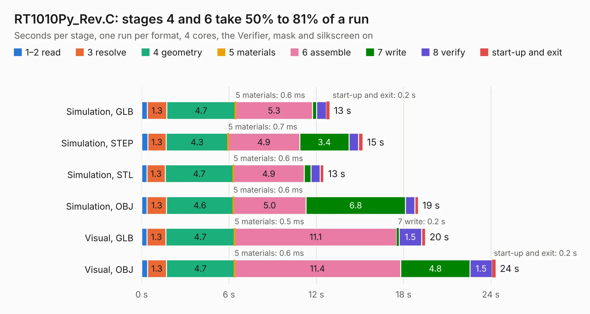

# 1950. RT1010Py_Rev.C

Board 1,950 of the 3,101 of [Corpus Testing](../Corpus-Testing.md), on [Corpus Page 19](../CorpusTestingPages/Corpus-Testing-19.md#1950-rt1010py_revc).

| Mode and format | 1–2 read | 3 resolve | 4 geometry | 5 materials | 6 assemble | 7 write | 8 verify | start-up and exit | Total |
|---|---:|---:|---:|---:|---:|---:|---:|---:|---:|
| Simulation, GLB | 0.4 | 1.3 | 4.7 | 0.6&nbsp;ms | 5.3 | 0.3 | 0.7 | 0.2 | 12.9 |
| Simulation, STEP | 0.4 | 1.3 | 4.3 | 0.7&nbsp;ms | 4.9 | 3.4 | 0.6 | 0.3 | 15.2 |
| Simulation, STL | 0.4 | 1.3 | 4.7 | 0.6&nbsp;ms | 4.9 | 0.5 | 0.6 | 0.3 | 12.5 |
| Simulation, OBJ | 0.4 | 1.3 | 4.6 | 0.6&nbsp;ms | 5.0 | 6.8 | 0.6 | 0.2 | 19.0 |
| Visual, GLB | 0.4 | 1.3 | 4.7 | 0.5&nbsp;ms | 11.1 | 0.2 | 1.5 | 0.3 | 19.5 |
| Visual, OBJ | 0.4 | 1.3 | 4.7 | 0.6&nbsp;ms | 11.4 | 4.8 | 1.5 | 0.2 | 24.3 |

<table align="center"><tr><td valign="top">

| Board | Repo: [OLIMEX/RT1010Py](https://github.com/OLIMEX/RT1010Py) Board: `RT1010Py_Rev.C.kicad_pcb` |
|---|---|
| Folder | HARDWARE / RT1010-Py-Rev-C |
| Complexity | 296&nbsp;/&nbsp;1000 (size&nbsp;241, features&nbsp;55) |
| KESE&nbsp;features | through vias, slotted holes, filled zones, copper text |
| Tested | 9th November 2026 |
| Copper&nbsp;layers | 4 |
| File&nbsp;format | KiCad 5 (20171130) |
| Parts,&nbsp;tracks,&nbsp;vias | 76, 1,222, 114 |
| Triangles,&nbsp;simulation | 1,389,960 in 101 parts |
| Verifier | PASS in all six runs |

</td><td valign="top">

<table>
<tr><th>File type</th><th>File size</th><th>Peak memory used</th></tr>
<tr><th colspan="3" align="left">Simulation</th></tr>
<tr><td>GLB</td><td align="right">49&nbsp;MB</td><td align="right">554&nbsp;MB</td></tr>
<tr><td>STEP</td><td align="right">232&nbsp;MB</td><td align="right">652&nbsp;MB</td></tr>
<tr><td>STL</td><td align="right">70&nbsp;MB</td><td align="right">518&nbsp;MB</td></tr>
<tr><td>OBJ</td><td align="right">146&nbsp;MB</td><td align="right">953&nbsp;MB</td></tr>
<tr><th colspan="3" align="left">Visual</th></tr>
<tr><td>GLB</td><td align="right">34&nbsp;MB</td><td align="right">709&nbsp;MB</td></tr>
<tr><td>OBJ</td><td align="right">103&nbsp;MB</td><td align="right">825&nbsp;MB</td></tr>
</table>

</td></tr></table>

| Previous | Next |
|:---|---:|
| [1949. RP2350pc_Rev_A](b1949b_RP2350pc_RP2350pc-Rev-A.md) | [1951. RT1010Py-DevKit_RevB](b1951b_RT1010Py-DevKit_RT1010Py-DevKit-RevB.md) |
