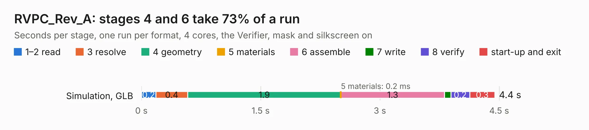

# 1951. RVPC_Rev_A

Board 1,951 of the 3,100 of [Corpus Testing](../Corpus-Testing.md), on [Corpus Page 19](../CorpusTestingPages/Corpus-Testing-19.md#1951-rvpc_rev_a).

| Mode and format | 1–2 read | 3 resolve | 4 geometry | 5 materials | 6 assemble | 7 write | 8 verify | start-up and exit | Total |
|---|---:|---:|---:|---:|---:|---:|---:|---:|---:|
| Simulation, GLB | 0.2 | 0.4 | 1.9 | 0.2&nbsp;ms | 1.3 | 79&nbsp;ms | 0.2 | 0.3 | 4.4 |
| Simulation, STEP | 0.2 | 0.4 | 2.0 | 0.4&nbsp;ms | 1.4 | 1.5 | 0.2 | 0.3 | 6.0 |
| Simulation, STL | 0.2 | 0.4 | 2.1 | 0.3&nbsp;ms | 1.3 | 0.1 | 0.2 | 0.3 | 4.7 |
| Simulation, OBJ | 0.2 | 0.4 | 1.7 | 0.3&nbsp;ms | 1.4 | 2.0 | 0.2 | 0.2 | 6.2 |
| Visual, GLB | 0.2 | 0.4 | 1.8 | 0.3&nbsp;ms | 2.7 | 34&nbsp;ms | 0.3 | 0.2 | 5.8 |
| Visual, OBJ | 0.2 | 0.4 | 1.8 | 0.3&nbsp;ms | 2.7 | 1.0 | 0.3 | 0.2 | 6.6 |

<table align="center"><tr><td valign="top">

| Board | Repo: [OLIMEX/RVPC](https://github.com/OLIMEX/RVPC) Board: `RVPC_Rev_A.kicad_pcb` |
|---|---|
| Folder | HARDWARE / RVPC-Rev.A |
| Complexity | 119&nbsp;/&nbsp;1000 (size&nbsp;49, features&nbsp;70) |
| KESE&nbsp;features | slotted holes, rounded, trapezoid or chamfered pads, knockout text, stack-up, dielectric εr and tanδ, mask and silkscreen colours |
| Tested | 9th November 2026 |
| Copper&nbsp;layers | 2 |
| File&nbsp;format | KiCad 7 (20221018) |
| Parts,&nbsp;tracks,&nbsp;vias | 18, 0, 0 |
| Triangles,&nbsp;simulation | 382,840 in 41 parts |
| Verifier | PASS in all six runs |

</td><td valign="top">

<table>
<tr><th>File type</th><th>File size</th><th>Peak memory used</th></tr>
<tr><th colspan="3" align="left">Simulation</th></tr>
<tr><td>GLB</td><td align="right">13&nbsp;MB</td><td align="right">278&nbsp;MB</td></tr>
<tr><td>STEP</td><td align="right">60&nbsp;MB</td><td align="right">274&nbsp;MB</td></tr>
<tr><td>STL</td><td align="right">19&nbsp;MB</td><td align="right">276&nbsp;MB</td></tr>
<tr><td>OBJ</td><td align="right">39&nbsp;MB</td><td align="right">305&nbsp;MB</td></tr>
<tr><th colspan="3" align="left">Visual</th></tr>
<tr><td>GLB</td><td align="right">7.3&nbsp;MB</td><td align="right">246&nbsp;MB</td></tr>
<tr><td>OBJ</td><td align="right">22&nbsp;MB</td><td align="right">234&nbsp;MB</td></tr>
</table>

</td></tr></table>

| Previous | Next |
|:---|---:|
| [1950. RT1010Py-DevKit_RevB](b1950b_RT1010Py-DevKit_RT1010Py-DevKit-RevB.md) | [1952. RVPC_Rev_B](b1952b_RVPC_RVPC-Rev-B.md) |
